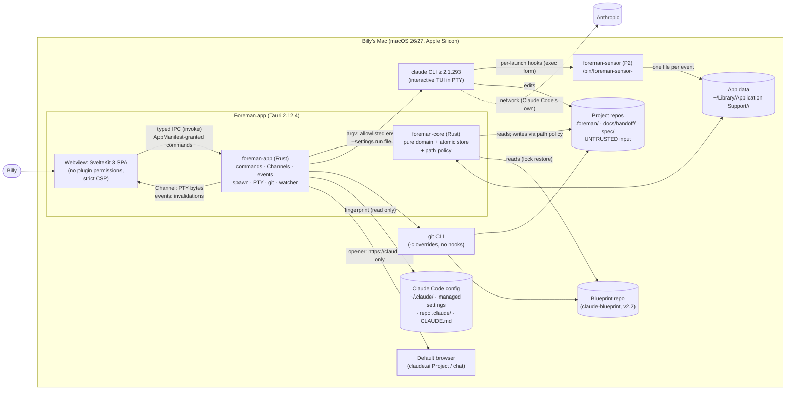
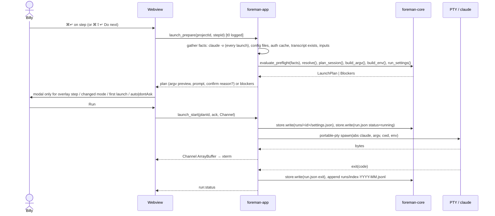

# Foreman · Design doc

Status: DRAFT for Stage 4.7 review · Date: 2026-10-19 · Author: principal architect (Opus 5.5) · Blueprint Stage 4.2
Inputs: `docs/handoff/stage-02.md`, `docs/MASTER-SPEC.md` (FROZEN v1.0, with Appendix A), `spec/council/r5-resolution.md`, `r5b-freeze-review.md`, `r6-feature-specs.md`, `r7-stack.md`, `r8-nfr.md`, `docs/requirements.md` (Stage 3 draft).
Decisions: `docs/adr/` (index in `docs/adr/README.md`). Every library version below was checked against crates.io, the npm registry or the crate source on 2026-10-19 unless marked **UNVERIFIED**.

> **Frontend change from the frozen text.** Billy chose **SvelteKit 3.1.0 in SPA mode** (adapter-static 4.0.0, `ssr = false`, file-based routes) over the plain Svelte 5 + Vite + hash-router recommendation, for consistency across his projects and for file routing and layouts (ADR-002). MASTER-SPEC §10, §13 and r6 §6 still name plain Vite; r7's DRI section says Billy may override at the Stage 2 sign with the reason recorded there. That record and the §10 table edit are **outside this stage's files** and must be made by Billy at the Stage 2 sign, or through a Change Request if the packet is already signed (see §9).

---

## 1. Context and scope

Billy runs the Claude Build Blueprint by hand. In practice that means a 2,235-line Markdown file, `claude` flags typed from memory, packets copied between chats and repos, and gates ticked from memory. Foreman is a personal macOS app that turns the blueprint into an executable, verified process:

- it parses the annotated blueprint (v2.2 `fm:` grammar) into typed stages, steps and inspection items;
- it computes each project's applicable path from tags and tri-state conditions;
- it resolves every prompt;
- it launches Claude Code in an embedded terminal with the exact argv, environment and settings;
- it re-arms "same session" steps, catches and validates packets, and (in P2) runs gates and signs packets with hash-bound, pathspec-only commits.

**In scope (v1):** F-001 to F-030 as phased in MASTER-SPEC §4 and §9. Milestones (used everywhere in this doc and the ADRs):

| ID | Blueprint stages | Contents |
|---|---|---|
| M0 Site prep | 5 | Scaffold, `pnpm verify`, CI, release build; spikes S-0, S-1′, S-3, S-7′, S-8, S-12, S-23 |
| M1 Domain core | 6 | `foreman-core`, no Tauri dependency: F-001 P1, F-002, F-003 P1 harness, F-004, F-005, F-006 P1, F-007, F-013 P1 validation, F-020, F-021, F-022 |
| M2 Walking skeleton | 7 | Tauri shell, typed IPC + mock, F-030 P1, F-018 P1, F-019 P1, F-029 P1, F-017 P1, F-028 P1 |
| M3 Runners | 8–9 | F-008 P1 + security controls, F-009 P1, F-010, F-012 P1, F-013 watcher, F-026 P1. **End of M3 = end of phase 1 = kill check** |
| M4 Complete v1 | 11–12 (10 n/a) | All P2 features |
| M5 Finishes | 13–17 | F-030 P2 design system and sheet strip, accessibility, audits, readiness, CO |

**Out of scope:** everything in MASTER-SPEC §13 (cloud, other users, Windows/Linux/Intel, API keys, notarization, editing code or the blueprint) and the v1.1 list (F-101 to F-108). v1 makes **no `claude -p` calls** (SR-16).

**The environment Foreman lives in:**

- one Apple Silicon Mac on macOS 26 or 27;
- Claude Code ≥ 2.1.293 (npm `stable` is 2.1.292 and `latest` is 2.1.303 as of 2026-10-19, so the floor sits above `stable`, as R-19 predicted);
- a subscription login;
- git;
- project repos that Claude Code edits continuously and that Foreman must treat as **untrusted input** (requirements.md, threat posture).

## 2. Goals and non-goals

**Goals** (each traceable to the spec):

1. **Exactness.** Every CLI step launches with exactly the argv, environment and run settings the template, model policy and overrides imply, with zero manual prompt edits (F-003 harness, NFR-48).
2. **Speed to start.** Starting a step takes p95 ≤ 10 s (NFR-09). Cold start p95 ≤ 1.5 s; project switch p95 ≤ 300 ms; template load p95 ≤ 50 ms; resolution plus preflight p95 ≤ 50 ms; keystroke to spawn p95 ≤ 250 ms; packet visible p95 ≤ 1 s (NFR-01 to NFR-06).
3. **No data loss, ever.** Atomic, durable, versioned writes that never overwrite a newer external edit (NFR-10 to NFR-12, SR-32, SR-33).
4. **Least authority.** The webview can't spawn, can't touch files and holds no plugin permissions. Only Rust spawns, and only allowlisted absolute paths with argv arrays (SR-01, SR-02, SR-22).
5. **Honest records.** Decision files take effect only as approved; signing is hash-bound and read back; gates need evidence (SR-40 to SR-47).
6. **Degrade, don't block.** If the sensor, watcher, Doctor or probes fail, the step still runs by hand (NFR-13). The run sheet export is the escape hatch (NFR-14).
7. **Last 20 years.** A pure, heavily tested domain core with no UI or framework dependency; plain JSON and Markdown files with schema versions; every external dependency behind a seam with a written exit path.

**Non-goals:**

- a general Claude Code GUI;
- replacing Claude Code's TUI;
- any network feature;
- multi-user use;
- headless gates (v1.1);
- the Crew Loop (v1.1);
- a plugin system;
- running on any OS other than macOS on Apple Silicon.

## 3. The design

### 3.1 System context



Trust boundaries (input to the Stage 4.3 threat model):

| Boundary | Trusted side | Untrusted side |
|---|---|---|
| T1 | Rust core | the webview |
| T2 | Foreman | repo content, including `.foreman/`, packets, `.claude/` and `.git/config` |
| T3 | Foreman | pasted chat output |
| T4 | Foreman | Claude Code's behavior and output |
| T5 | Foreman | sensor events (token-scoped; never trigger actions) |

Foreman itself makes **no network requests** (SR-60). Claude Code's traffic is Claude Code's.

### 3.2 Rust workspace (ADR-003)

```text
Cargo.toml                 [workspace] members = crates/*, src-tauri; resolver 3; shared lints
rust-toolchain.toml        channel = "1.99.1" (current stable tag; floor 1.90 for tauri-build 2.7.3)
deny.toml                  graph targets = aarch64-apple-darwin; bans (ADR-016)
crates/foreman-core/       pure domain + atomic store + path policy; no tauri, no process spawning
crates/foreman-sensor/     hook helper binary (P2); std + serde_json only
crates/fake-claude/        test-only binary (never bundled): records argv/env/cwd, scripted TUI
src-tauri/                 foreman-app: Tauri shell, IPC, spawning, PTY, git, watcher
```

**Crate rules:**

- Every crate has `#![forbid(unsafe_code)]`.
- `unwrap`/`expect` are denied outside tests (`clippy::unwrap_used`, `clippy::expect_used`).
- `foreman-core` also runs `clippy::pedantic` (NFR-46, SR-62).
- Direct dependencies in `foreman-core` are exact-pinned (`=x.y.z`, SR-61).
- `foreman-core` may use `std::fs` and `rustix` (the store and path policy need them). It must not depend on `tauri`, `tokio`, `portable-pty` or `notify`, and must not spawn processes. A CI check (`cargo tree -p foreman-core -e normal`) enforces this.

`foreman-core` dependencies:

| Crate | Version | Why |
|---|---|---|
| `comrak` | =0.56.0 (`default-features = false`) | Markdown AST with sourcepos |
| `serde`, `serde_json` | =1.0.229, =1.0.154 | Serialization |
| `thiserror` | =2.0.21 | Typed errors |
| `uuid` | =1.28.0 | Session IDs |
| `semver` | =1.0.28 | Version floors |
| `sha2` | =0.11.1 | SHA-256 |
| `jiff` | =0.2.38 | Timestamps and local dates |
| `rustix` | =1.1.5 (`fs`, `process`) | `openat`, `O_NOFOLLOW`, `renameatx_np`, `F_FULLFSYNC`, `kill` without `unsafe` |
| `ts-rs` | =12.0.1 | Behind the `ts` feature only; type export (ADR-004) |

Dev-dependencies: `proptest` 1.12.0, `insta` 1.49.0, `criterion` 0.8.2.

`foreman-app` dependencies:

- `tauri` 2.12.4 and `tauri-build` 2.7.3;
- `tokio` 1.54.0 (`process`, `rt-multi-thread`, `macros`, `sync`, `time`);
- `portable-pty` 0.9.0;
- `notify` 8.2.0 + `notify-debouncer-full` 0.7.0;
- `tracing` 0.1.44 + `tracing-subscriber` 0.3.23;
- the plugins `tauri-plugin-opener` 2.7.2, `-clipboard-manager` 2.5.0, `-dialog` 2.8.3, `-window-state` 2.5.0, and `-notification` **2.7.0** (P2; latest stable on crates.io 2026-10-19, which fills the version MASTER-SPEC §10 left open);
- `tauri-plugin-wdio-webdriver` 1.5.0, optional, `e2e` feature only.

#### 3.2.1 `foreman-core` modules and public APIs (signature level)

The core follows "functional core, imperative shell". Every decision is a pure function of explicit inputs. Facts that need I/O (Claude version, auth status, file hashes, transcript existence, the clock) are gathered by `foreman-app` and passed in as values, so every rule is unit- and property-testable.

```rust
// template — F-001 (ADR-005)
pub fn parse_template(source: &str) -> Template;            // never panics; problems go to diagnostics
pub struct Template { pub grammar_version: u32, pub blueprint_version: String,
    pub source_sha256: Sha256, pub stages: Vec<Stage>, pub steps: Vec<Step>,
    pub items: Vec<InspectionItem>, pub packet_formats: Vec<PacketFormat>,
    pub diagnostics: Vec<Diagnostic> }                       // Diagnostic { severity, code, line, col, message }
pub fn normalize_item_text(bullet: &str) -> String;         // lowercase, collapse whitespace, strip emphasis
// template::grammar
pub fn parse_directive(comment: &str, at: SourcePos) -> Result<Directive, Diagnostic>;
pub enum Directive { Grammar { v: u32 }, Step(StepAnnotation), Verify(Vec<VerifyEntry>), If(Expr), End }

// lock — F-002
pub fn pin(t: &Template, commit: GitOid, blueprint_path: &RepoPath, at: Timestamp) -> BlueprintLock;
pub fn check_lock(lock: &BlueprintLock, t: &Template) -> LockCheck;   // Ok | SourceMismatch | ItemDrift(Vec<ItemId>)

// rules — F-004
pub fn parse_expr(s: &str) -> Result<Expr, ExprError>;      // ! & | ( ) over the 12 condition IDs
pub fn eval(e: &Expr, c: &Conditions) -> TriState;          // Yes | No | Undecided
pub fn applicable_path(t: &Template, d: &Decisions, o: &Overlay) -> ApplicablePath;
pub fn set_condition(d: &Decisions, id: ConditionId, to: TriState, note: &str, at: Timestamp,
    signed: &SignedStages) -> Result<Decisions, RuleError>;  // refuses after Stage 2 signed

// policy — F-005
pub fn effective_start(step: &Step, policy: &ModelPolicy, ovr: Option<&RunOverride>) -> Explained<Start>;

// resolver — F-006
pub fn classify_tokens(prompt: &PromptText) -> Vec<Token>;  // six classes; unknown = template error
pub fn resolve(ctx: &ResolveCtx<'_>) -> Result<ResolvedPrompt, Vec<Unresolved>>;
// ResolveCtx { template, step, decisions, signed_packets, run_inputs, optional_parts, stage_ctx }

// steps — F-007
pub fn transition(s: &StepState, e: StepEvent) -> Result<StepState, Rejected>;

// chain — F-010
pub fn plan_session(step: &Step, chains: &Chains, new_id: SessionId) -> SessionPlan;
// SessionPlan::New { id } | Continue { chain, id, fork: Option<SessionId> } | Broken { chain }

// launch — F-008 (pure half of prepare_launch; ADR-007, ADR-021)
pub fn evaluate_preflight(f: &PreflightFacts) -> Result<(), Vec<Blocker>>;
pub fn build_argv(p: &LaunchInputs) -> Result<Argv, Blocker>;   // SR-03, SR-04, SR-14
pub fn build_env(own: &EnvSnapshot, passthrough: &[EnvName], path: &BuiltPath) -> ChildEnv; // SR-05
pub fn run_settings(token: Option<&RunToken>, sensor: Option<&SensorExe>) -> RunSettingsJson; // SR-09
pub fn needs_confirmation(step: &Step, effective: &Start, ctx: &ConfirmCtx) -> Option<ConfirmReason>;

// fingerprint — F-008 step 3 (ADR-021)
pub fn fingerprint(files: &[ConfigFile]) -> Fingerprint;           // ConfigFile { origin, path, bytes }
pub fn auth_key_hits(files: &[ConfigFile]) -> Vec<AuthKeyHit>;     // SR-07
pub fn diff(prev: &Fingerprint, now: &Fingerprint) -> FingerprintDiff;

// packet — F-013 / F-012
pub fn normalize_packet(text: &str) -> Normalized;                 // <blank> variants, smart quotes, NBSP
pub fn split_paste(text: &str, fmt: &PacketFormat) -> Result<PasteParts, PasteError>; // packet + attachments
pub fn validate_packet(p: &Packet, fmt: &PacketFormat, ctx: &PacketCtx) -> Vec<PacketProblem>;

// decisions — F-022 (ADR-022)
pub fn classify_outside_change(approved: &DecisionSet, on_disk: &DecisionSet) -> OutsideChange;
// OutsideChange { variables_only: bool, pending: Vec<DecisionDiff> }

// pathpolicy — F-021 (ADR-011): lexical half, pure
pub fn check_write(rel: &str, purpose: WritePurpose) -> Result<RepoPath, PolicyViolation>;
pub fn check_read(rel: &str) -> Result<RepoPath, PolicyViolation>; // SR-31, SR-50

// store — F-020 (ADR-010): imperative, no tauri; every write goes through it
pub struct Root { /* directory fd of a project root or app data, opened O_DIRECTORY|O_NOFOLLOW */ }
impl Root {
    pub fn open(abs: &AbsPath, kind: RootKind) -> Result<Root, StoreError>;
    pub fn read(&self, p: &RepoPath) -> Result<(Vec<u8>, ReadStamp), StoreError>;
    pub fn write(&self, p: &RepoPath, bytes: &[u8], expect: &ReadStamp) -> Result<ReadStamp, WriteError>;
    pub fn append_line(&self, p: &RepoPath, line: &[u8]) -> Result<(), StoreError>; // JSONL index
}
pub enum WriteError { Conflict { newer: ReadStamp }, Policy(PolicyViolation), Io(std::io::Error) }
// schema
pub fn migrate<T: Versioned>(raw: serde_json::Value) -> Result<T, MigrationError>;  // ADR-023

// runlog — F-026 (ADR-018)
pub fn export_metrics(index: &[RunIndexLine], baseline: Option<&Baseline>) -> String; // Markdown

// harness — F-003 (test-only module, cfg(test) + integration test)
```

#### 3.2.2 `foreman-app` modules

| Module | Responsibility | Key items |
|---|---|---|
| `main.rs` / `lib.rs` | Builder: plugins, state, `generate_handler!`, setup; quit guard | `run()` |
| `ipc` | One file per command group; DTOs (`#[derive(Serialize, Deserialize, TS)]`, `#[serde(deny_unknown_fields)]`); `IpcError` | `COMMANDS: &[&str]` (single source for `build.rs` and the contract test) |
| `state` | `AppState`: registry, open projects (`Arc<RwLock<ProjectRuntime>>`), template cache by hash, run table | revision counters per project |
| `spawn` | Allowlist resolution, `tokio::process::Command` with `env_clear`, timeouts; the only module that constructs a `Command` | `Program::{Claude, Git, Probe(Tool)}`; `run_capture(program, argv, cwd, env, timeout)` |
| `pty` | portable-pty wrapper: open, spawn, reader thread → Channel, writer, resize, signals | `PtySession` (ADR-006) |
| `claude` | `claude -v`, `claude auth status`, contract probes (P2), config file gathering for the fingerprint | |
| `launch` | Imperative half of `prepare_launch`: gathers facts, calls core, writes the run record and run settings, starts the PTY | `prepare(step) -> Result<LaunchPlan, Vec<Blocker>>`, `start(plan, channel)` |
| `rearm` | Idle confirmation, Ctrl-C then `/exit`, wait, relaunch (ADR-008) | |
| `git` | `GitCli` with fixed `-c` overrides and env; lock restore; signing (P2) | ADR-012 |
| `watch` | notify + debouncer; maps events to packet, output and decision-file changes | ADR-013 |
| `sensor_ingest` | P2: reads `events/<runId>/`, checks the token, derives session state | ADR-009 |
| `doctor` | First-run checks, PATH capture (the only shell), capability table | |
| `os` | Rust-side wrappers for opener (URL allowlist), clipboard, dialog, notification, window-state | SR-22, SR-25 |
| `logging` | `tracing` to a size-rotated local file (10 MB × 5) with redaction | SR-54 |
| `paths` | App data layout, permission bits (`0700` directories, `0600` files) | SR-53 |

### 3.3 The Svelte app (ADR-002, ADR-004, ADR-020)

SvelteKit **3.1.0** in SPA mode (`@sveltejs/adapter-static` 4.0.0 with `fallback: 'index.html'`), Svelte 5.57.2, Vite 8.3.4, TypeScript 6.0.3 strict, configured exactly as verified in r1 §A4:

- `sveltekit({ adapter: adapter({ fallback: 'index.html' }), version: { pollInterval: 0 } })` in `vite.config.ts` (SvelteKit 3 doesn't support `svelte.config.js`);
- `export const ssr = false` in the root `+layout.ts`;
- `#lib` imports through `package.json` `imports`;
- `tsconfig.json` extends `$app/tsconfig`.

Tauri's asset resolver falls back to `index.html` for unknown paths (verified in `tauri-2.12.4/src/manager/mod.rs`), so SvelteKit's pathname routing survives a webview reload.

```text
src/
  app.html
  routes/
    +layout.ts                ssr = false; prerender = false
    +layout.svelte            shell: sidebar, terminal drawer host, global shortcuts, live region
    +page.svelte              Today (P1: Next step rows; P2: inbox)
    first-run/+page.svelte    blueprint → health → DRI → Doctor
    setup/+page.svelte        P1 setup form (P2 wizard: setup/[step]/)
    projects/[projectId]/
      +layout.svelte          project frame (P2: sheet strip, title block, inspector)
      +page.ts                redirect to the current stage
      stages/[stage]/+page.svelte    stage workspace (F-030)
      stages/[stage]/gate/+page.svelte (P2)
      runs/+page.svelte       (P2 run log)
    doctor/+page.svelte
    settings/+page.svelte
  lib/
    ipc/
      bindings/               generated by ts-rs (checked in; CI fails on drift)
      contract.ts             IpcClient interface: one typed method per Rust command
      tauri.ts                TauriIpcClient (invoke, Channel, listen)
      mock.ts                 MockIpcClient (in-memory fixtures + scripted PTY)
      index.ts                getIpc(): selects the real or mock client once at startup
    stores/                   *.svelte.ts rune modules: projects, today, workspace, terminals, doctor, settings
    terminal/                 xterm 6 host, key router, archive sections
    components/               step block, spec line, prompt block, packet view, pills, dialogs (bits-ui)
    render/                   Markdown-to-fixed-elements renderer (SR-26)
    keyboard/                 shortcut registry (F-028)
```

- **Rust is the source of truth.** Stores hold the last snapshot from a command and a revision number. A Rust event (`project:changed { projectId, rev }`) triggers a refetch when `rev` is newer. Stores never derive domain facts on their own: applicability, resolution and blockers always come from Rust.
- **Routing.** File-based routes; navigation through `goto` and `$app/state`. Route params are IDs that Rust validates (SR-24).
- **The IPC client is the only importer of `@tauri-apps/api`.** An ESLint `no-restricted-imports` rule enforces it. Components get the client through context, so component tests and the browser preview (`pnpm dev:mock`) use `MockIpcClient` with no Tauri runtime. Tests that need the low-level layer use `@tauri-apps/api/mocks` (`mockIPC`, `mockWindows`, `clearMocks`; `shouldMockEvents` verified in 2.12.4).
- **No `{@html}`** anywhere (ESLint rule, SR-26). Markdown from repos renders through `lib/render` to a fixed element set.

### 3.4 The IPC boundary (ADR-004, ADR-014)

**Commands** (request/response, `invoke`). Each is declared in `ipc::COMMANDS`, passed to `tauri_build::AppManifest::commands` (verified in tauri-build 2.7.3 `src/acl.rs`, which generates `allow-<cmd>`/`deny-<cmd>`), and granted only to the `main` window. All arguments are DTOs with `deny_unknown_fields`, bounded lengths and enums. The webview never passes a path, program, argv, URL or environment value that Rust uses unvalidated (SR-24): paths come from Rust-side dialogs or are repo-relative and policy-checked.

| Group | Commands (P1 unless marked) |
|---|---|
| App | `app_bootstrap`, `settings_get`, `settings_update`, `today_get`, `do_next` |
| First run / Doctor | `blueprint_pick_repo` (Rust dialog), `template_health`, `doctor_run`, `doctor_capture_login_path` (consented shell), `probe_folder_open` (P2) |
| Projects | `projects_list`, `setup_preview`, `setup_apply`, `project_open`, `condition_set`, `variable_set` |
| Steps | `step_view` (resolved prompt, argv preview, blockers, explain-on-hover sources), `run_input_set`, `optional_part_set`, `step_mark_done`, `step_skip` |
| Chat | `chat_copy_and_open`, `chat_link_set`, `paste_back_preview` (Rust reads the clipboard), `paste_back_apply`, `fix_request_copy` |
| Launch | `launch_prepare`, `launch_start(planId, ack, output: Channel<Response>)`, `config_ack` |
| Terminal | `pty_attach(runId, output)`, `pty_write`, `pty_resize`, `pty_interrupt`, `pty_terminate(confirm)`, `rearm_start(stepId, idleConfirmed)` |
| Decisions | `pending_changes_list`, `pending_change_accept`, `pending_change_reject` |
| Packets | `packet_view`, `packet_open_in_editor` |
| Run log | `metrics_export` (Rust save dialog) |
| P2 | `gate_*`, `sign_preview`, `sign_apply`, `tamper_restore`, `lessons_*`, `manifest_*`, `assembler_*`, `desktop_open`, `add_step`, `run_sheet_export`, `runs_search` |

**Channels.** PTY output goes over a `tauri::ipc::Channel<tauri::ipc::Response>`, sending `Response::new(bytes)`. That yields `InvokeResponseBody::Raw` and arrives in JS as an `ArrayBuffer`. A `Channel<Vec<u8>>` would go through the blanket `Serialize` impl and send a JSON array of numbers; this was verified in tauri 2.12.4 `src/ipc/mod.rs` and in the `@tauri-apps/api` 2.12.4 `Channel` docs, and it corrects the r1 note. One Channel per attached tab. `pty_attach` replays the in-memory tail (last 2,000 lines) so a webview reload reconnects without losing state.

**Events** (Rust → webview; invalidation only, small payloads, never domain data the UI must trust):

| Event | Payload |
|---|---|
| `project:changed` | `{projectId, rev}` |
| `packet:changed` | `{projectId, stage, rev}` |
| `run:status` | `{runId, status}` |
| `decision:pending` | `{projectId, count}` |
| `doctor:status` | `{level}` |
| `config:changed` | `{projectId, cwd}` |

The capability grants `core:event:allow-listen` and `core:event:allow-unlisten` only (SR-22). There are no webview → Rust events: all input is commands.

**Errors.** `IpcError { code: IpcErrorCode, message: String, detail?: … }`, serialized as a tagged enum. Codes are a closed set the UI can switch on (`PolicyViolation`, `Conflict`, `Blocked`, `NotFound`, `Invalid`, `Io`, …).

### 3.5 Data flows

#### 3.5.1 Run a CLI step (P1)



1. `launch_prepare` re-resolves from current state; the UI never sends argv. `claude -v` runs every time. The fingerprint uses cached `(path, size, mtime, inode) → sha256` entries, re-hashing only changed files, to stay within NFR-04's 50 ms. `claude auth status` runs only when the fingerprint, version or environment changed (cached against them; SR-08).
2. The plan is stored in `AppState` under a one-time `planId`, valid for 60 s and for the exact project revision. `launch_start` refuses a stale plan, so state can't change between preview and spawn.
3. The run record is written **before** spawn (NFR-11); the PTY's `cwd` is checked to be an existing directory reached through the path walk, because portable-pty silently falls back to `$HOME` otherwise (ADR-006).
4. Time-to-start, entry point, input interventions and Copy-prompt usage are recorded (F-026).

#### 3.5.2 Re-arm a continuing step (P1 manual idle; P2 sensor)

1. Billy presses Run on a `session=continue` step. `plan_session` returns `Continue { chain }` (or `Broken` if the transcript is missing, which offers "Start a fresh chain with context").
2. If the chain's process is alive, the UI shows the idle assertion button: "Claude is idle and nothing is running in the background". In P2 the sensor decides (last event `Stop`, no outstanding subagents or tasks); otherwise it shows "N background tasks still running: Wait / End anyway".
3. On confirmation: write `\x03` (Ctrl-C) to the PTY, then `/exit\r`. Wait up to 10 s for exit (P2: `SessionEnd` with `prompt_input_exit`). On timeout: "Claude didn't exit. End it yourself, then press Continue." Foreman never signals a non-idle session without explicit confirmation (SR-13).
4. The old xterm buffer is archived as a collapsed read-only section. A divider is written: `── 2.3 Feature specifications · Opus 5.5 · xhigh · Accept edits · permission grants reset ──`.
5. Relaunch in the same tab through 3.5.1 with `--resume <uuid>` (never `--session-id`, SR-14), plus `--fork-session` (and a Foreman-chosen `--session-id` only if S-8 passes) after a Desktop handoff. Effort on resume follows S-3's branch.
6. No sensor or file event can start any of this (SR-18).

#### 3.5.3 Chat: copy, and paste back (P1)

1. `chat_copy_and_open`: Rust resolves the prompt, writes it to the clipboard (clipboard-manager, Rust side) and opens the stored conversation URL or the Project URL through opener, only if it matches `https://claude.ai/…` (SR-25). The time-to-start stamp is taken here.
2. `paste_back_preview(stepId)`: Rust reads the clipboard text and calls `normalize_packet` and `split_paste`. It validates the result and computes every target path (packet, `-attachments.md`, declared extras), each through `check_write`, plus diffs for existing files. It returns a preview with a one-time ID.
3. `paste_back_apply(previewId)`: each target is written with `store.write` against the `ReadStamp` captured at preview time. If any file changed since then, the write is refused with a conflict and nothing is partially applied (targets are written in a fixed order; a failure after the first write reports exactly which files were written).
4. A valid packet implies Mark done (F-007). An invalid one offers Copy fix request.

#### 3.5.4 Packet lands (P1)

1. The watcher (notify 8.2 FSEvents + debouncer-full, about 250 ms) on `docs/handoff/` and the declared `out` paths emits a debounced change. It ignores `.git`, `node_modules`, `target`, `.claude/worktrees/**`, `*.foreman-tmp` and secret patterns (SR-50).
2. `foreman-app::watch` reads the file through `Root::read` (`O_NOFOLLOW`; a symlinked packet is refused and reported), then calls `normalize_packet` and `validate_packet` with the applicable-path context (next applicable stage, lock version).
3. It updates the project runtime, bumps `rev`, and emits `packet:changed`. The UI refetches `packet_view`. The target is visible ≤ 1 s after the write (NFR-06).
4. If the stage is signed and the content differs from the committed blob, this is a tamper event (P2, SR-46).

#### 3.5.5 Sign a packet (P2, F-014)

1. `sign_preview` checks the close-out sequence for the stage type (MASTER-SPEC §8), lessons presence, and chain idle (or Billy's confirmation). It computes the fields Foreman adds (SKIPPED, SUBSTITUTIONS, ATTESTED) as a diff, plus the packet's SHA-256, and runs the **git config preflight** (ADR-012): it blocks if repo-local config defines a filter driver that applies to a signed path, or sets `gpg.program`/`gpg.*.program`.
2. `sign_apply(previewId)`, phase 1: re-read the packet and compare its hash with the reviewed one (SR-42). Write APPROVED BY and the added fields with `store.write`. Write `.foreman/stages/stage-NN.json`. Flush pending decision changes.
3. Phase 2, current branch: `git add -- <paths>`, then `git commit --only -m "handoff: stage NN" -- <paths>`, all with the fixed overrides and a 60 s timeout. Another branch: `hash-object -w` per file, a temporary `GIT_INDEX_FILE` from the branch tip, `update-index --cacheinfo`, `write-tree`, `commit-tree`, `update-ref` (old value given, so a concurrent update fails).
4. Read-back: `git cat-file blob <commit>:<path>` (no textconv, no filters) for every path; compare the hashes. On a mismatch, show the diff ("Your repo's commit hooks changed the packet"). The state stays `signed (commit pending)` until this passes; then the stamp animation runs.

#### 3.5.6 Outside change to a decision file (P1, F-022)

1. The watcher (or a check on project open or at launch) sees `.foreman/project.json`, `overlay.json` or `blueprint.lock.json` whose SHA-256 differs from `approvals/<projectId>.json`.
2. Rust parses it. If it fails to parse, the project goes read-only with Open in editor. `classify_outside_change(approved, on_disk)` splits variable-only changes (reloaded with a toast) from decision changes (conditions, skips, additions, model policy, lock).
3. Decision changes go to a **Pending outside change** with a diff. The effective configuration Foreman uses stays the approved copy, which is held in app data (`approvals/<id>/<file>.json`), so the change has no effect until Billy accepts (SR-40).
4. Accept: the approved hash and copy are updated. Reject: the approved content is written back through `store.write` against the on-disk stamp; if the file changed again meanwhile, it's a conflict and the review repeats.
5. Before Stage 5 is signed, Foreman's own decision changes are committed at once with a pathspec commit; from Stage 5 on they stay pending in `progress.json` until the next signing commit (R-10).

### 3.6 File layout

**Repo (per project).** Schemas are written in Stage 4.4 (`docs/contracts/files.md`).

| Path | Writer | Notes |
|---|---|---|
| `.foreman/project.json` | decision-file writer | `schemaVersion`, variables, conditions + audit, model policy, spec folder, chat URLs |
| `.foreman/overlay.json` | decision-file writer | Skips with reasons, project-only additions |
| `.foreman/blueprint.lock.json` | decision-file writer | Commit, sha256, versions, `items {id: {textSha256, kind}}` |
| `.foreman/stages/stage-NN.json` | signing | Immutable provenance |
| `docs/handoff/stage-NN.md` (+ `-attachments.md`) | paste-back, signing | Packets |
| `docs/lessons.md`, `docs/templates/`, `docs/change-requests/`, `docs/postmortems/`, `spec/` | setup, lessons | As in the blueprint |
| `.git/info/exclude` | setup (append, once) | Adds `*.foreman-tmp` (SR-32). The single sanctioned write under `.git`, done by a dedicated function with a fixed path, not by the general writer |

**App data:** `~/Library/Application Support/<bundle id>/`, which is `app_data_dir()` in tauri 2.12.4. Directories are `0700` and files `0600` (SR-53).

```text
settings.json  projects.json
projects/<projectId>/progress.json            step states, chains, gate runs, run inputs, pending decisions, read stamps
approvals/<projectId>.json                    approved hashes + item-kind confirmations
approvals/<projectId>/<file>.json             approved copies of decision files (effective config)
runs/<runId>/{run.json, output.log, settings.json}
runs/index-YYYY-MM.jsonl
events/<runId>/<seq>-<event>.json             P2 sensor events (max 20 per run)
templates/<sha256>.md                         locked blueprint text
cache/fingerprints/<cwdHash>.json             config fingerprint + per-file stamps + auth cache
bin/foreman-sensor-<hash>                     P2
probe/                                        P2 contract-probe folder (trusted once)
logs/foreman.log[.1-.4]                       diagnostics, 10 MB × 5, redacted
```

## 4. Alternatives considered

| Alternative | Why it lost |
|---|---|
| **Domain logic in TypeScript, Rust as a thin file/PTY layer** | Splits the source of truth across the IPC boundary; the security-relevant decisions (argv, env, path policy) would be made in the less-trusted webview (T1). Property testing and crash injection are stronger in Rust. Rejected by the required decisions of prompt 4.2. |
| **A background daemon owning PTYs, so sessions survive quitting the UI** | A second process, a local socket (an IPC surface and a network-shaped listener SR-60 forbids in spirit), and lifecycle complexity. The spec chose a quit guard plus resume (F-009). |
| **A local HTTP/WebSocket server between UI and Rust** | A network listener; a CSP `connect-src` hole; a reimplementation of what Tauri commands, Channels and capabilities already provide with ACLs. |
| **SQLite for app state** | Opaque to Billy and to git; PR-06 requires plain JSON/Markdown readable without Foreman; NFR-21 (100,000 runs) is met by monthly JSONL indexes. |
| **libgit2 (`git2` 0.21.0) or `gix` 0.89.0 for git** | ADR-012. In short: `git2`'s `https`/`ssh` features drag in OpenSSL and libssh2, and either library diverges from the git Billy's repos are used with (hooks semantics, attributes, signing config). The CLI with fixed overrides is what the spec fixes and what can be audited from argv. |
| **`cap-std` 4.0.3 for the path policy** | ADR-011. It resolves intermediate symlinks that stay inside the sandbox, and its `*_nofollow` APIs act on the final component only. The policy needs refusal at every component, so we'd walk components ourselves anyway. |
| **tauri-specta 2.0.0-rc.25 for IPC types** | ADR-004. Still a release candidate after 25 RCs; it exact-pins `specta =2.0.0-rc.25` and replaces command registration with its own macros, coupling Tauri upgrades to an RC chain. |
| **Plain Svelte 5 + Vite + in-house hash router** | ADR-002. The evidence-backed recommendation (11.8 vs 30.3 KB gzip; no inline script). Billy chose SvelteKit 3 for consistency and file routing; the inline bootstrap is hash-pinned by Tauri, so SR-20 holds. |
| **Electron; SwiftUI + SwiftTerm** | ADR-001 (r7 PART 1). SwiftUI + SwiftTerm stays the fallback if S-0 fails fundamentally. |
| **`tauri-plugin-pty`, `-shell`, `-fs`** | They let the webview choose programs or paths (r1 §A2; SR-01, SR-22). |

## 5. Cross-cutting concerns

### 5.1 Security (SR → design element)

The requirements were written per blueprint stage. The milestone column maps them to the milestones above; requirements whose feature is P2 (sensor, probes, signing, gates) land in M4 even where `docs/requirements.md` names Stage 9. That's a planning note for Stage 4.6, not a change.

| SR | Design element | Milestone | ADR |
|---|---|---|---|
| SR-01 | `foreman-app::spawn::Program` allowlist; absolute paths re-resolved and checked (exists, executable, `lstat` chain not passing through a registered project root) before each spawn | M3 | 007 |
| SR-02 | `spawn` is the only module that builds a `Command`; no `sh`/`-c` outside `doctor::capture_login_path` (static test); PTY via portable-pty `CommandBuilder::new(abs)`, never `new_default_prog` | M3 | 006, 007 |
| SR-03 | `core::launch::build_argv` (forbidden-flag property test); `template::grammar` rejects `bypassPermissions` | M1, M3 | 005, 007 |
| SR-04 | `build_argv`: prompt is the final positional argument; `check_prompt` rejects a leading `-`, `/` or `!` | M3 | 007 |
| SR-05 | `core::launch::build_env` (allowlist + denylist wins); PTY `env_clear()` then explicit set | M3 | 007 |
| SR-06 | `core::fingerprint` + `foreman-app::claude::gather_config_files`; `config_ack` command | M3 | 021 |
| SR-07 | `core::fingerprint::auth_key_hits` → Blocker | M3 | 021 |
| SR-08 | `claude::auth_status(cwd, env)` reading only `authMethod` and the exit code; cache keyed on fingerprint + version + env | M3 | 021 |
| SR-09 | `core::launch::run_settings` written fresh per run by `store`; hash in run.json | M3 | 007, 009 |
| SR-10 | Path policy denies `.claude` at any depth and the user settings paths are outside every root | M1 | 011 |
| SR-11, SR-12 | v1.1 (F-101); no code path in v1 | — | — |
| SR-13 | `rearm` state machine: Ctrl-C → `/exit` → wait; signals only after confirmation | M3 | 008 |
| SR-14 | `core::chain::plan_session` + `build_argv` invariant | M3 | 008 |
| SR-15 | `foreman-sensor` exec-form hook, per-run token checked by `sensor_ingest`, binary hash checked at startup, `O_EXCL` event files | M4 | 009 |
| SR-16 | `spawn` has no print-mode builder; static test that `-p`/`--print` never appears | M3 | 017 |
| SR-17 | `claude::probes` in `<app-data>/probe/`, 20 s timeout, three outcomes | M4 | 017 |
| SR-18 | Events only bump revisions; every session-affecting command requires a user-originated invoke (no Rust-internal caller) | M3 | 008, 009 |
| SR-20 | `tauri.conf.json` `app.security.csp` + `devCsp`; SvelteKit bootstrap hash-pinned by Tauri | M0 | 014 |
| SR-21 | `freezePrototype: true`, `withGlobalTauri: false`, `assetProtocol.enable: false` (config snapshot test) | M0 | 014 |
| SR-22 | Capability `main.json`: event listen/unlisten, start-dragging, app commands only; plugins called from Rust (`os` module) | M0, M3 | 014 |
| SR-23 | `build.rs` `AppManifest::commands(ipc::COMMANDS)`; contract test | M0 | 004, 014 |
| SR-24 | DTOs with `deny_unknown_fields`, bounded types; Rust-side dialogs; proptest fuzz per command | M2 | 004 |
| SR-25 | `os::open_url` allowlist (`https://claude.ai/`, `https://code.claude.com/docs/`); reveal requires the path policy | M3 | 014 |
| SR-26 | `lib/render` fixed-element renderer; ESLint bans `{@html}` | M2, M5 | 002 |
| SR-27 | Core acts only on parsed structure; abuse-case tests from Stage 4.3 | M1, M4 | 005 |
| SR-30 | `core::pathpolicy::check_write` + `store::Root` fd walk (`O_NOFOLLOW` per component, `O_NOFOLLOW_ANY` on the final open) | M1 | 011 |
| SR-31 | `check_read`, roots limited to registered projects, the blueprint repo and app data; watcher doesn't follow symlinks | M1, M3 | 011, 013 |
| SR-32 | `store::Root::write` (temp, `sync_all` = `F_FULLFSYNC`, `renameatx_np`, dir `F_FULLFSYNC`); exclude entry | M1 | 010 |
| SR-33 | `ReadStamp` + `RENAME_SWAP` compare-and-swap; conflict error | M1 | 010 |
| SR-34 | `core::steps::actions`: destinations are Rust constants per action ID | M1 | 005 |
| SR-35 | `paste_back_preview`/`apply` two-phase with targets and diffs | M3 | — (design §3.5.3) |
| SR-40 | `core::decisions` + `approvals/` copies as effective config | M1, M2 | 022 |
| SR-41 | `core::lock::check_lock` at open; read-only on mismatch | M1 | 005 |
| SR-42 | `sign_apply` phases + `git cat-file blob` read-back | M4 | 012 |
| SR-43 | Plumbing path with a temporary `GIT_INDEX_FILE` and `update-ref <ref> <new> <old>` | M4 | 012 |
| SR-44, SR-45 | `GitCli` fixed `-c` list + env; git config preflight for local filters and `gpg.program` | M3 | 012 |
| SR-46 | Watcher + committed blob compare → tamper event | M4 | 012, 013 |
| SR-47 | `core` gate state machine; `signable` property test | M4 | — (F-015) |
| SR-50 | `check_read` denies secret patterns; watcher filter | M1, M3 | 011, 013 |
| SR-51 | Foreman code calls no keychain API; cargo-deny bans `keyring`; a CI grep fails on `SecItem`/`SecKeychain` in Foreman's crates; auth learned from `authMethod` only | M3 | 016, 021 |
| SR-52 | Run record schema: argv with the prompt replaced by `<prompt sha256>`, env names only | M3 | 018 |
| SR-53 | `paths` permission bits; retention pruner at startup | M3, M4 | 018 |
| SR-54 | `logging` with a redaction layer and a size-rotating writer | M3 | 018 |
| SR-60 | cargo-deny bans (HTTP clients and servers) on the `aarch64-apple-darwin` graph without `e2e`; CSP `connect-src` | M0 | 016 |
| SR-61 | Exact pins in core; `deny`, `audit`, `pnpm audit` CI jobs | M0 | 016 |
| SR-62 | Crate attributes + clippy config | M0 | 003 |
| SR-63 | CI: CodeQL or Semgrep, secret scan, SBOM, planted-failure proofs | M0 | 015 |
| SR-64 | `scripts/build-release`, ad-hoc signing, lockfiles + toolchain pin | M0 | 001 |

### 5.2 Privacy

| PR | Design element |
|---|---|
| PR-01 | Same as SR-60: no network code paths in Foreman. |
| PR-02 | The file tables in §3.6 carry the data class. The Stage 4.4 `docs/contracts/files.md` will tag each file (a)–(f). |
| PR-03 | The run log stores prompt hashes; no transcript copies; sensor events capped at 20 (ADR-009, ADR-018). |
| PR-04 | A startup pruner deletes tails older than 90 days and templates unused for 90 days; events are deleted at sign. |
| PR-05 | `runs_clear` removes `runs/` and `events/`; `project_remove` deletes `projects/<id>/` and `approvals/<id>*` and never touches the repo. |
| PR-06 | JSON with `schemaVersion` and sorted keys; Markdown packets; schemas documented in Stage 4.4. |
| PR-07 | No processors; stated in the threat model. |
| PR-08 | Roots are the only readable trees; auto-detection checks fixed candidate paths only. |

### 5.3 Observability (local only)

- `tracing` spans per command, launch phase and git call, with durations, to `logs/foreman.log` (10 MB × 5, own size-rotating writer). A redaction layer drops field values whose names are on a denylist (`prompt`, `text`, `body`, `env_value`, `output`) and a test snapshot proves no prompt, packet or terminal text is logged (SR-54).
- The run log (ADR-018) holds the product metrics. Doctor shows health. Crash reports are the macOS ones (no upload). Debug builds can enable a perf mark overlay. Nothing leaves the Mac.

### 5.4 Accessibility

- WCAG 2.2 AA: bits-ui primitives for focus management and ARIA, plus our tokens (contrast table computed in Stage 4.5, NFR-35).
- Full keyboard operation: the shortcut registry; xterm's `attachCustomKeyEventHandler` routes ⌘-chords and ⌃` to the app, while ⌘C/⌘V/⌘A/⌘F stay in the terminal; ⌘⇧E leaves the terminal (no trap, NFR-32).
- VoiceOver: an `aria-live` region for status changes; xterm `screenReaderMode` (present in the 6.0.0 typings); `--ax-screen-reader` added to CLI launches when VoiceOver is on (detected in Rust, P1).
- Reduce Motion, Reduce Transparency and Increase Contrast through CSS media queries; window effects are removed under Reduce Transparency.
- axe in Playwright (zero violations) plus a manual VoiceOver pass at the M5 gate. S-0 measures xterm with VoiceOver in WKWebView.

### 5.5 Performance (against NFR IDs)

| NFR | How the design meets it | Measured by |
|---|---|---|
| NFR-01 cold start ≤ 1.5 s | Small SPA (SvelteKit route chunks, lazy terminal module); `app_bootstrap` returns Today from `projects.json` + `progress.json` only; Doctor runs async after first paint | Run-log startup mark; S-0 |
| NFR-02 switch ≤ 300 ms | Template cache by hash in memory; progress JSON ≤ 200 runs summary; no git calls on switch | `criterion` `bench_project_open` |
| NFR-03 template ≤ 50 ms | One comrak pass + directive parse; cache by source hash (r1 measured 1.7 ms parse) | `criterion` on the golden blueprint and a 20,000-line synthetic |
| NFR-04 resolve + preflight ≤ 50 ms | Pure core; fingerprint stamps cache; auth status cached | `criterion` + launch-phase spans |
| NFR-05 spawn ≤ 250 ms | `claude -v` (~tens of ms, UNVERIFIED until S-0) is the only per-launch process before spawn | Run-log timestamps |
| NFR-06 packet ≤ 1 s | 250 ms debounce + parse + event | Integration test with a fake writer |
| NFR-07 UI ≤ 100 ms | No heavy work on the JS main thread; terminal on WebGL | Playwright traces |
| NFR-08 1 MB burst | Reader thread batches into ≤ 64 KB chunks per Channel send; xterm write with flow control (`write(data, cb)`) | PTY integration test |
| NFR-23 memory | Scrollback cap 10,000; archived buffers serialized to text and disposed | S-0 |

### 5.6 Data integrity

- Every write goes through `store::Root::write` (ADR-010): temp `.<name>.foreman-tmp` created with `O_CREAT|O_EXCL|O_NOFOLLOW` in the target's directory fd, `File::sync_all` (verified in the Rust 1.97.0 and 1.99.1 std sources to be `fcntl(F_FULLFSYNC)` on Apple targets), then `renameatx_np` with `RENAME_SWAP` or `RENAME_EXCL` (rustix 1.1.5), then a directory `F_FULLFSYNC`.
- **Never overwrite a newer edit:** the `ReadStamp` (dev, ino, size, mtime, sha256) captured at read time must match the content swapped out; otherwise Foreman swaps back and reports a conflict.
- JSON is written with sorted keys and a trailing newline (stable diffs). Every file has `schemaVersion` (ADR-023). Run state is written before spawn and at exit; crash-injection proptests kill at every step (NFR-10, NFR-11).

### 5.7 Upgrade and migration paths

| Area | Path |
|---|---|
| File schemas | `schemaVersion` integer per file; `migrate()` chain `vN → vN+1` as pure functions with golden fixtures for every historical version. A file newer than Foreman's latest opens read-only (ADR-023). |
| Blueprint | Grammar `v=1`; an unknown key is an error within v1 and a warning for v>1 (ADR-005); the pin upgrade is v1.1 (F-104). |
| Tauri | 3.0.0-alpha.5 exists on crates.io (`@tauri-apps/api` `next` = 3.0.0-alpha.3). Foreman's Tauri surface is concentrated in `foreman-app` (commands, Channel, events, capabilities); the core has no Tauri dependency, so a v3 migration touches one crate (ADR-001). |
| SvelteKit | 3.x minors; the IPC client and stores don't depend on SvelteKit APIs beyond routes, `goto` and `$app/state` (ADR-002). |
| TypeScript | Pinned 6.0.3 until svelte-check and typescript-eslint accept 7.x; typescript-eslint 8.72.0 still peers `<6.1.0` (ADR-019). |
| comrak | Exact pin; golden tests gate every bump (ADR-005). |
| notify | Stay on 8.2 until 9.0 is stable and debouncer-full follows (ADR-013). |
| Claude Code | ADR-017 (below). |

### 5.8 Claude Code version drift

Claude Code ships often (2.1.292 `stable`, 2.1.303 `latest`, 2.1.304 `next` on 2026-10-19), and "`claude --help` does not list every flag". Foreman defends in four layers:

1. the computed version floor, checked on **every** launch;
2. (P2) zero-token contract probes on every version change, in the trusted probe folder;
3. the fake-`claude` contract tests that pin argv;
4. Doctor's capability table.

A failed probe disables only the dependent feature. An inconclusive one keeps the last verified state (ADR-017). Hook names and fields Foreman reads (`Stop`, `SessionEnd` with `prompt_input_exit`, `last_assistant_message`, exec-form `args`) were spot-checked in the hooks docs on 2026-10-19.

## 6. Testing (summary; ADR-015)

| Layer | Tools | Covers |
|---|---|---|
| 1. Core unit/property/golden | cargo test, proptest 1.12.0, insta 1.49.0 | Everything in `foreman-core`, including the harness and crash injection |
| 2. App integration | tauri `test` feature (`mock_builder`, `get_ipc_response`), fake-claude, fixture git repos | Commands, spawn, PTY, re-arm, git |
| 3. Component | Vitest 5.0.5 browser mode with `MockIpcClient` | Components and stores |
| 4. Flow | Playwright 1.64.1 (WebKit) + axe 4.14.0 with the mock client | Keyboard flows, a11y, CSP |
| 5. Real-app smoke | @wdio/tauri-service 1.5.0 + `tauri-plugin-wdio-webdriver` 1.5.0 behind `e2e` | About 5 paths, run locally |
| 6. Benchmarks | criterion 0.8.2 | NFR-02 to NFR-04 |

## 7. Risks this design carries

| Risk | Mitigation | Owner spike / test |
|---|---|---|
| xterm 6 in WKWebView with the real TUI | S-0 decision rule | S-0 |
| Strict `style-src` with bits-ui, Svelte transitions and xterm | S-0 decision rule (fallback `style-src 'unsafe-inline'` only, recorded as accepted risk in ADR-014) | S-0 |
| SvelteKit 3 SPA under the strict CSP: the hash-pinned bootstrap, and whether `version.pollInterval: 0` fully disables `_app/version.json` fetches (SvelteKit 3 also checks on focus and visibility, r1 §A4) | Added to S-0's CSP check. If a fetch remains, `connect-src` gains `'self'` (a local asset, not a network call) | S-0 (**UNVERIFIED**) |
| `RENAME_SWAP` unsupported on a volume (ENOTSUP) | Fall back to stamp check + plain rename (a narrow window, logged) | `atomic::swap_unsupported_fallback` |
| Directory `F_FULLFSYNC` returns an error on a filesystem | Fall back to `fsync` on that directory and log once | `atomic::dir_sync_fallback` (**UNVERIFIED** on APFS until M0 runs on Billy's Mac) |

## 8. Open items

None for design. The UNVERIFIED items above have spikes or tests that decide them, each with both outcomes defined.

## 9. Change control note

The only difference from the frozen spec is the frontend (ADR-002), which Billy decided. Recording it needs:

- the reason added to `spec/council/r7-stack.md` DRI section;
- MASTER-SPEC §10 (Frontend row), §13 (Rejected list: "SvelteKit 3 SPA") and r6 §6 updated;
- the r7 pinned list gaining `@sveltejs/kit` 3.1.0 and `@sveltejs/adapter-static` 4.0.0.

If the Stage 2 packet is already signed, this is a Change Request (`docs/change-requests/CR-001.md`); otherwise Billy notes it at the Stage 2 sign. No other ADR departs from the frozen spec.
