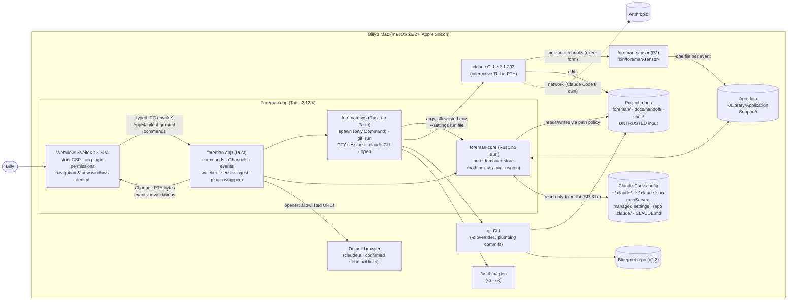
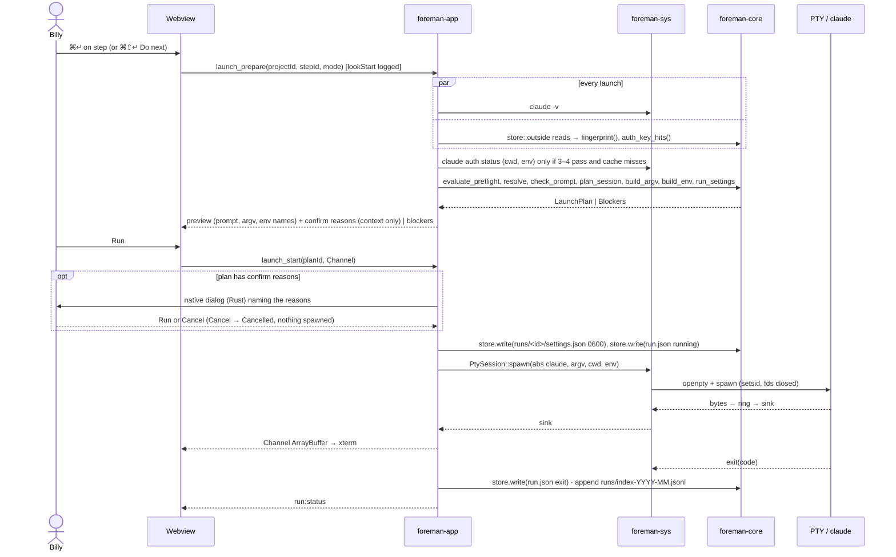

# Foreman · Design doc

**Status:** DRAFT for the Stage 4.7 review
**Date:** 2026-10-19
**Author:** principal architect (Opus 5.5)
**Blueprint stage:** 4.2

**Inputs:**

- `docs/handoff/stage-02.md`;
- `docs/MASTER-SPEC.md` (FROZEN v1.0, with Appendix A);
- `spec/council/r5-resolution.md`, `r5b-freeze-review.md`, `r6-feature-specs.md`, `r7-stack.md`, `r8-nfr.md`;
- `docs/requirements.md` (Stage 3, revised after the security review; its SR/PR IDs are used throughout).

**Decisions:** `docs/adr/` (index: `docs/adr/README.md`). Every library version and API named here was checked on 2026-10-19 against crates.io, the npm registry, the crate or package source, the Rust std source, or the official docs, unless it's marked **UNVERIFIED**.

---

## 1. Context and scope

Billy runs the Claude Build Blueprint by hand: a 2,235-line Markdown file, `claude` flags typed from memory, packets copied between chats and repos, gates ticked from memory. Foreman is a personal macOS app that turns the blueprint into an executable, verified process. It:

- parses the annotated blueprint (v2.2 `fm:` grammar);
- computes each project's applicable path from tags and tri-state conditions;
- resolves every prompt;
- launches Claude Code in an embedded terminal with the exact argv, environment and run settings;
- re-arms "same session" steps;
- catches and validates packets;
- in P2, runs gates and signs packets with hash-bound plumbing commits.

**Milestones** (used everywhere):

| ID | Blueprint stages | Contents |
|---|---|---|
| M0 Site prep | 5 | Scaffold, `pnpm verify`, CI, release build; spikes S-0, S-1′, S-3, S-7′, S-8, S-12, S-23 |
| M1 Domain core | 6 | `foreman-core` (no Tauri) and `git::run`: F-001 P1, F-002, F-003 P1, F-004, F-005, F-006 P1, F-007, F-013 P1 validation, F-020, F-021, F-022 |
| M2 Walking skeleton | 7 | Tauri shell, typed IPC + mock, the first spawn and its controls, F-030 P1, F-018 P1, F-019 P1, F-029 P1, F-017 P1, F-028 P1 |
| M3 Runners | 8–9 | F-008 P1 + security controls, F-009 P1, F-010, F-012 P1, F-013 watcher, F-026 P1. **End of M3 = end of phase 1 = kill check** |
| M4 Complete v1 | 11–12 (10 n/a) | All P2 features |
| M5 Finishes | 13–17 | F-030 P2 design system and sheet strip, accessibility, audits, readiness, CO |

**Out of scope:** MASTER-SPEC §13 non-goals and v1.1 (F-101 to F-108). v1 makes **no `claude -p` calls** (SR-16).

**Environment:**

- one Apple Silicon Mac, macOS 26/27;
- Claude Code ≥ 2.1.293 (npm `stable` 2.1.292, `latest` 2.1.303 on 2026-10-19, so the floor sits above `stable`, R-19);
- a subscription login;
- git;
- project repos that Claude Code edits continuously and that Foreman treats as **untrusted input**.

## 2. Goals and non-goals

**Goals:**

1. **Exactness.** Every CLI step launches with exactly the argv, environment and run settings the template, model policy and overrides imply, with zero manual prompt edits (F-003, NFR-48).
2. **Speed to start.** p95 ≤ 10 s to start a step (NFR-09). Also: cold start ≤ 1.5 s, project switch ≤ 300 ms, template load ≤ 50 ms, resolve plus preflight ≤ 50 ms, spawn ≤ 250 ms, packet visible ≤ 1 s (NFR-01 to NFR-06).
3. **No data loss, ever.** Atomic, durable, versioned writes that never overwrite a newer external edit (NFR-10 to NFR-12, SR-32, SR-33).
4. **Least authority.** The webview can't spawn, touch files, navigate away or open windows, and holds no plugin permissions. Only Rust spawns, through one module, and only allowlisted absolute programs with argv arrays (SR-01, SR-02, SR-22, SR-29).
5. **Honest records.** Decision files take effect only as approved; commits are plumbing-only and read back; gates need evidence (SR-40 to SR-47).
6. **Degrade, don't block** (NFR-13). The run sheet export is the escape hatch (NFR-14).
7. **Last 20 years.** A pure, heavily tested core; plain JSON/Markdown with schema versions; every dependency behind a seam with an exit path.

**Non-goals:**

- a general Claude Code GUI;
- replacing Claude Code's TUI;
- any network feature;
- multi-user;
- headless gates and the Crew Loop (v1.1);
- plugins;
- any OS but macOS on Apple Silicon.

## 3. The design

### 3.1 System context



**Trust boundaries** (input to the Stage 4.3 threat model):

| Boundary | Trusted side | Untrusted side |
|---|---|---|
| T1 | Rust | the webview, which is less trusted: a compromised webview can type into a live session through `pty_write`, so this is a named residual risk |
| T2 | Foreman | repo content: `.foreman/`, packets, `.claude/`, `CLAUDE.md`, `.git/config` |
| T3 | Foreman | pasted chat output |
| T4 | Foreman | Claude Code's behavior and **terminal output** |
| T5 | Foreman | sensor events (token-scoped; never trigger actions) |

Foreman itself makes **no network requests** (SR-60).

### 3.2 Rust workspace (ADR-003)

```text
Cargo.toml              [workspace] crates/*, src-tauri; resolver 3; shared lints; clippy.toml disallowed-methods
rust-toolchain.toml     channel = "1.99.1" (newest rust-lang tag 2026-10-19; floors 1.90 tauri-build, 1.89 comrak)
deny.toml               graph targets = aarch64-apple-darwin; bans (ADR-016)
crates/foreman-core/    pure domain + store (path policy, atomic I/O, SR-31a reader); no tauri/tokio/spawn
crates/foreman-sys/     spawn (sole Command/CommandBuilder site), git::run, PtySession, claude CLI, open
crates/foreman-sensor/  hook helper (P2): std + serde_json + rustix (`fs`, `event`)
crates/fake-claude/     test-only double (never bundled)
src-tauri/              foreman-app: Tauri shell, IPC, watcher, sensor ingest, plugin wrappers, logging
```

- `#![forbid(unsafe_code)]` everywhere; `unwrap`/`expect` denied outside tests; `clippy::pedantic` on the core; `-D warnings` (SR-62).
- `clippy.toml` `disallowed-methods` confines `Command::new`/`CommandBuilder::new` to `foreman-sys::spawn` (SR-02, SR-44) and `std::fs` to `foreman-core::store` (including `store::outside` and `store::git_exclude`), `foreman-app::logging` (the size-rotating diagnostics writer, `logs/` in app data only), the `foreman-sensor` crate (its event-file writer), and test code (`#[cfg(test)]`, `tests/`) (SR-31a, AC-XC-30).

**Core dependencies** (exact pins, SR-61):

| Crate | Version | Notes |
|---|---|---|
| `comrak` | =0.56.0 | `default-features = false` |
| `serde` / `serde_json` | =1.0.229 / =1.0.154 | |
| `thiserror` | =2.0.21 | |
| `uuid` | =1.28.0 | v4 |
| `semver` | =1.0.28 | |
| `sha2` | =0.11.1 | |
| `jiff` | =0.2.38 | |
| `rustix` | =1.1.5 | `fs`, `process` |
| `icu_normalizer` | =2.3.0 | Already in the macOS graph through `url` → `idna` |
| `icu_casemap` | =2.3.0 | New |
| `ts-rs` | =12.0.1 | `ts` feature only |

Dev: `proptest` 1.12.0, `insta` 1.49.0, `criterion` 0.8.2, `tempfile` 3.27.0.

**Sys:** `tokio` 1.54.0, `portable-pty` 0.9.0.

**App:**

- `tauri` 2.12.4 (no `devtools` in release), `tauri-build` 2.7.3;
- `notify` 8.2.0 + `notify-debouncer-full` 0.7.0;
- `tracing` 0.1.44 + `tracing-subscriber` 0.3.23;
- plugins (Rust side only): opener 2.7.2, clipboard-manager 2.5.0, dialog 2.8.3, window-state 2.5.0, **notification 2.7.0** (latest stable, filling MASTER-SPEC §10's open version; per SR-56 it ships with the first feature that needs it, the F-007 `wait` steps in P1);
- `tauri-plugin-wdio-webdriver` 1.5.0 under the `e2e` feature only. Its client is in-repo (`e2e/webdriver.ts`, no dependencies); `@wdio/tauri-service` and webdriverio are not used (ADR-015 amendment 2026-10-20).

#### 3.2.1 `foreman-core` modules and public APIs (signature level)

Functional core, imperative shell. Facts that need processes or the clock are gathered by `foreman-sys`/`foreman-app` and passed in as values.

```rust
// template — F-001 (ADR-005)
pub fn parse_template(source: &str) -> Template;              // never panics; problems → diagnostics
pub struct Template { pub grammar_version: u32, pub blueprint_version: String, pub source_sha256: Sha256,
    pub stages: Vec<Stage>, pub steps: Vec<Step>, pub items: Vec<InspectionItem>,
    pub packet_formats: Vec<PacketFormat>, pub diagnostics: Vec<Diagnostic> }
pub fn normalize_item_text(bullet: &str) -> String;
pub mod grammar { pub fn parse_directive(comment: &str, at: SourcePos) -> Result<Directive, Diagnostic>; }

// lock — F-002
pub fn pin(t: &Template, commit: GitOid, path: &RepoPath, at: Timestamp) -> BlueprintLock;
pub fn check_lock(lock: &BlueprintLock, t: &Template) -> LockCheck;     // Ok | SourceMismatch | ItemDrift(..)

// rules — F-004
pub fn parse_expr(s: &str) -> Result<Expr, ExprError>;
pub fn eval(e: &Expr, c: &Conditions) -> TriState;
pub fn applicable_path(t: &Template, d: &Decisions, o: &Overlay) -> ApplicablePath;
pub fn set_condition(d: &Decisions, id: ConditionId, to: TriState, note: &str, at: Timestamp,
    signed: &SignedStages) -> Result<Decisions, RuleError>;

// policy — F-005
pub fn effective_start(step: &Step, p: &ModelPolicy, ovr: Option<&RunOverride>) -> Explained<Start>;

// resolver — F-006
pub fn classify_tokens(prompt: &PromptText) -> Vec<Token>;
pub fn resolve(ctx: &ResolveCtx<'_>) -> Result<ResolvedPrompt, Vec<Unresolved>>;

// sanitize — SR-28, SR-26
pub fn check_prompt(p: &str) -> Result<(), Blocker>;          // leading - / ! after trim; C0/DEL/C1
pub fn for_paste(text: &str) -> (String, SanitizeReport);     // strips ESC, C0 (≠TAB/LF/CR), DEL, C1
pub fn visible_escapes(text: &str) -> Vec<Span>;              // bidi, zero-width, controls shown visibly

// steps, chain — F-007, F-010
pub fn transition(s: &StepState, e: StepEvent) -> Result<StepState, Rejected>;
pub fn plan_session(step: &Step, chains: &Chains, new_id: SessionId) -> SessionPlan;

// launch — F-008 (ADR-007, ADR-021)
pub fn evaluate_preflight(f: &PreflightFacts) -> Result<(), Vec<Blocker>>;
pub fn build_argv(p: &LaunchInputs) -> Result<Argv, Blocker>;             // fixed flag enum
pub fn build_env(own: &EnvSnapshot, passthrough: &[EnvName], path: &BuiltPath) -> ChildEnv;
pub fn build_path(sources: &PathSources, roots: &[AbsPath]) -> BuiltPath;  // sanitized entries
pub fn run_settings(repo: &AbsPath, app_data: &AbsPath, sensor: Option<&SensorHooks>) -> RunSettingsJson;
pub fn needs_confirmation(step: &Step, eff: &Start, ctx: &ConfirmCtx) -> Option<ConfirmReason>;

// fingerprint — SR-06, SR-07, SR-55
pub fn sources(cwd: &AbsPath, repo_root: &AbsPath, home: &AbsPath, cfg: &ClaudeConfigDir) -> Vec<SourceSpec>;
pub fn fingerprint(files: &[ConfigFile]) -> Fingerprint;
pub fn auth_key_hits(files: &[ConfigFile], allow: &UserAllowlist) -> Vec<AuthKeyHit>;
pub fn redact(v: &serde_json::Value) -> serde_json::Value;
pub fn diff(prev: &RedactedSnapshot, now: &RedactedSnapshot) -> FingerprintDiff;

// compat — ADR-017
pub fn floor(t: &Template, kit: &KitAgents, p: &ModelPolicy) -> (semver::Version, Vec<Requirement>);

// git (pure arg builders) — ADR-012
pub fn args(op: &GitOp) -> GitArgs;                            // closed operation enum, SR-45 overrides

// packet — F-012, F-013
pub fn normalize_packet(text: &str) -> Normalized;
pub fn split_paste(text: &str, fmt: &PacketFormat) -> Result<PasteParts, PasteError>;
pub fn validate_packet(p: &Packet, fmt: &PacketFormat, ctx: &PacketCtx) -> Vec<PacketProblem>;

// decisions — F-022 (ADR-022)
pub fn classify_outside_change(approved: &DecisionSet, on_disk: &DecisionSet) -> OutsideChange;

// pathpolicy — F-021 (ADR-011), lexical, pure
pub fn check_write(rel: &str, purpose: WritePurpose) -> Result<RepoPath, PolicyViolation>;
pub fn check_read(rel: &str, class: ReadClass) -> Result<RepoPath, PolicyViolation>;

// store — F-020 (ADR-010, ADR-011): imperative; the only std::fs user
impl Root {
    pub fn open(abs: &AbsPath, kind: RootKind) -> Result<Root, StoreError>;
    pub fn read(&self, p: &RepoPath, class: ReadClass) -> Result<(Vec<u8>, ReadStamp), StoreError>;
    pub fn write(&self, p: &RepoPath, bytes: &[u8], expect: &ReadStamp) -> Result<ReadStamp, WriteError>;
    pub fn append_line(&self, p: &RepoPath, line: &[u8]) -> Result<(), StoreError>;
}
pub mod outside { /* SR-31a fixed list: user/managed settings, ~/.claude.json mcpServers, … */ }
pub mod git_exclude { pub fn ensure(root: &Root, exclude_path: &AbsPath, common_dir: &AbsPath) -> Result<(), StoreError>; }

// schema — ADR-023;  runlog — ADR-018
pub fn migrate<T: Versioned>(raw: serde_json::Value) -> Result<T, MigrationError>;
pub fn export_metrics(index: &[RunIndexLine], baseline: Option<&Baseline>) -> String;
```

#### 3.2.2 `foreman-sys` and `foreman-app`

| Crate::module | Responsibility | Key items |
|---|---|---|
| `sys::spawn` | Only `Command`/`CommandBuilder` site; program allowlist re-checked per spawn; `env_clear` + built env; `process_group(0)` for non-PTY children; timeouts; output caps | `spawn(req: SpawnRequest) -> Result<Child, SpawnError>` |
| `sys::git` | `git::run(root, GitArgs, opts)`: SR-45 overrides and env; plumbing commits; read-back | ADR-012 |
| `sys::pty` | `PtySession` (portable-pty): spawn, sink, write, paste, resize, signals, ring tail | ADR-006 |
| `sys::claude` | `version()`, `auth_status(cwd, env)`, `probe_*()` (P2), `desktop()` (P2) | ADR-017, ADR-021 |
| `sys::open` | `/usr/bin/open -b <id> <path>`, `open -R <path>`, Terminal by bundle ID | SR-25a |
| `app::ipc` | Commands (one request struct each, `deny_unknown_fields`, no `flatten`), DTOs (`TS` derive), `IpcError`, `COMMANDS`, `catch_unwind` boundary | ADR-004 |
| `app::window` | Builds `main` in Rust: `on_navigation`, `on_new_window` → Deny, drag-drop disabled, overlay title bar | ADR-014 |
| `app::state` | `AppState`: registry, open projects (`RwLock<ProjectRuntime>`), template cache, run table, one-time plan/preview IDs | |
| `app::launch` / `app::rearm` | Imperative halves of the launch pipeline and re-arm | ADR-021, ADR-008 |
| `app::watch` | notify + debouncer; interest sets; re-read via `store` | ADR-013 |
| `app::sensor_ingest` | P2: token check, derived session state, pruning | ADR-009 |
| `app::doctor` | First-run checks, PATH capture (the only shell), capability table | |
| `app::os` | Opener (URL allowlist; terminal links with confirmation), clipboard (read on explicit actions only, ≤ 1 MB), dialog, notification (fixed templates), window-state | SR-25, SR-29, SR-56 |
| `app::logging` | `tracing` → size-rotated file (10 MB × 5) with a redaction layer; panic hook without payload values | SR-54, SR-57 |

At startup: `rustix::process::umask(0o022)` (SR-57); app-data directories `0700`, files `0600` (SR-53).

### 3.3 The Svelte app (ADR-002, ADR-004, ADR-020)

SvelteKit **3.1.0** SPA, as verified in r1 §A4: `@sveltejs/adapter-static` 4.0.0, Svelte 5.57.2, Vite 8.3.4, TypeScript 6.0.3 strict.

- `sveltekit({ adapter: adapter({ fallback: 'index.html' }), version: { pollInterval: 0 } })` in `vite.config.ts` (SvelteKit 3 dropped `svelte.config.js`).
- `export const ssr = false` in the root `+layout.ts`.
- `#lib` imports; `tsconfig.json` extends `$app/tsconfig`.
- `kit.csp` stays unset; Tauri hash-pins the inline bootstrap (ADR-014).
- Tauri's asset resolver falls back to `index.html` for unknown paths (verified in tauri 2.12.4 `src/manager/mod.rs`), so pathname routes survive a reload.

```text
src/
  app.html
  routes/
    +layout.ts                ssr = false; prerender = false
    +layout.svelte            shell: sidebar, terminal drawer host, shortcuts, aria-live region
    +page.svelte              Today (P1 Next step rows; P2 inbox)
    first-run/+page.svelte    setup/+page.svelte   doctor/+page.svelte   settings/+page.svelte
    projects/[projectId]/+layout.svelte          (P2: sheet strip, title block, inspector)
    projects/[projectId]/stages/[stage]/+page.svelte
    projects/[projectId]/stages/[stage]/gate/+page.svelte   (P2)
    projects/[projectId]/runs/+page.svelte                  (P2)
  lib/
    ipc/  bindings/ (ts-rs, checked in) · contract.ts (IpcClient) · tauri.ts · mock.ts · index.ts
    stores/      *.svelte.ts rune modules (projects, today, workspace, terminals, doctor, settings)
    terminal/    xterm host, key router, link handler, paste path, archive sections
    components/ui/  bits-ui wrappers;  components/  step block, spec line, prompt block, packet view
    render/      Rust node tree → Svelte components (no HTML strings)
    keyboard/    shortcut registry;  nav/  goto/$app/state wrapper
```

- **Rust is the source of truth.** Stores hold the last command result plus a revision. Events carry `{id, rev}` only, and a newer `rev` triggers a refetch.
- **`#lib/ipc` is the only importer of `@tauri-apps/api`** (ESLint). `MockIpcClient` serves browser preview (`pnpm dev:mock`), Vitest and Playwright.
- **No `{@html}`, `innerHTML`, `outerHTML` or `insertAdjacentHTML`** (`svelte/no-at-html-tags`, `no-restricted-properties`). Markdown arrives from Rust as a typed node tree (SR-26). No `+page.server.ts`, form actions or server hooks (lint).

### 3.4 The IPC boundary (ADR-004, ADR-014)

**Commands.** Each is listed in `ipc::COMMANDS`, passed to `AppManifest::commands`, and granted only to the `main-window` capability. Each takes exactly one request struct with `deny_unknown_fields` and no `flatten`; Rust validates lengths, enums and IDs. The webview never supplies a path, program, argv, URL or env value that Rust uses unvalidated (SR-24).

The command list, request and response types, errors and mock fixtures live in **`docs/contracts/ipc.md`**, which is the single source; this doc no longer keeps its own table. No request carries an approval: every confirmation (launch confirmation, config acknowledgement, Terminate, re-arm idle assertion, accepting an outside change, signing, security-relevant settings) is a native dialog raised by Rust, and the webview's buttons only request the action (`docs/contracts/ipc.md` IPC-R11, SR-24a).

**Channels.** PTY output uses `Channel<tauri::ipc::Response>` with `Response::new(bytes)`. That's `InvokeResponseBody::Raw`, which arrives as an `ArrayBuffer`. A `Channel<Vec<u8>>` would serialize a JSON number array (blanket `Serialize` impl in tauri 2.12.4 `src/ipc/mod.rs`; `@tauri-apps/api` 2.12.4 `Channel` docs). `pty_attach` replays the last 2,000 lines. Channels need no capability permission (SR-22).

**Events** (Rust → webview, invalidation only):

| Event | Payload |
|---|---|
| `project:changed` | `{projectId, rev}` |
| `packet:changed` | `{projectId, stage, rev}` |
| `run:status` | `{runId, status}` |
| `decision:pending` | `{projectId, count}` |
| `doctor:status` | `{level}` |
| `config:changed` | `{projectId, cwd}` |

The capability allows `core:event:allow-listen`/`allow-unlisten` only. There are no webview → Rust events.

**Errors.** `IpcError { code, message, detail? }` with a closed `code` set. Handler panics become `Internal`, logged without payload values (SR-57).

### 3.5 Data flows

#### 3.5.1 Run a CLI step (P1)



1. `launch_prepare` re-resolves from current state; the UI never sends argv. `mode: freshWithContext` starts a new chain with context instead of resuming (broken chain, DR-113); resuming a chain from a tab or the Run log uses `chain_resume_prepare`. The order of checks is fixed (ADR-021): version → fingerprint + block scan → acknowledgement → auth (fail closed) → transcript → inputs → run inputs → prompt hygiene → argv/env → run settings → confirmation reason (SR-19, including "Claude Code updated X → Y"). `claude -v` runs in parallel with the fingerprint reads; its spawn time counts toward NFR-05, not NFR-04.
2. **Confirmations are native** (SR-24a; `docs/contracts/ipc.md` IPC-R11). `launch_start` takes only the `planId`. If the plan has confirmation reasons, Rust shows them in a native dialog and acts on the answer; the webview's preview shows the reasons only as context. The config acknowledgement (`config_ack`) is a native dialog too.
3. The plan is stored under a one-time `planId`, valid for 60 s and for the exact project revision and fingerprint.
4. The run record is written **before** spawn (SR-19, NFR-11). The PTY cwd must be a directory reached through the no-symlink walk; portable-pty would otherwise fall back silently to `$HOME` (ADR-006).
5. The run log records time-to-start, active time, entry point, input interventions and Copy-prompt usage (F-026). The argv is stored with the prompt replaced by its hash (SR-52).

#### 3.5.2 Re-arm a continuing step

1. Billy presses Run on a `session=continue` step. `plan_session` → `Continue`, or `Broken` (transcript missing, offering "Start a fresh chain with context", `launch_prepare { mode: freshWithContext }`). The UI then calls `rearm_start(planId)`; no request field carries the idle assertion.
2. If the process is alive, idle is required, confirmed in a **native dialog** raised by Rust (SR-24a):
   - P1: "Claude is idle and nothing is running in the background", Continue or Cancel.
   - P2: the sensor reports idle; otherwise the native dialog says "N background tasks still running" with Wait and End anyway.
3. Write `\x03`, then `/exit\r`. Wait ≤ 10 s (P2: `SessionEnd` with `prompt_input_exit`). On timeout: "Claude didn't exit. End it yourself, then press Continue." No signal is sent without Billy's explicit Terminate confirmation, which is a native dialog too (`pty_terminate(runId)`, SR-13, SR-24a).
4. Archive the old buffer and write the divider `── <step> · <model> · <effort> · <mode> · permission grants reset ──`.
5. Relaunch through 3.5.1 with `--resume <uuid>`. `--session-id` is used only at chain start, or with `--fork-session` if S-8 passes (SR-14). Effort follows S-3's branch.
6. Only `rearm_start` (a user invoke) can begin this; no event can (SR-18).

#### 3.5.3 Chat: copy, and paste back (P1)

1. `chat_copy_and_open`: Rust resolves the prompt, checks it (SR-28), writes it to the clipboard, and opens the stored conversation URL or Project URL if it matches `https://claude.ai/…` (SR-25). Time-to-start ends here: the filled prompt is on the clipboard and the target chat is open, the same end point the by-hand baseline uses (AC-KC-01).
2. `paste_back_preview(stepId, kind, source)`: Rust reads the clipboard (or, in P2 with `source: sensor`, the run's `last_assistant_message`) (text only, ≤ 1 MB, never logged; SR-56), then normalizes, splits (packet / attachments / extras) and validates. It computes each target through `check_write` and returns diffs with bidi, zero-width and control characters shown visibly (SR-26, SR-35), under a one-time `previewId`.
3. `paste_back_apply(previewId)`: writes each target with `store.write` against the stamps captured at preview time. A newer file causes a conflict, which is reported with exactly which targets were written.
4. A valid packet implies Mark done; an invalid one offers Copy fix request.

#### 3.5.4 Packet lands (P1)

1. A notify/FSEvents hint (debounced 250 ms) arrives for an interest-set path, matched exactly (ADR-013, DR-162): `docs/handoff/stage-NN.md` and `stage-NN-attachments.md`, `docs/lessons.md`, declared `out` paths, `.foreman/{project,overlay,blueprint.lock}.json`. Ignored and secret patterns are dropped (SR-50).
2. `store::Root::read` re-reads the file: no-symlink walk, regular file, `nlink == 1`, 1 MB cap (SR-31). The watch root's ancestors are `lstat`-checked.
3. `normalize_packet` and `validate_packet` run with the applicable-path context. The runtime updates, `rev` bumps, `packet:changed` fires, and the UI refetches `packet_view` within 1 s (NFR-06).
4. A signed stage whose on-disk packet differs from the committed blob is a tamper event (P2, SR-46).
5. Missed events are tolerated: Foreman re-stats the interest set on open, focus, launch and sign (ADR-013).

#### 3.5.5 Sign a packet (P2, F-014; ADR-012)

1. `sign_preview` checks the close-out sequence for the stage type (MASTER-SPEC §8), lessons presence, chain idle (or confirmation), and the fields Foreman will add (SKIPPED, SUBSTITUTIONS, ATTESTED). It returns a diff and the packet SHA-256.
2. `sign_apply(previewId)`: Rust shows the native signing dialog (name, date, "Signing stage-05.md @ a3f9c1", conditions, chain state, SR-24a); Cancel changes nothing. Then:
   1. Re-read and compare the hash (SR-42).
   2. Write APPROVED BY and the added fields, `.foreman/stages/stage-NN.json`, and pending decision changes, each with a CAS `store.write`.
   3. Check HEAD (current branch): detached (`symbolic-ref -q HEAD` fails) → refused, "Check out a branch first"; unborn (`rev-parse --verify -q HEAD` fails) → a parentless first commit.
   4. Commit by plumbing through `git::run`, with SR-45's environment and `-c` overrides (ADR-012, DR-143):
      1. dirty check per path: `hash-object --no-filters` vs `rev-parse HEAD:<path>`; only changed paths are committed;
      2. `hash-object -w --no-filters --stdin` per path;
      3. temporary `GIT_INDEX_FILE`: `read-tree <tip>` (unborn: `read-tree --empty`), `update-index --cacheinfo`, `write-tree`;
      4. `commit-tree --no-gpg-sign` (always in v1; unborn: no `-p`);
      5. `update-ref <ref> <new> <old>` (unborn: old = the zero OID);
      6. current branch only: `update-index --cacheinfo` on the real index for those paths only, retried 5 × 200 ms on `index.lock`; on failure `indexRefreshPending` is recorded and the banner "Index not refreshed; don't commit until this clears" shows until a retry on open or focus succeeds.

      Another branch (SR-43) uses the same plumbing against that branch's tip and leaves HEAD, the index and the working tree untouched.
   5. Read-back: `cat-file blob <commit>:<path>` for every path, comparing hashes. The stage stays `signed (commit pending)` until this passes; then the stamp animation runs. The commit OID goes to `progress.json` `signing[NN].commit`, never into the stage record (the record is inside that commit).

#### 3.5.6 Outside change to a decision file (P1, F-022; ADR-022)

1. On open, a watcher hint, a launch or a sign, a repo decision file's SHA-256 differs from `approvals/<projectId>.json`.
2. Rust parses it. If it's unparsable or from a newer schema, the project goes read-only. `classify_outside_change(approved, on_disk)` splits variable-only changes (auto-accepted with a toast) from decision changes.
3. Decision changes go to a Pending outside change with a **redacted** diff (SR-55). The effective config stays the approved copy in `approvals/<projectId>/` (SR-40).
4. Accept (a native dialog raised by Rust, SR-24a) updates the approved copy and hash. Reject writes the approved content back with a CAS write; a newer edit means a conflict and the review repeats.
5. Foreman's own changes: committed at once by plumbing before Stage 5 is signed; afterwards they're pending until the signing commit (R-10).

### 3.6 File layout

**Repo (per project).** Schemas are written in Stage 4.4 (`docs/contracts/files.md`).

| Path | Writer | Notes |
|---|---|---|
| `.foreman/project.json`, `overlay.json`, `blueprint.lock.json` | decision-file writer (typed purpose) | `schemaVersion`; approved copies in app data |
| `.foreman/stages/stage-NN.json` | signing | Immutable provenance |
| `docs/handoff/stage-NN.md` (+ `-attachments.md`) | paste-back, signing | Packets |
| `docs/lessons.md`, `docs/templates/`, `docs/change-requests/`, `docs/postmortems/`, `spec/` | setup, lessons | As in the blueprint |
| `<git-path info/exclude>` | `store::git_exclude` | Appends `.*.foreman-tmp` idempotently; the only write under `.git` (SR-32) |

**App data:** `~/Library/Application Support/<bundle id>/` (`app_data_dir()` in tauri 2.12.4); directories `0700`, files `0600`.

```text
settings.json  projects.json
projects/<projectId>/progress.json            step states, chains, gate runs, run inputs, pending decisions, read stamps
approvals/<projectId>.json · approvals/<projectId>/<file>.json   approved hashes + approved copies (effective config)
runs/<runId>/{run.json, output.log, settings.json}   ·   runs/index-YYYY-MM.jsonl
events/<runId>/<seq>-<event>.json             P2 sensor events (≤ 20 per run; deleted at sign or 30 days)
templates/<sha256>.md                         locked blueprint text
cache/fingerprints/<cwdHash>.json             redacted config snapshot + stat cache + auth cache (SR-55)
bin/foreman-sensor-<hash>  ·  probe/          P2
logs/foreman.log[.1-.4]                       diagnostics, 10 MB × 5, redacted
recovered/<timestamp>-<name>                  leftover temp files that differed from their target (shown, never deleted; ADR-010)
```

## 4. Alternatives considered

| Alternative | Why it lost |
|---|---|
| **Domain logic in TypeScript, Rust as a thin I/O layer** | Security decisions (argv, env, path policy) would move into the less-trusted webview (T1); property testing and crash injection are stronger in Rust. Ruled out by prompt 4.2's required decisions. |
| **Spawning inside `foreman-app` (no `foreman-sys`)** | SR-44 puts `git::run` in Stage 6, before Tauri exists. Spawning in the core would break "the core never spawns" (ADR-003). |
| **A daemon owning PTYs so sessions survive quitting** | A second process plus a local socket listener (against SR-60's spirit) plus lifecycle complexity. The spec chose a quit guard plus resume. |
| **A local HTTP/WebSocket bridge instead of Tauri IPC** | A listener, a CSP `connect-src` hole, and a reimplementation of commands, Channels and capabilities. |
| **SQLite for app state** | Opaque; PR-06 requires plain JSON/Markdown; JSONL indexes meet NFR-21 (ADR-018). |
| **Porcelain signing (`git add` + `git commit --only`)** | `git add` runs repo filter drivers and `commit` honors repo `gpg.program` even with hooks off. Plumbing with `--no-filters` closes both (SR-42, SR-45; ADR-012). |
| **`git2` 0.21.0 / `gix` 0.89.0** | ADR-012: C plus OpenSSL/libssh2 exposure, or a pre-1.0 API, and divergence from the CLI used in the same repos. |
| **`cap-std` 4.0.3 for the path policy** | ADR-011: its nofollow covers the last component only; F-021 needs refusal at every component. |
| **tauri-specta 2.0.0-rc.25** | ADR-004: still an RC, with an exact-pinned specta RC and its own command registration. |
| **Plain Svelte 5 + Vite + hash router** | ADR-002: smaller (11.8 vs 30.3 KB gzip) with no inline script; Billy chose SvelteKit 3 for consistency and file routing. |
| **The isolation pattern** | ADR-014: little gain with Rust-side validation, no plugin permissions and a strict CSP; `brownfield` with the residual risk recorded. |
| **Electron; SwiftUI + SwiftTerm** | ADR-001; SwiftUI + SwiftTerm stays the S-0 fundamental-failure fallback. |
| **`tauri-plugin-pty`, `-shell`, `-fs`** | The webview would choose programs or paths (SR-01, SR-22). |

## 5. Cross-cutting concerns

### 5.1 Security (SR → design element)

| SR | Design element | Milestone | ADR |
|---|---|---|---|
| SR-01 | `sys::spawn` allowlist (`claude`, `git`, `/usr/bin/open`, probes), re-checked per spawn | M1 (git via `git::run`) · M2 | 007, 012 |
| SR-02 | `sys::spawn` sole `Command`/`CommandBuilder` site (clippy `disallowed-methods`); `doctor::capture_login_path` with `/etc/shells` check | M2 | 003, 007 |
| SR-03 | `core::launch::build_argv` fixed flag enum, `--name` regex, forbidden flags; `template::grammar` rejects `bypassPermissions` | M1, M2 | 005, 007 |
| SR-04 | `core::sanitize::check_prompt` (after trim), prompt as the final positional argument | M2 | 007 |
| SR-05 | `core::launch::build_env` + `build_path`; `env_clear` in `sys::spawn` and `PtySession` | M2 | 007 |
| SR-06 | `core::fingerprint::sources` + `store::outside`; `config_ack` | M3 | 021 |
| SR-07 | `core::fingerprint::auth_key_hits` with the user allowlist | M3 | 021 |
| SR-08 | `sys::claude::auth_status` after fingerprint, fail closed, cached | M3 (env M2) | 021 |
| SR-09 | `core::launch::run_settings` (`//` deny paths, `disableBypassPermissionsMode`), written `0600` per run | M2 | 021, 009 |
| SR-10 | Path policy denies `.claude`; user config is outside every writable root | M1 | 011 |
| SR-11, SR-12 | v1.1 (F-101); no code path in v1 | — | — |
| SR-13 | `app::rearm` state machine; Terminate needs confirmation | M3 | 008 |
| SR-14 | `core::chain::plan_session` + argv property test | M3 | 008 |
| SR-15 | `foreman-sensor` (256 KB stdin, `O_EXCL\|O_NOFOLLOW` `0600`), hash checked per run, token checked on ingest | M4 | 009 |
| SR-16 | No print-mode flag in the argv enum (`argv::no_print_mode_in_v1`) | M2 | 007, 017 |
| SR-17 | `sys::claude::probe_*` in a reset `probe/` folder, three outcomes | M4 | 017 |
| SR-18 | Events and watcher only bump revisions; session-affecting commands are user invokes only | M3 | 008, 009, 013 |
| SR-19 | `launch_prepare` preview (prompt, argv, env names); `needs_confirmation` incl. version change; run record before spawn | M2 | 007, 017, 018 |
| SR-20 | `app.security.csp` + `devCsp`; Tauri script hashes and style nonces; `kit.csp` unset; S-0 style rule | M0, M3 | 014, 002 |
| SR-21 | `freezePrototype`, `withGlobalTauri: false`, `assetProtocol` off, `capabilities: ["main-window"]`, drag-drop off, no release devtools, `brownfield` with reason | M0 | 014 |
| SR-22 | `capabilities/main-window.json` (listen/unlisten, start-dragging, internal-toggle-maximize, app commands); plugins only via `app::os` | M0 · M2 | 014 |
| SR-23 | `build.rs` `AppManifest::commands(ipc::COMMANDS)`; contract test | M0 | 004, 014 |
| SR-24 | One request struct per command (`deny_unknown_fields`, no `flatten`), validation, proptest fuzz; `pty_write` live runs only | M2 · M3 (`pty_write`) | 004, 006 |
| SR-24a | Native confirmations raised by Rust in `app::os` (`tauri-plugin-dialog`); no approval field in any request (IPC-R11); tests `ipc::security_confirmations_are_native`, `settings::security_fields_require_native_confirm` | M2 · M3 · M4 | 014, 008, 012 |
| SR-25 | `app::os::open_url` allowlist after URL parsing | M3 | 014 |
| SR-25a | `sys::open` (`open -b <editor id>`, `.md/.json/.txt`, policy-checked; `open -R`); opener `open_js_links_on_click(false)` | M2 · M3 | 014 |
| SR-26 | Rust → typed node tree → Svelte; lint bans; `core::sanitize::visible_escapes` in diffs and views | M2, M5 | 002 |
| SR-27 | Core acts only on parsed structure; abuse-case tests (Stage 4.3) | M1, M4 | 005 |
| SR-28 | `core::sanitize::{check_prompt, for_paste}`; `pty_paste` Rust path; xterm paste-event interception | M1 (prompts) · M3 (terminal pastes) | 006 |
| SR-29 | `app::window` `on_navigation`/`on_new_window`; xterm `linkHandler` + web-links handler → `terminal_link_open` with confirmation; no clipboard addon; titles ignored | M2 (navigation) · M3 (terminal links) | 006, 014 |
| SR-30 | `pathpolicy::check_write` (NFC + full case folding) + `store::Root` fd walk + `F_GETPATH` name check | M1 | 011 |
| SR-31 | `store::Root::read` (no-symlink walk, regular file, `nlink == 1`, size caps); watch-root `lstat` checks | M1, M3 | 011, 013 |
| SR-31a | `store::outside` fixed list; `std::fs` clippy-denied elsewhere | M1 | 011, 021 |
| SR-32 | `store::Root::write` (random `.foreman-tmp` with `O_EXCL\|O_NOFOLLOW` `0600`, `sync_all` = `F_FULLFSYNC`, `renameatx_np`, dir `F_FULLFSYNC`); `store::git_exclude` | M1 | 010 |
| SR-33 | `ReadStamp` + `RENAME_SWAP` compare-and-swap | M1 | 010 |
| SR-34 | Action destinations as Rust constants (typed `WritePurpose`) | M1 | 005, 011 |
| SR-35 | `paste_back_preview`/`apply` two-phase, targets and diffs | M3 | (§3.5.3) |
| SR-40 | `core::decisions` + approved copies as the effective config | M1 (store) · M2 (review UI) · M3 (live) | 022 |
| SR-41 | `core::lock::check_lock` + `cat-file blob` at the locked commit | M1 | 005, 012 |
| SR-42 | `sys::git` plumbing commit + read-back (P1 decision commits in M1; signing M4) | M1, M4 | 012 |
| SR-43 | Plumbing against the other branch's tip; HEAD, index and working tree untouched | M4 | 012 |
| SR-44 | `sys::git::run`, the single entry point, built in M1 | M1 | 012, 003 |
| SR-45 | Fixed env + `-c` list + DR-140's plumbing operations only + `--no-filters` + `commit-tree --no-gpg-sign` always + timeout | M1 | 012 |
| SR-46 | Watcher + committed-blob compare → tamper event | M4 | 012, 013 |
| SR-47 | Core gate state machine; `signable` property test; outside signatures need a native confirmation bound to the packet hash (`packet_signature_confirm`, DR-135) | M3 (outside signatures) · M4 | 022 (F-015) |
| SR-50 | `check_read` secret patterns on folded keys; watcher filter | M1, M3 | 011, 013 |
| SR-51 | No keychain API; cargo-deny bans `security-framework` and `keyring` (verified absent from the macOS graph) | M0 | 016 |
| SR-52 | `run.json`/index: argv with `<prompt sha256:…>`, env names only | M2 | 018 |
| SR-53 | `app::paths` permissions; startup retention pruner | M1 (permissions) · M3 (tails) · M4 (retention) | 018 |
| SR-54 | `app::logging` redaction layer + size-rotating writer | M4 | 018 |
| SR-55 | `core::fingerprint::redact`; snapshots `0600`, deleted with the project | M3 | 021 |
| SR-56 | `app::os` clipboard (explicit actions, ≤ 1 MB, never logged); notification templates | M3 · M4 (inbox notifications) | 006, 014 |
| SR-57 | `sys::spawn`/`PtySession` lifecycle (`env_clear`, setsid via portable-pty for the PTY child, `process_group(0)` for non-PTY children (accepted in Stage 4.7), umask 022, SIGHUP on quit, Interrupted, `catch_unwind`) | M2 | 007, 006 |
| SR-60 | cargo-deny bans on `aarch64-apple-darwin` (verified clean); CSP `connect-src`; `protocol.allow=never`; `sandbox-exec` deny-network run | M0, M5 | 016 |
| SR-61 | Exact pins; `deny`, `audit`; pnpm 12 policy (`allowBuilds`, `minimumReleaseAge: 10080`, lockfile scan); SHA-pinned Actions | M0 | 016, 024 |
| SR-62 | Crate attributes + clippy config | M0 | 003 |
| SR-63 | CI: Semgrep, gitleaks, CycloneDX SBOM, planted-failure proofs | M0 | 015 |
| SR-64 | `scripts/build-release`, ad-hoc signing, lockfiles + toolchain pin | M0 | 001 |

**Milestone note.** The milestone column follows `docs/scope.md` §5 (Stage 4.1), including its stated differences from `docs/requirements.md`'s stage column:

- SR-01 applies to git from M1, through `git::run`;
- SR-15 and SR-17 land in M4 (P2 features);
- SR-25a lands in M2 (the first Open in editor).

### 5.2 Privacy

| PR | Design element |
|---|---|
| PR-01 | SR-60 controls. |
| PR-02 | §3.6 tables plus Stage 4.4 `docs/contracts/files.md`, which tags each file (a)–(g). |
| PR-03 | Prompt hashes only; no transcript copies (transcript existence is checked with `stat` only); sensor events capped. |
| PR-04 | A startup pruner handles tails (90 days), events (sign or 30 days), templates (90 days unused). Config snapshots live until the project is removed. |
| PR-05 | `runs_clear`; `project_remove` deletes `projects/<id>/`, `approvals/<id>*` and fingerprint snapshots, never the repo. |
| PR-06 | JSON with `schemaVersion` and sorted keys; Markdown packets (ADR-023). |
| PR-07 | No processors; stated in the threat model. |
| PR-08 | `store::outside` is the only reader outside roots; fixed candidates only. |

### 5.3 Observability (local only)

- `tracing` spans per command, launch phase and git call go to `logs/foreman.log` (10 MB × 5). A redaction layer drops values of content-bearing fields, and a snapshot test proves no prompt, packet, terminal or env content is logged (SR-54).
- The panic hook records the location without payload values.
- The run log holds the product metrics (ADR-018). Doctor shows health. Crash reports are the macOS ones (no upload).

### 5.4 Accessibility

- WCAG 2.2 AA through bits-ui primitives in `#lib/components/ui` wrappers and the tokens (Stage 4.5 contrast table, NFR-35).
- Keyboard: the shortcut registry; xterm's `attachCustomKeyEventHandler` routes ⌘-chords to the app (except ⌘C/⌘V/⌘A/⌘F); ⌘⇧E leaves the terminal, so there's no trap.
- VoiceOver: an `aria-live` region. A Settings toggle, "Screen reader mode", turns on xterm `screenReaderMode` and adds `--ax-screen-reader` to CLI launches (Foreman doesn't detect VoiceOver).
- Reduce Motion and Increase Contrast are CSS media queries in the webview (`prefers-reduced-motion`, `prefers-contrast: more`, whose tokens reach ≥ 7:1). Reduce Transparency is detected the same way (`prefers-reduced-transparency`); the webview reports it and Increase Contrast to Rust (`settings_update` `osDisplay`), which turns the window's vibrancy off (ADR-014).
- Proof: axe in Playwright, a keyboard-only script, and the M5 VoiceOver pass.

### 5.5 Performance (against NFR IDs)

| NFR | How the design meets it | Measured by |
|---|---|---|
| NFR-01 cold start ≤ 1.5 s | SvelteKit route chunks; terminal module lazy-loaded; `app_bootstrap` reads only `projects.json` + `progress.json`; Doctor async after first paint | Startup mark; S-0 |
| NFR-02 switch ≤ 300 ms | Template cache by hash; no git calls on switch | `criterion` `bench_project_open` |
| NFR-03 template ≤ 50 ms | One comrak pass (r1 measured 1.7 ms) + directive parse; cache | `criterion` on golden + 20,000-line synthetic |
| NFR-04 resolve + preflight ≤ 50 ms | Pure core; fingerprint stat cache; auth cache; first-ever scan of a cwd excluded and shown. Measured **excluding** the `claude -v` spawn, which runs in parallel with the fingerprint | `criterion` `bench_prepare_launch` |
| NFR-05 spawn ≤ 250 ms | Keystroke to spawn includes preflight (NFR-04) and the parallel `claude -v`, the only per-launch process before spawn (its latency is **UNVERIFIED** until S-0) | Run-log timestamps |
| NFR-06 packet ≤ 1 s | 250 ms debounce + re-read + validate | Fake-writer integration test |
| NFR-07 UI ≤ 100 ms | No heavy JS work; WebGL terminal | Playwright traces |
| NFR-08 1 MB burst | 64 KB chunks; xterm write callbacks; `pty_flow` back-pressure | PTY integration test |
| NFR-23 memory | Scrollback 10,000; archived buffers disposed | S-0 |

### 5.6 Data integrity

All writes go through `store::Root::write` (ADR-010):

1. a random `.<name>.<hex>.foreman-tmp` created with `O_CREAT|O_EXCL|O_NOFOLLOW` (`0600`) through the parent fd;
2. `File::sync_all`, verified in the Rust 1.97.0 and 1.99.1 std sources to be `fcntl(F_FULLFSYNC)` on Apple targets;
3. `renameatx_np` with `RENAME_SWAP` (or `RENAME_EXCL` for new files), via rustix 1.1.5;
4. a directory `F_FULLFSYNC`.

The swapped-out content must match the `ReadStamp` from Foreman's read; otherwise Foreman swaps back and reports a conflict, so a newer external edit is never lost. Every file has `schemaVersion` (ADR-023). Run state is written before spawn and at exit. Crash-injection proptests kill at every step (NFR-10, NFR-11).

### 5.7 Upgrade and migration paths

| Area | Path |
|---|---|
| File schemas | Integer `schemaVersion`; pure forward migrations with goldens for every historical version; newer files open read-only (ADR-023) |
| Blueprint | Grammar `v=1`; unknown keys are errors within v1. For v>1, a step with an unknown key is `needsNewerForeman` (shown, not runnable), other unknowns are warnings, and Template health says "Update Foreman" (ADR-005, DR-035); pin upgrade in v1.1 (F-104) |
| Tauri | 3.0.0-alpha.5 on crates.io (`@tauri-apps/api` `next` 3.0.0-alpha.3). Tauri code is confined to `foreman-app`, while core and sys are Tauri-free (ADR-001, ADR-003) |
| SvelteKit | 3.x minors. Stores, the IPC client and components use only `goto`/`$app/state` through `#lib/nav` (ADR-002) |
| TypeScript | 6.0.3 until svelte-check, typescript-eslint (`<6.1.0`) and kit accept 7.x (ADR-019) |
| comrak / notify / pnpm | Exact pin plus goldens (ADR-005); 8.2 until 9.0 is stable (ADR-013); policy keys fail loudly when pinned (ADR-024) |
| Claude Code | ADR-017 |

### 5.8 Claude Code version drift

Claude Code ships often, and "`claude --help` does not list every flag". Four layers defend against drift:

1. the computed floor, checked on **every** launch;
2. (P2) zero-token contract probes on every version change, in the reset probe folder, which also record real hook payloads as fixtures;
3. fake-claude contract tests pinning argv, env and run settings;
4. Doctor's capability table, plus a confirmation on the first launch after a version change (SR-19).

A failed probe disables only the dependent feature; an inconclusive one keeps the last verified state (ADR-017). Hook names and fields, permission-rule syntax (`//` absolute paths, `disableBypassPermissionsMode`) and settings sources were checked in the official docs on 2026-10-19. Two documented behaviors are recorded for the threat model:

- Claude Code **reloads settings mid-session** (including `apiKeyHelper`), so a change after launch is caught at the next launch, and open runs get a `config:changed` warning.
- Server-managed and MDM settings can't be fingerprinted from files; the fail-closed auth check is the backstop.

## 6. Testing (summary; ADR-015)

| Layer | Tools | Covers |
|---|---|---|
| 1. Core | cargo test, proptest 1.12.0, insta 1.49.0 | Everything in `foreman-core`, including crash injection and the TradeLog harness |
| 2. Sys/app integration | Tauri `test` feature (`mock_builder`, `get_ipc_response`), fake-claude, fixture git repos | Commands, spawn, PTY, re-arm, git plumbing, watcher, sensor ingest |
| 3. Component | Vitest 5.0.5 browser mode with `MockIpcClient` | Components, stores, the IPC contract |
| 4. Flow | Playwright 1.64.1 (WebKit) + axe 4.14.0 with the mock | Keyboard flows, a11y, routes |
| 5. Real-app smoke | In-repo W3C WebDriver client + `node:test` + webdriver plugin under `e2e` (ADR-015 amendment) | About 5 paths, plus the CSP header and inline-script test (SR-20) |
| 6. Benchmarks | criterion 0.8.2 | NFR-02 to NFR-04 |

## 7. Risks this design carries

| Risk | Mitigation | Owner |
|---|---|---|
| xterm 6 in WKWebView with the real TUI | S-0 decision rule | S-0 |
| Strict `style-src` with SvelteKit's `app.html` style attribute, Svelte transitions, bits-ui, xterm | S-0 rule: `style-src 'unsafe-inline'` only, recorded in ADR-014 | S-0 |
| SvelteKit 3 `version.json` focus/visibility check with `pollInterval: 0` (**UNVERIFIED**) | S-0. If it fetches, `connect-src` gains `'self'` | S-0 |
| Non-PTY children get `process_group(0)`, not `setsid` (no safe stable `setsid` in std 1.99.1) | Accepted in Stage 4.7 (SR-57 amended); fallback is spawning via portable-pty | ADR-007, `spawn::no_inherited_fds` |
| Fds inherited by non-PTY children from system frameworks | `spawn::no_inherited_fds` in M2; same fallback | ADR-007 |
| `RENAME_SWAP` unsupported, or directory `F_FULLFSYNC` failing on a volume | Defined fallbacks, logged | ADR-010 tests (directory sync on APFS is **UNVERIFIED** until M0 on Billy's Mac) |
| Plugin folder layout for fingerprinting (**UNVERIFIED**) | Fingerprint the whole `plugins/` directory if unresolved | ADR-021 |
| `sandbox-exec` deny-network profile on macOS 27 (**UNVERIFIED**) | `pf` anchor fallback | ADR-016 |

## 8. Open items

None for design. Each UNVERIFIED item has a spike or test with both outcomes defined.

## 9. Change control note

No open departures from the frozen spec. The Master Spec records SvelteKit 3 (§10, ADR-002) and signing by plumbing (§8, aligned in the Stage 4.7 fix pass, ADR-012), and the Stage 2 packet records SvelteKit 3; `docs/requirements.md`'s mapping table governs SR IDs. Reading SR-57's `setsid` as `process_group(0)` for non-PTY children was accepted in the Stage 4.7 review. Any later change goes through a Change Request (`docs/templates/change-request.md`).
